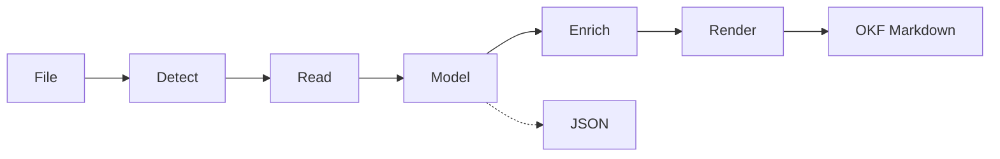
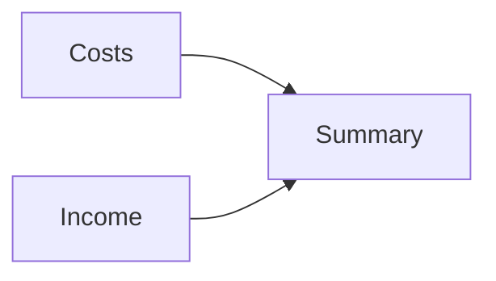
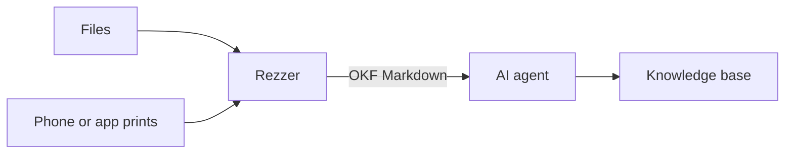

```
.pdf   ━━━━━━━━━━┓                           ◆───◆
                 ┗━━━━━━━━━━━┓              ╱ ╲ ╱ ╲
.xlsx  ━━━━━━━━━━━━━━━━━━━━━━╋━━━━━━━━━━━▶ ◆───◆───◆
                 ┏━━━━━━━━━━━┛              ╲ ╱ ╲ ╱
.dxf   ━━━━━━━━━━┛                           ◆───◆

░░░░░░╗ ▒▒▒▒▒▒▒╗▓▓▓▓▓▓▓╗███████╗███████╗██████╗
░░╔══░░╗▒▒╔════╝╚══▓▓▓╔╝╚══███╔╝██╔════╝██╔══██╗
░░░░░░╔╝▒▒▒▒▒╗    ▓▓▓╔╝   ███╔╝ █████╗  ██████╔╝
░░╔══░░╗▒▒╔══╝   ▓▓▓╔╝   ███╔╝  ██╔══╝  ██╔══██╗
░░║  ░░║▒▒▒▒▒▒▒╗▓▓▓▓▓▓▓╗███████╗███████╗██║  ██║
╚═╝  ╚═╝╚══════╝╚══════╝╚══════╝╚══════╝╚═╝  ╚═╝
```

# Rezzer

**Rez your files into knowledge.**

[](LICENSE)
[](#status)
[](https://github.com/jordiboehme/crystalline)

Greetings, program.

Rezzer is a knowledge extraction pipeline for AI agents. It reads your files and finds what they know: structure, metadata, facts, intent and the logic behind them. It hands that over as Markdown an agent can learn from and a person can read. Use it to understand a file or to add it to a knowledge base.

It's not a converter that dumps plain text. A spreadsheet is more than its values. A contract is more than its words. Rezzer keeps the formulas, the comments, the tracked changes and everything else that tells what a file means.

One Rust binary. It runs locally as an MCP server and a CLI on macOS and Linux (Windows maybe later). Your files never leave your machine. And yes, Rezzer is an MCP. The friendly kind. It reads your files and gives the knowledge back to you.

## Status

Early. The design is done, the formats and crates are picked after tests on about 600 public files and the code is being written right now. There is nothing to install yet. This README describes what Rezzer is built to do. Star the repo if you want to see it rez.

## Why

Ask an agent to read a `.docx`, an old `.xls` or a PDF form and watch what happens. It writes a Python script, installs a library, tries again and in the end gets a wall of text. The tables are broken, the formulas are gone and the comments never made it. Next session it does the same thing again. Groundhog Day, but with `pip install`.

Rezzer replaces that with one tool that knows the formats. The agent asks for a file and gets back the knowledge in it. Every time, the same way. No Python environment, no JVM, no "let me try another library".

## How it works



1. **Detect:** Rezzer looks at the content, not at the file extension. A CSV saved as `.txt` is still a CSV.
2. **Read:** one reader per format fills Rezzer's document model. Readers never write Markdown themselves.
3. **Model:** the content as blocks (sections, headings, tables, lists, pictures) plus layers for what lies beneath: formulas and dependencies, graphs, timelines, comments, annotations and embedded objects. Anchors tie every comment to its passage and every formula to its cell. The model also lists what couldn't be read, and why.
4. **Enrich:** steps that work the same for every format. Group copied formulas into patterns, tell inputs from results, build dependency graphs, write an overview.
5. **Render:** one renderer writes Markdown with frontmatter in the [Open Knowledge Format](https://okf.md) (OKF). Graphs become Mermaid. The model is also available as JSON.

A new format means one new reader. The rest of the pipeline stays the same.

## What you get

- **Structure:** headings, sections, lists, footnotes and cross references stay what they are. Tables become real Markdown tables, merged cells included.
- **Metadata:** title, authors, dates, revisions, keywords and custom properties go into the frontmatter. Values keep their type: a date stays a date, 9 % stays a percentage.
- **The logic behind the content:** every format has a layer that tells how it works. Rezzer reads it and shows it as tables and graphs:
  - Spreadsheets: formulas with the cells they read, named ranges, number formats, validation rules, data tables
  - PDF forms: which field is calculated from which, in what order, with what format
  - Documents: fields, cross references, mail merge sources, embedded data
  - Mail and web: reply threads, link graphs, structured data
- **An overview as data:** what the file is, its parts, inputs and results, dependencies, who changed what and when. Your agent turns that into sentences if it needs them. Rezzer doesn't guess what things mean: it states what it can prove from the file.
- **Comments and changes:** comments with their replies, tracked changes and PDF annotations stay attached to their passage, with author and date.
- **Engineering sheets:** long formula chains, dynamic arrays, `LET` and `LAMBDA`. Hundreds of copied formulas fold into a few patterns. There's no limit on the number of formulas.
- **Diagrams as Mermaid:** dependencies, charts, threads and trees become Mermaid blocks an agent can read and reason about.
- **Pictures:** images are extracted to files and marked in the text with their caption and position. A multimodal agent can look at them.
- **Honest gaps:** if Rezzer can't read a part, the output says what, where and why. No silent gaps.
- **Provenance:** every result says where it came from: original path, checksum, source date and which reader was used.
- **Source archive (optional):** point Rezzer at an archive folder and it keeps a read-only copy of every source. The same content is stored once and a changed file becomes a new version.
- **Evidence on demand:** the frontmatter cites the archived source as `rezzer://sha256/<hash>/<name>`. Ask Rezzer for that reference and it hands out the original. Every piece of knowledge links back to its evidence.
- **Big documents:** the MCP tool returns the Markdown in pages. It can also write an OKF bundle (Markdown plus images) to a folder. Output is always UTF-8.

## Example

A budget spreadsheet could come out like this (the format is not final yet):

````markdown
---
type: document
title: "Budget 2026"
description: "Spreadsheet with 3 sheets: Costs, Income, Summary."
resource: "finance/budget-2026.xlsx"
tags: [spreadsheet]
generated: { by: rezzer/0.1.0, at: 2026-11-02T10:15:00+01:00 }
source_date: 2026-10-28
---

# Budget 2026

## Overview

| Sheet   | Role   | Cells  | Formulas | Reads from    |
|---------|--------|--------|----------|---------------|
| Costs   | input  | A1:D40 | 0        |               |
| Income  | input  | A1:C25 | 0        |               |
| Summary | result | A1:D4  | 6        | Costs, Income |



- Last changed: 2026-10-28 by A. Meyer
- Open comments: 2 (Costs!C12, Summary!D4)

## Sheet: Summary

| Item    | 2025   | 2026   | Change |
|---------|--------|--------|--------|
| Costs   | 41,200 | 44,900 | 9.0 %  |
| Income  | 52,000 | 55,300 | 6.3 %  |
| Result  | 10,800 | 10,400 | -3.7 % |

### Formulas

| Cells | Formula              | Reads               | Role   |
|-------|----------------------|---------------------|--------|
| C2    | `=SUM(Costs!C2:C40)` | sheet Costs, C2:C40 | result |
| C4    | `=C3-C2`             | C3, C2              | result |
| D2:D4 | `=C2/B2-1` (copied)  | B, C of each row    | result |
````

## Formats

Planned for the first release. Each format has its own page with what Rezzer extracts and the known limitations.

| Format | What Rezzer gets | Built on |
|---|---|---|
| [PDF](docs/formats/pdf.md) | Text in reading order, tables, outline, annotations, forms with their calculations, signatures, revisions | [lopdf](https://crates.io/crates/lopdf), [pdf-inspector](https://crates.io/crates/pdf-inspector), [hayro](https://crates.io/crates/hayro) |
| [XLSX, XLSM, XLSB](docs/formats/xlsx.md) | Values, formulas with references, names, number formats, validation, comments, tables, charts, pivots | [calamine](https://crates.io/crates/calamine), [formualizer-parse](https://crates.io/crates/formualizer-parse), own reader |
| [XLS](docs/formats/xls.md) | Values and formulas from Excel 97-2003 | [calamine](https://crates.io/crates/calamine), [formualizer-parse](https://crates.io/crates/formualizer-parse) |
| [ODS](docs/formats/ods.md) | Values, formulas, names, comments | [calamine](https://crates.io/crates/calamine), own reader |
| [DOCX](docs/formats/docx.md) | Styles as structure, comments with replies, tracked changes, footnotes, fields, content controls | own reader |
| [DOC](docs/formats/doc.md) | Text and structure from Word 97-2003 | [office_oxide](https://crates.io/crates/office_oxide), [anydoc](https://crates.io/crates/anydoc) |
| [ODT](docs/formats/odt.md) | Structure, comments, tracked changes, footnotes | own reader |
| [RTF](docs/formats/rtf.md) | Text and structure | [anydoc](https://crates.io/crates/anydoc) |
| [PPTX](docs/formats/pptx.md) | Slides, speaker notes, comments, sections, chart data | own reader |
| [PPT](docs/formats/ppt.md) | Slides, notes and comments from PowerPoint 97-2003 | own reader, [cfb](https://crates.io/crates/cfb) |
| [ODP](docs/formats/odp.md) | Slides, notes, comments | own reader |
| [EPUB](docs/formats/epub.md) | Chapters, table of contents, footnotes, authors with roles, series | [rbook](https://crates.io/crates/rbook) |
| [HTML](docs/formats/html.md) | Main content, landmarks, tables, forms, structured data, link graph | [scraper](https://crates.io/crates/scraper), [dom_smoothie](https://crates.io/crates/dom_smoothie) |
| [PostScript, EPS](docs/formats/postscript.md) | Document facts from the header; text later | own reader |
| [CSV, TSV](docs/formats/csv.md) | Delimiter, header, column types, key columns, calculated columns | [csv](https://crates.io/crates/csv) |
| [Text](docs/formats/text.md) | Any encoding, language | [chardetng](https://crates.io/crates/chardetng), [encoding_rs](https://crates.io/crates/encoding_rs), [whatlang](https://crates.io/crates/whatlang) |
| [Markdown](docs/formats/markdown.md) | Structure and existing frontmatter | [pulldown-cmark](https://crates.io/crates/pulldown-cmark) |
| [CAD and engineering](docs/formats/cad.md) | FreeCAD, STEP, IGES, IFC, DXF, 3MF, STL, OBJ, glTF, G-code, KiCad, Gerber, OpenSCAD: units, layers, parts lists, assembly and feature trees, parameters and what drives them, PMI, nets, print settings | own readers, [stepq](https://crates.io/crates/stepq) |

"Own reader" means Rezzer reads that part itself. These readers will be published as crates of their own.

DWG and closed CAD formats like SolidWorks, Creo, NX, CATIA, Inventor or Fusion 360 come later. Until then Rezzer detects them and asks for a DXF or STEP AP242 export.

Planned after that:

| Group | Formats |
|---|---|
| [Mail](docs/formats/mail.md) | EML, MBOX, MSG |
| [Calculation sheets](docs/formats/mathcad.md) | Mathcad Prime, Mathcad 12-15, SMath |
| Diagrams | draw.io, Visio |

## What sets Rezzer apart

There are good tools that turn files into text: [Xberg](https://github.com/xberg-io/xberg) (formerly Kreuzberg), [MarkItDown](https://github.com/microsoft/markitdown), [Docling](https://github.com/docling-project/docling) and [Apache Tika](https://tika.apache.org/). They are built for search and RAG: get the text out, fast and from many formats. Xberg reads over 100 formats. If plain text is what you need, use them.

Rezzer is built for knowledge, and that changes what counts:

- **The logic, not just the content.** Others give you the values of a spreadsheet. Rezzer also gives you every formula, what it reads and how the sheets depend on each other. In our tests Xberg 1.3.10 kept at most 200 formulas per sheet, as metadata only.
- **Context stays attached.** Comments with replies, tracked changes and annotations stay tied to their passage, with author and date.
- **Facts, not guesses.** No model guesses the meaning. What Rezzer states, it can prove from the file. What it can't read, it says.
- **Evidence.** Every result points back to its source, and the optional archive keeps that source.
- **One model, one renderer.** Every format goes through the same document model. The output looks the same across formats, and the model is available as JSON too.
- **Reusable parts.** Every reader Rezzer writes is a crate of its own, usable without Rezzer.

## Built from reusable crates

Rezzer ships as one binary, but it's made of crates you can use on their own:

- Format crates read one format each and have their own API. They don't depend on Rezzer.
- Small adapters map each format crate into Rezzer's document model.
- Core crates hold the model, detection, enrichment, the renderer, the archive, jobs and the MCP server.
- The `rezzer` binary only wires them together. Formats can be switched off at build time.

## Sending files to a remote Rezzer

Locally, the agent just passes a file path. When Rezzer runs on another machine (server mode), the agent sends the file in three steps:

1. The agent tells Rezzer the file name (and what it knows about the file). Rezzer answers with a one-time upload address that expires after a few minutes, and the exact `curl` command to use.
2. The agent uploads the file. Rezzer archives it and starts the conversion as a job. The answer holds the job id, the source reference and what to do next.
3. The agent asks for the job. When it's done, it gets the Markdown inline, as a download or written to a folder.

Clients that support MCP tasks can follow the job natively. All others use the job id. MCP has no standard file upload yet. When it gets one, Rezzer will support it next to this.

## Optional extras

These come as opt-in features or as a prebuilt image. The core stays small.

- **OCR in tiers.** First the PDF text layer, when there is one. Then the operating system's own text recognition, or a small local model. For hard cases (handwriting, complex tables, diagrams) a larger local vision model that you download once. Everything runs on your machine.
- **A printer for your agent.** Rezzer can show up as a network printer (AirPrint and IPP). Print from your phone or any app and the document lands with your agent. Rezzer only accepts print jobs that keep their text, so a print job doesn't turn into an OCR job. First PDF, then PostScript as soon as Rezzer reads its text.

## How it fits

Rezzer is the reading part of a knowledge pipeline. The agent decides what to keep, Rezzer makes sure it can read everything first.



It works with any MCP client (Claude Code and others). Its output follows the frontmatter and Markdown conventions of [Crystalline](https://github.com/jordiboehme/crystalline), so the two fit together without any glue.

## Principles

- **Knowledge first.** Structure, metadata, logic and context are the product. Plain text alone is a bug.
- **Local first.** No cloud services, no telemetry. A server mode over HTTP comes later.
- **One binary.** No Python environment, no JVM, nothing to install during a session.
- **Honest output.** When Rezzer can't read something, it says so in the output: no guessing, no silent gaps.
- **Safe by default.** Files are data, never code. Scripts and macros are listed, never run. Readers have limits on size, depth and time.
- **Self-contained.** Every reader runs inside the one binary. No LibreOffice, no Ghostscript, no helper programs.
- **Clean licenses.** Rezzer links only libraries with permissive or MPL licenses.

## License

[MPL-2.0](https://www.mozilla.org/en-US/MPL/2.0/)

*End of line.*
