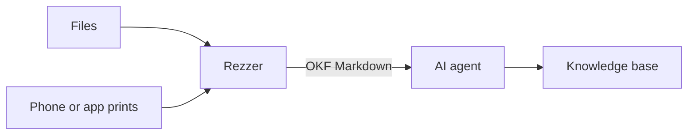

# Rezzer

**Rez your files into knowledge.**

Rezzer reads the files you give it and turns them into Markdown that an AI agent can learn from. It's not a converter that dumps plain text. Rezzer keeps what makes a document knowledge: its structure, metadata, relations and context.

One Rust binary. It runs locally as an MCP server and a CLI on macOS and Linux (Windows maybe later). Your files never leave your machine.

> **Status: design phase.** There is no code to install yet. This README describes what Rezzer is built to do.

## Why

Ask an agent to read a `.docx`, an old `.xls` or a DXF drawing and watch what happens. It writes a Python script, installs a library, tries again, and in the end gets a wall of text with the tables broken and the formulas gone. Next session it does the same thing again.

Rezzer replaces that with one tool that knows the formats. The agent asks for a file and gets back clean Markdown with frontmatter. Every time, the same way.

## What the agent gets

- **Structure:** headings, lists, footnotes and cross references stay what they are. Tables become real Markdown tables.
- **Metadata:** title, authors, dates, revisions, keywords and the source file go into the frontmatter, in the [Open Knowledge Format](https://okf.md) (OKF). Tools that read OKF can ingest the result as is.
- **Context:** comments, tracked changes and PDF annotations (highlights, notes, free text) stay attached to the passage they belong to, with author and date.
- **Spreadsheets:** each sheet becomes a table of values, plus a section that lists every formula with the cells it reads. Named ranges and links between sheets are kept. An agent can check a calculation, not only read its result.
- **Diagrams as Mermaid:** charts, SmartArt, draw.io and Visio drawings become Mermaid blocks an agent can read and reason about.
- **Pictures:** images are extracted to files and marked in the text with their caption and position. A multimodal agent can look at them and describe them.
- **Big documents:** the MCP tool returns the Markdown in pages. It can also write an OKF bundle (Markdown plus images) to a folder.
- **Provenance:** every result says where it came from: original path, checksum, source date and how it was read. If Rezzer couldn't read a part, the result says that too.
- **Source archive (optional):** point Rezzer at an archive folder and it keeps a read-only copy of every source. The same content is stored once and a changed file becomes a new version. Your knowledge keeps its source, even after the original file is moved or deleted.

A spreadsheet could come out like this (the format is not final yet):

````markdown
---
type: document
title: "Budget 2026"
description: "Spreadsheet with 3 sheets: Costs, Income, Summary."
resource: "finance/budget-2026.xlsx"
tags: [spreadsheet]
generated: { by: rezzer/0.1.0, at: 2026-11-02T10:15:00+01:00 }
source_date: 2026-10-28
---

# Budget 2026

## Sheet: Summary

| Item    | 2025   | 2026   | Change |
|---------|--------|--------|--------|
| Costs   | 41,200 | 44,900 | 9.0 %  |
| Income  | 52,000 | 55,300 | 6.3 %  |
| Result  | 10,800 | 10,400 | -3.7 % |

### Formulas

| Cell | Formula                    | Reads                    |
|------|----------------------------|--------------------------|
| C2   | `=SUM(Costs!C2:C40)`       | sheet Costs, C2:C40      |
| C4   | `=C3-C2`                   | C3, C2                   |
| D2   | `=C2/B2-1`                 | C2, B2                   |
````

## Formats

Planned for the first release:

| Group | Formats |
|---|---|
| PDF | Text in reading order, tables, outline, metadata, annotations, form fields |
| Word processing | DOCX, DOC, RTF, ODT |
| Spreadsheets | XLSX, XLSM, XLSB, XLS, ODS, CSV, TSV |
| Presentations | PPTX, PPT, ODP (with speaker notes) |
| Books and web | EPUB, HTML |
| Print | PostScript, EPS |
| Text | Plain text in any encoding, Markdown |

Planned after that:

| Group | Formats |
|---|---|
| CAD and engineering | DXF, 3MF (with slicer settings), FreeCAD, STEP, IGES, IFC, STL, OBJ, glTF, KiCad, Gerber, G-code, OpenSCAD |
| Diagrams | draw.io, Visio |
| Mail | EML, MBOX, MSG |

For engineering files the agent gets what matters to an engineer: units, layers, parts lists, assembly and feature trees, sketch constraints, parameters, materials and print settings. Assembly and feature trees come out as Mermaid. Closed formats like Creo or SolidWorks only give up their metadata, so Rezzer asks for a STEP export instead.

## Optional extras

These come as opt-in features or as a prebuilt image. The core stays small.

- **OCR in tiers.** First the PDF text layer, when there is one. Then the operating system's own text recognition, or a small local model. For hard cases (handwriting, complex tables, diagrams) a larger local vision model that you download once. Everything runs on your machine.
- **A printer for your agent.** Rezzer can show up as a network printer (AirPrint and IPP). Print from your phone or any app and the document lands with your agent. Rezzer only accepts print jobs that keep their text, like PDF or PostScript, so a print job doesn't turn into an OCR job.

## How it fits

Rezzer is the reading part of a knowledge pipeline. The agent decides what to keep, Rezzer makes sure it can read everything first.



It works with any MCP client (Claude Code and others). Its output follows the frontmatter conventions of [Crystalline](https://github.com/jordiboehme/crystalline), so the two fit together without any glue.

## Principles

- **Semantics first.** Structure, metadata and context are the product. Plain text alone is a bug.
- **Local first.** No cloud services, no telemetry. A server mode over HTTP comes later.
- **One binary.** No Python environment, no JVM, nothing to install during a session.
- **Honest output.** When Rezzer can't read something, it says so in the output: no guessing, no silent gaps.
- **Clean licenses.** Rezzer links only libraries with permissive or MPL licenses. GPL tools like Ghostscript or LibreOffice can be used if you install them, but they're never bundled.

## License

[MPL-2.0](https://www.mozilla.org/en-US/MPL/2.0/)

*End of line.*
