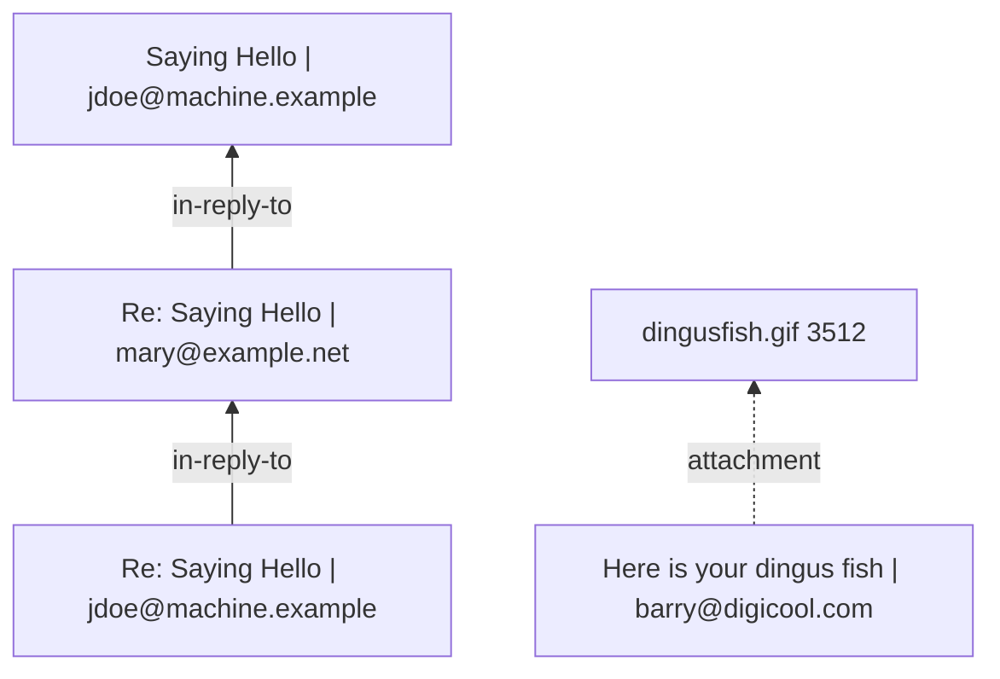

# Mail (EML and MBOX)

Rezzer reads single mails and whole mailboxes: senders, recipients, dates, the reply graph of a thread and the attachments, which it reads as documents of their own.

Status: planned for a later release (after the first one).

File types: `.eml`, `.mbox`. Rezzer detects the format by content, not by extension. It looks for mail headers and for the `From ` lines that separate the messages in an mbox file, also in files named `.txt`. The output says how the format was decided.

Built on (versions as tested on 2026-10-19):

- [mail-parser](https://crates.io/crates/mail-parser) 0.11.9 for single mails and mbox files
- The [HTML](html.md) reader for HTML parts
- Rezzer's own reader for the reply graph and the attachment handling

## What Rezzer extracts

### Structure

- Text and HTML parts of each message
- The tree of parts, also nested messages

### Metadata

- From, to, cc, date, subject
- Message-ID, In-Reply-To and References

### Hidden logic

- The reply graph of a thread, built from Message-ID, In-Reply-To and References
- Attachments with name, type and size, linked to their message

### Pictures and embedded files

- Attachments go back through Rezzer's own readers. A PDF attachment becomes its own result, linked to the mail

## How it shows up in the output

A `Thread` table (message id, date, from, subject, in reply to) and a Mermaid graph of replies and attachments. Attachments are linked child results.

Example (not final):

## Known limitations

- MSG files (Outlook) are planned too, but no reader has been chosen or tested yet
- mail-parser 0.11.9 builds an HTML body from the text part when a mail has no HTML part. Rezzer uses the list of parts, so it shows only what is really in the mail
- Scripts in HTML parts are listed, never run, the same as for [HTML](html.md)

## Tested with

4 EML files and 1 mbox file, public test files from the CPython test suite and the RFC 2046 and RFC 5322 examples. The mbox file was put together from public messages to test threads. See [MANIFEST-web-text.md](../spike-2026-10-19/MANIFEST-web-text.md).
