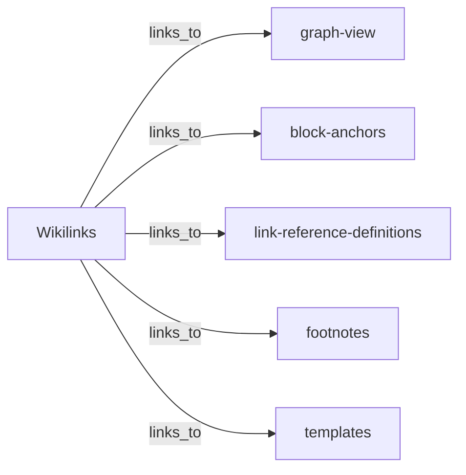

# Markdown

Rezzer reads Markdown files, keeps their own frontmatter and adds an outline and a graph of the links, including wikilinks.

Status: ✅ available in the development version. It is part of 0.1.0, the first release.

File types: `.md`, `.markdown`. Rezzer detects the format by content, not by extension.

Built on (versions as used in the development version):

- [pulldown-cmark](https://crates.io/crates/pulldown-cmark) 0.13.5 for the structure, with source positions, YAML and TOML frontmatter blocks and wikilinks
- [saphyr-parser](https://crates.io/crates/saphyr-parser) 0.3.2 for YAML frontmatter, read as events with Rezzer's own limits on depth and alias expansion
- [toml](https://crates.io/crates/toml) 1.1.8 for TOML frontmatter
- Rezzer's own reader for the frontmatter values and the link table

## What Rezzer reads

### Structure

- Heading outline with the position in the source file
- Lists, tables, code blocks

### Metadata

- The existing frontmatter, YAML (`---`) or TOML (`+++`), kept as it is
- The values in it, so Rezzer can use them

### Hidden logic

- Links by kind: inline, reference, autolink, wikilink; internal, external or anchor
- Whether each link target can be found
- Wikilinks as relations. They are kept in the link graph. In the body they are written as plain text, because Rezzer does not know the name of the linked note in the output. In the Markdown file this looks like `\[\[graph-view\]\]`. Wikilinks inside code stay as they are
- Frontmatter keys that point to other pages, like aliases or redirects

## How it shows up in the output

The original frontmatter stays as it is. Rezzer's own keys are added after it. The links of the file show up as a Mermaid graph in the Logic section.

## Example

Real output of `rezzer read` for `md-wikilinks-foam-docs.md` from the test corpus. The overview and the Logic section; the text between them is cut:

````markdown
## Overview

- Graphs: 1
- Links: 5

## Logic

### Graph: links

Kind link, 6 nodes, 5 edges.

````

## Known limitations

- A byte order mark inside YAML frontmatter is not allowed by YAML. Such frontmatter is not read: it is kept as a code block and a loss says why. A byte order mark at the start of the file is fine
- An empty block value (`summary: |` with nothing after it) is an empty text, as YAML says
- Liquid or other template tags in the text are kept as text, not run

## How it is tested

The corpus has 3 public Markdown files from GitHub Docs, the Rust blog and Foam. See [MANIFEST.md](../../tests/corpus/MANIFEST.md).

Extreme cases the test suite holds, at the default limits unless a limit is named (the figures are the bounds the tests check):

- 100,000 levels of block quotes: the read stops at the depth limit and says so
- 1.2 million emphasized words: the read stops at 2 million elements and says so
- Bytes that are not valid UTF-8: decoded, the text around them is kept

Speed: `md-toml-frontmatter-rust-blog-traits.md` (18 KB) reads in under 0.01 seconds with a peak memory of 5 MiB. Median of 3 runs with `--no-cache`, on an Apple M5 (Mac17,3, 32 GB, load average 3.2), release build (cargo profile release) of Rezzer 0.1.0 at commit 958df97, 2026-10-21.
