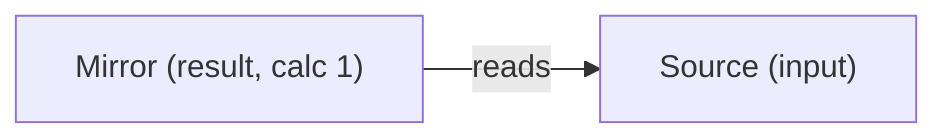

# PDF

Rezzer reads the text of a PDF in reading order, and also the layer behind it: outline, annotations with author and date, form fields with their calculations, scripts, signatures and saved revisions.

Status: ✅ available in the development version. It is part of 0.1.0, the first release.

File types: `.pdf`. Rezzer detects the format by content, not by extension.

Built on (versions as used in the development version):

- Rezzer's own crate pdfparts for the object layer. It has its own bounded parser for the file and uses [lopdf](https://crates.io/crates/lopdf) 0.46.0 only on a clean copy it writes itself. It reads metadata, page labels, outline, links, annotations, the tag tree, attachments, layers, threads, forms, scripts, signatures and revisions
- [hayro](https://crates.io/crates/hayro) 0.8.0 (with hayro-interpret and hayro-syntax) for the text with its position on the page, the exact glyph boxes under an annotation, page renders and as a fallback parser for broken files
- Rezzer's own crate barcodes for barcodes and QR codes. It uses [rxing](https://crates.io/crates/rxing) 0.9.3 (Apache-2.0) with bounds of its own
- Rezzer's own reader for the interpretation: reading order, headings, tables, the form logic, field formats in words and revision diffs

## What Rezzer reads

### Structure

- Text in reading order, also on two-column pages. Every page starts with a marker that names its label and its number in the file
- Headings, lists and tables from the tag tree when the PDF is tagged. Untagged PDFs get headings from the font size. Bold is read from the font, also from the names of TeX fonts (`cmbx` and similar), whose files do not say their weight. Sizes are counted by the characters with ink, so the padding of a form's data lines does not count. A size that sets at least a quarter of a page's text, or 400 characters of it, is body text on that page and never a heading. A line under 1.5 times the body size is a heading only when it starts in bold and is no label with a colon before its value. Bold lines that read as an address or as sentences stay a paragraph with their line breaks. A line that ends in an amount is never a heading. A line under 1.5 times the body size that holds only numbers, codes and dates is no heading either
- A star or a dash followed by padding (a mark in a form field) is no list bullet
- Footnotes: lines at the bottom of a page, in its smallest size and below all other text, that start with a note marker (`*`, `**`, `***`, `1)` or a raised number) are footnotes when the same marker stands after a word above. Each one becomes a Markdown footnote at the end of the page, labelled by page and marker (`[^p2-4]`), and each marker above (also a raised number in a table header cell) becomes a reference to it. The footnote text starts after its marker, because the label already names it. A raised number that the legend does not explain stays text, set apart from its word. A legend entry that no marker above points to stays a paragraph with its marker, because Markdown viewers hide a footnote that nothing refers to. A legend line is never counted for the body size of the page. A note at the top of the page says how the footnotes were found. A legend set in columns is cut into its footnotes, and an entry that wraps onto the next line stays whole
- Tables as cells. A tagged PDF gives its tables from the tag tree. On untagged pages Rezzer rebuilds a table from a grid of drawn lines, or from text in columns with white space between them. A form often draws one grid over several sections with columns of their own: Rezzer cuts such a grid at a line across its width where the columns above and below differ, or where a header row starts whose column lines hang from its top, and judges each section as a grid of its own. A title line (or two) right above such a cut, or right above the top of a grid that was cut, with no column lines across it, is the title of the section below and becomes the caption of its table. A section with text that is refused is named as a loss. Lines without rules under such a header are read as its rows: each value goes into the column it stands under, an empty field is an empty cell, and the header row is the table's header row. A line that fills less than half of the columns joins the row above only when each of its parts goes on text in its column there and none is a number; otherwise it is a row of its own. Where a column line crosses a run of text in the space between two words (a value line padded into its fields), the text is cut there; a line inside a word cuts nothing. A grid with more than 15 columns or with more than 60 % empty cells is read as a form or a chart. Rows of narrow boxes with one digit each (a boxed number field) are read as text, not as a table. In a table without lines at least 80 % of the rows must stay inside the columns and the cells must be short (under 40 characters on median, unless most are numbers). A table that fails a check stays text, with a note that names the check
- Running headers and footers are marked in the JSON model; the Markdown keeps them as text. Text that is invisible on the page is listed apart, with its render mode
- Outline (bookmarks) with level, title and target page
- Page labels (i, ii, iii, then 1, 2, 3 and so on)
- Links: web links in the text, internal targets and named destinations. Internal links stay text, because there is no target to link to in the output. Only `http`, `https` and `mailto` addresses become links. Other addresses, such as `file:` or `ftp:`, stay text with the address as code
- Article threads (reading paths across pages)
- Arabic text and vertical Japanese text in logical order
- A large PDF written with `-o` becomes `<file name>.md` plus parts in `<file name>.parts/`: one part per chapter of the outline with its pages, like `pages 53 to 61`, and long tables cut into row ranges

### Metadata

- Info dictionary: title, author, subject, keywords, creator, producer, dates with their time zone
- XMP metadata, also PDF/A
- Document language and PDF version
- File facts in the frontmatter: pages, tagged, encrypted, signed, signatures, revisions, form fields, whether it has scripts and layers
- Title and date from page 1 when the file has none: the largest heading in the top third of the page is the title (`title_from` says so). A date is the document date only when something marks it as that: a date label such as `Datum`, `Date`, `Fecha` or `Erstellt am` right before it on its line or right over it, or, in a two-column table of labels and values in the top half of the page, a label cell with the date in the cell beside it. A label marks one date only: the date must be the only date in its column of the page, dates in short or long forms counted (`16.01.`, `16.01.26`, `16. Januar 2026`), so a label over or before a list of dates, or a table row whose list goes on below it, marks none of them. `document_date_from` names the label. A date that nothing marks is never taken, also when it is the only date at the top of the page; a loss then says how many dates stand there. Dates are read only when they read one way: `01.02.2026` and `2026-02-01` as written, `02/13/2026` only because 13 can only be the day

### Hidden logic

- Annotations: highlight, underline, strikeout, squiggly, free text, sticky notes, ink, caret, stamps, shapes and others, with author and date. A markup annotation quotes the exact words under it. Replies stay with their annotation, and a review state marks it as resolved
- Form fields: name, label, type, value, flags (read-only, required, multiline and others) and options
- Form calculations: the calculation order and the fields each calculation reads (from `getField("...")` calls)
- Field formats in words: `AFNumber_Format(2, 0, 0, 0, "$", true)` becomes `number, 2 decimals, "$" before the number`. The same for date, time, percent and special formats (ZIP code, phone number, social security number)
- Each field gets a role: input (the user fills it), result (a calculation sets it) or constant (read-only, no calculation)
- Scripts: document JavaScript, open actions, page and field actions. Listed with their text, never run
- Digital signatures: signer, date, reason, location, kind (field, usage rights, certification), whether the signature covers the whole file and how many saves came after it. Signatures are not verified
- Revisions: each incremental save, with its date and what changed
- Layers (optional content) with name and default visibility
- XFA form data is found and said, not read

### Pictures and embedded files

- A page without a text layer, with glyphs that have no Unicode mapping or with large pictures needs vision. It is listed with the reason. With an output directory (`-o` on the command line), Rezzer renders it to a PNG file at 144 dpi, at most 16 million pixels
- Small pictures (1 square centimeter or more, together under 2 % of the page) do not make the whole page need vision. Each one is written at its place in the text with its box in points. With an output directory, Rezzer cuts it out of the page render with a margin of 8 pixels and writes it as `page-<N>-pic-<K>.png` (picture K on page N, in reading order). On a very large page, where the page render is coarser than 144 dpi, the crop is rendered again at 144 dpi
- A small picture is a logo when it does not look like a barcode or QR code and lies in the top or bottom 15 % of the page or in a corner, or when the same picture is on every page of a file with two pages or more. A logo is written as "logo or small picture" with its box. It does not need vision. All other small pictures are marked "Needs vision", unless a code is read from them
- Equal pictures share one file. The same picture on three pages is one PNG, and each place links to it with its own box. The list of pictures that need vision has it once, with its pages and boxes. When the page of its first place is not rendered, the file is cut from the next page that shows it. The overview counts the places and the distinct pictures
- In a tagged file, the alt text of a Figure goes to the picture drawn inside it. A Figure that marks no picture gives its alt text to the one new small picture of its page. Every other Figure alt text stays in the text as "Figure (not matched to a picture): " and the alt text. It stands at the picture the Figure marks, else at the first picture of the page, else at the end of the page
- A picture at the same place on at least 3 pages and half the pages is page furniture, like a running header. It is not listed
- Attachments are listed with name and size. They are never opened

### Barcodes and QR codes

- Rezzer reads QR Code, Data Matrix, Aztec, PDF417, Code 128, Code 39, EAN-13, UPC-A and ITF, also turned a quarter or a little. It reads them with and without an output directory
- It looks in small pictures (logos and page furniture too), in pages that need vision and in codes drawn as paths (many small squares or bars filled in any solid color, on one module grid, with the pattern of a code: the finder squares of a QR code, the solid L of a Data Matrix, the bullseye of an Aztec code, the start bars of a PDF417 or bars of a linear code of any length, at least two modules long, each bar and space a whole number of modules wide, with free space at both ends; light modules on a dark field count too). A page that needs vision is read once at its own scale with two quick attempts; the likely codes on it are looked at again finer. A small picture that gives no code is looked at again at its own resolution when that is finer than the page render. A code drawn as paths is rendered again with each module on 3 whole pixels. Its crop is written as `page-<N>-code-<K>.png`
- A code the decoder reads from a picture or a render is listed only on evidence that it is there, as screens of dots or lines, letters and noise can read as a code. A linear code stands in bars that fit what was read: on lines along it (upright, lying or along the slanted line it was read on), one after the other across its bars for at least 4 modules within the box the decoder gives, its bars and spaces are those of the value read (EAN-13 and UPC-A: the widths of its digits and guards; Code 39 and ITF: the narrow and wide bars of its characters; Code 128: a start, symbols of 11 modules and the stop), each within 0.4 of a module after the spread of the ink (up to half a module where a module is under 2.5 pixels), with paper for 3 modules at both ends. Past the edge of the render is paper, as the decoder takes it, and an end bar cut by that edge may be narrower. A matrix or stacked code holds something: a screen read on the grid of a code gives code words of nothing but padding. A code read within a drawing of paths that looks like a code needs no more: the drawing already has the pattern of a code; a read elsewhere on that page is checked. What fails is not listed, and it is said without its value: the page or the picture says "a part read as Code 39, middle of the page, that its bars do not confirm, not listed" (or "that holds nothing" for a matrix code), once for each place. Checking the reads counts against the time for reading codes. The barcodes crate on its own still returns such reads; Rezzer checks them where it lists the codes
- A small picture with a code is named after the code, for example "QR Code, box 480, 40 to 570, 130". It does not need vision and is not in the list of pictures that need vision. Below its first place, each code has a line with its kind and its content: `QR Code: https://example.org/t/dNuKThV1`. Later places of the same picture say "its codes are listed at its first place on page N"
- The content is data from the file. It is escaped for Markdown and never run or followed. Only `http`, `https` and `mailto` addresses without hidden characters become links, as for links in the text. Content of several lines is a code block. Control and format characters show as their symbols or as `<U+XXXX>`. Bytes that are not text are shown as their size and in base64
- A code read from a page that needs vision is listed below the page picture with its place in words, by thirds of the page as its text reads: `Code 128, middle left of the page: 0000000001`. The page still needs vision for the rest of it. A code drawn as paths, or a picture that looks like a code, has the box of its bars or of the picture when it is read again from that part of the page and is the only code there (a linear code only when its bars fill that part). Otherwise a linear code has the box of its bars as the decoder sees them in the render, and a matrix code the box of its finder patterns, a little widened. One code read along two lines is listed once; two equal codes one over the other are listed twice
- A picture that looks like a code but gives none keeps "Needs vision" and says "barcode or QR code found, not decoded". A drawing that looks like a code but gives none is listed with its crop as "a drawing that looks like a barcode or QR code" and "not decoded", and needs vision. On a page that needs vision as a whole, the page picture says so with the place in words: "a drawing that looks like a barcode or QR code, top right of the page, not decoded" ("part of a drawing" when codes read there do not reach its ends). Two equal codes side by side closer than their quiet zone cannot be told apart and are said that way. Ruled tables, checkerboards, zebra rows, heatmaps and bar charts are not taken for codes
- A page reads at most 8 drawings that look like a code. On a page that needs no vision, a loss says how many more there are; they are not read and not listed. On a page that needs vision, each of them that the page's own read gave no code is named in the page picture with its place and "not scanned", and a loss says why
- The render of a page that needs vision is also searched for printed codes that the decoder did not read, by the same rules as codes drawn as paths, and only on signs of a code, not of a screen: modules of at least 2 pixels of the page render (144 dpi); for a linear code, bars at least 3 modules long, of several widths, whole modules give or take the spread of the ink, with paper past their ends, and at least 20 bars (8 when the code runs off the edge of the page at one end, a bar cut by that edge in its band past its last bar, and shows its quiet zone at the other); for a matrix code, paper around it inside the page, or at least two whole QR finder patterns with their light separators in one row or column of modules (letters, halftone screens of dots or lines, hatching, rulers and the edges of a small picture drawn large are no code). Each one is named in the page picture: "a printed part that looks like a barcode or QR code, top left of the page, not decoded" ("only in part decoded" when a code read there fills only a part of it). This covers two equal codes side by side closer than their quiet zone, a code cut by the edge of the page and a code with short bars. QR codes touching or close side by side, and a QR code cut by the edge of the page, are said when fewer QR codes are read there than their finder patterns show (three for each code). A code cut to fewer than 8 bars is not named
- When a lighter line runs across the bars of a code read from a page that needs vision, the page picture says that it may be two codes, one not decoded: two equal codes one over the other with little paper between them blur into one in a scan. The code is listed once
- A code read on several lines across its bars, with boxes one after the other along them and its bars going on between them, is one code, listed once and boxed by all its bars.
- A dark line across the bars of a code (a rule or a stroke) cuts them in two, and each part reads as the code. The code is listed once, boxed by all its bars, and the page picture says "a dark line runs across the bars of the Code 128, top left of the page: it may be two codes, one not decoded", as two equal codes one over the other with a dark line between them look the same. With paper between them, two equal codes are two
- A code in the page furniture (the same picture at one place on many pages) is read once and named once, at its first place, with its pages. Furniture without a code stays unlisted
- Equal pictures are read once
- The overview counts the codes by kind, and the pictures that look like a code but gave none
- In the JSON, the codes are in `codes` of their asset: kind, text or base64, the size of the payload in bytes, and for a page picture the box on the page in points (`box`) and the place in words (`place`)
- Bounds: 10 seconds a picture, a quarter of the time limit for the file, 50 codes a picture, 500 a file, 64 KiB a code, 500 parts of pages rendered again a file, pictures up to 100 million pixels, read in tiles of up to 4 million pixels. What is not read because of a bound is named in the output. When the time for codes runs out, the pages not read for codes are named in an info note and the read stays complete: their pictures keep their need of vision
- A PDF with a user password is read with `--password-stdin` (command line) or the `password` option (MCP). The password never shows up in the output, in the logs or in the cache

## Example

Real output of `rezzer read` for two files of the test corpus, cut to the parts that show the form logic and an annotation. From `pdfjs-text-field-calc.pdf` (the empty page markers and the Embedded section are cut):

````markdown
## Logic

### Form

| Field | Type | Role | Value | Format | Rule | Reads | Flags |
| --- | --- | --- | --- | --- | --- | --- | --- |
| Source | text | input |  |  |  |  |  |
| Mirror | text | result (calc 1) |  |  | script, see below | Source | read-only |

### Graph: form

Kind dependency, 2 nodes, 1 edge.


### Calculations

Mirror, calc 1:
```javascript
event.value = this.getField("Source").value;
```
````

From `pdfjs-annotation-highlight.pdf` (the frontmatter and the overview are cut):

```markdown
:status[Page 1]{grey}

Highlight

Lorem ipsum dolor sit amet

> [!NOTE] Highlight by Tim van der Meij, 2015-12-30T15:22:48+01:00
> > Lorem ipsum dolor sit amet
>
> Highlight content
```

No file of the test corpus has a barcode or QR code. This part comes from a generated invoice: a QR code picture in the bottom right corner and a Code 128 drawn as bars. It is the real output of `rezzer read invoice.pdf -o out`, cut to the overview and the page:

```markdown
## Overview

- Pages: 1
- Images: 2
- Codes: 2 (Code 128 1, QR Code 1)

:status[Page 1]{grey}

## Invoice 2026-114

Two chairs, 240.00 EUR

Pay within 14 days.


Code 128: RZ-2026-114


QR Code: [https://example.org/t/dNuKThV1](https://example.org/t/dNuKThV1)
```

## Known limitations

- XFA forms are not read. The output says "XFA form data present, not read"
- Scripts are listed, never run. When a script builds field names at run time, the dependency is marked "unknown, see script"
- Tables marked only by a rule at the top and at the bottom (as in many scientific papers) stay paragraphs. A note says "Possible table on page N not rebuilt" with the reason
- A header row of several lines is found by bold text or font size, not by its fill color alone
- Header icons drawn with curves are not marked
- Some line breaks are joined: lines of verse with five words or more, two-line blocks that are aligned right, label pairs and lines like "Suite 200 of the / Old Mill Building". No text is lost
- Tables on pages with form fields and tables inside pictures are not rebuilt
- Scans without a text layer need OCR. OCR is a separate, optional part of Rezzer. Until then the page is rendered and listed as needing vision
- A page render cannot stop in the middle of a page. A page whose pictures would take too much memory is not rendered, and the output says so
- A small picture in a corner or in the top or bottom band is taken as a logo, even when it shows content. It is listed with its box, but not marked as needing vision
- A QR code with a logo over more than about 15 % of its area cannot be read. The error correction does not reach that far
- Aztec codes in scans, and codes turned by an angle other than a quarter, are read less well than codes that are drawn straight. Micro QR Code is looked for but not tested
- EAN-8, UPC-E and MaxiCode are not read. The first two give too many false hits, the last one can take minutes on a small picture
- Codes are read as text or bytes. What a ticket, a payment or a boarding pass code means (EPC QR, Swiss QR bill, UIC 918, IATA BCBP) is read in a later version
- A code drawn as one outline path, not as squares or bars, is only found when its page is rendered for vision
- Codes in scans are read from the page render at 144 dpi only. A code whose modules are finer than about 2 pixels at 144 dpi is not read. An invoice QR code of about 20 mm still has about 2.3 pixels a module there
- When the decoder runs past its time on one file, Rezzer starts a new worker, so later files are not held up. When two such calls still run, later files wait for them. Those files name the pages without codes in an info note
- Without an output directory, a page that draws more than 1,000 pictures is not rendered to look for codes. The output says so
- Equal pictures are found by all of their data. Two copies of one picture with different compression get a file each, and so do two copies in their own objects after the first 65,536 picture objects of a file. A stencil mask drawn in two colors is one picture
- At a low memory limit (256 MiB) a large file like the NIST report with 492 pages is not read, and the output says which limit was hit
- The text parser holds about 2 KB for every page of the file. When that does not fit in the memory left after the objects of the file (for example 100,000 pages with their own content streams at a 512 MiB limit), the text is not read and the output says so
- A word split by a hyphen at a line end keeps its hyphen ("adip-iscing"). Rezzer cannot tell a break hyphen from a real one, so it keeps both
- Paragraphs marked only by an indent of their first line, with no space between them, stay one paragraph with line breaks (as in LaTeX two-column papers)
- On a form page, a block of two text columns can be read in bands across both columns, with each printed line as its own paragraph (the directions on the front of the SF 1199A form)
- When the object layer cannot be read, Rezzer falls back to hayro for the text and says so in the output. Annotations, forms, scripts and signatures are then not read
- Revision diffs count the first save of a linearized file as one save
- No public test file was found for annotation replies, `AFSimple_Calculate`, `AFPercent_Format`, a field with the required flag or table header scope. These parts follow the format specification but are not proven on a real file

## How it is tested

The corpus has 41 public PDF files. Most come from the test suites of pdf.js, qpdf, PDFBox, py-pdf, pdfplumber and Mustang. The others come from the IRS, the National Archives, NIST and arXiv. 39 of them are in the repository. The two large ones (NIST and arXiv) are fetched by a script.

Extreme cases that were held, at the default limits unless a limit is named. Figures from the release build, measured as below:

- A content stream of 1 MB that unpacks to 1 GiB: the page is not read, the other page is, peak memory 9 MiB
- An object stream of 1 MB that unpacks to 1 GiB: the file is refused, peak memory 73 MiB
- A picture of 40,000 by 40,000 pixels on a page that needs vision: not rendered, peak memory 7 MiB
- 100,000 pages that share one content stream of 40 lines, with a time limit of 2 seconds: the read stops after 1.8 seconds, keeps the text of the 4,746 pages it read and names the first page it did not read, peak memory 433 MiB
- A script of 64 MiB: listed without its text, peak memory 124 MiB

Speed: the NIST report SP 800-53 revision 5 (6.1 MB, 492 pages) reads in 0.81 seconds with a peak memory of 206 MiB. Median of 3 runs with `--no-cache`, on an Apple M5 (Mac17,3, 32 GB, load average 3.2), release build (cargo profile release) of Rezzer 0.1.0 at commit 958df97, 2026-10-21.
