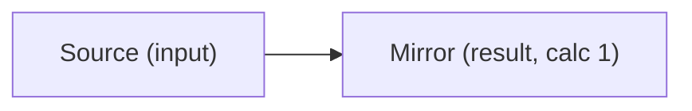

# PDF

Rezzer reads the text of a PDF in reading order, and also the layer behind it: outline, annotations with author and date, form fields with their calculations, scripts, signatures and saved revisions.

Status: planned for the first release. Nothing is implemented yet.

File types: `.pdf`. Rezzer detects the format by content, not by extension.

Built on (versions as tested on 2026-10-19):

- [lopdf](https://crates.io/crates/lopdf) 0.45.0 for the object layer: metadata, outline, annotations, forms, scripts, layers, signatures, revisions
- [pdf-inspector](https://crates.io/crates/pdf-inspector) 1.25.2 for text in reading order, tables and the "does this page need OCR" check
- [hayro](https://crates.io/crates/hayro) 0.8.0 to render pages for OCR and vision, for exact glyph boxes and as a fallback for broken files
- Rezzer's own reader for the interpretation: page labels, name trees, the form logic, revision diffs and XMP

## What Rezzer extracts

### Structure

- Text in reading order, also on two-column pages
- Headings, lists, tables and footnotes from the tag tree when the PDF is tagged. Untagged PDFs get headings from font size
- Tables as cells. A tagged PDF gives its tables from the tag tree, with header rows and cells that span. A table that goes on over several pages stays one table, and the column titles it repeats on each page are left out
- Outline (bookmarks) with level, title and target page
- Page labels (i, ii, iii, then 1, 2, 3 and so on)
- Links: internal targets, named destinations and web links
- Article threads (reading paths across pages)
- Alt text, ActualText and table header attributes from the tag tree

### Metadata

- Info dictionary: title, author, subject, keywords, creator, producer, dates with their time zone
- XMP metadata
- Document language

### Hidden logic

- Annotations: highlight, underline, strikeout, free text, sticky notes, ink and others, with author, dates, color and the text they cover. Replies and popups stay with their annotation
- Form fields: name, type, value and flags (read-only, required)
- Form calculations: the calculation order and the field each calculation reads (from `getField("...")` calls)
- Field formats in words: `AFNumber_Format(2, 0, 0, 0, "$", true)` becomes "number, 2 decimals, $ before the number". The same for date, percent and special formats (ZIP, phone, SSN)
- Each field gets a role: input (the user fills it), result (a calculation sets it) or constant (read-only, no calculation)
- Scripts: document JavaScript, open actions, page and field actions. Listed as text, never run
- Digital signatures: signer, date, reason, type and whether the signature covers the whole file
- Revisions: each incremental save, with its date and what changed
- Layers (optional content) with name and default visibility

### Pictures and embedded files

- Pages that need OCR or hold pictures are rendered to PNG and listed as "needs vision" with page number and reason
- Embedded files are listed and can be read by Rezzer as well

## How it shows up in the output

The text comes first, with annotations next to their passage. Then a `Form logic` section with one table per form, a Mermaid graph when a field reads another field, a `Scripts` section and a `Revisions` section. Signatures, revision count, layers and the form field count go into the frontmatter.

Example (not final):

```markdown
## Form logic

| Field | Type | Role | Format | Rule | Reads | Flags |
|---|---|---|---|---|---|---|
| Source | text | input | | | | |
| Mirror | text | result (calc 1) | | `event.value = this.getField("Source").value` | Source | read-only |
| Allottment Amount | text | input | number, 2 decimals, "$" before | | | |
```



## Known limitations

- XFA forms are not read. The output says "XFA form data present, not read"
- Scripts are listed, never run. When a script builds field names at run time, the dependency is marked "unknown, see script"
- Tables on untagged PDFs are found from drawn lines and from the white space between columns. Rezzer only rebuilds such a table when the evidence is strong. When it is not sure, the text stays as paragraphs and a note says "Possible table on page N not rebuilt" with the reason. Complex tables, for example with two header rows or values between rows, often get this note
- Tables on pages with form fields and tables inside pictures are not rebuilt
- Scans without a text layer need OCR. OCR is a separate, optional part of Rezzer
- lopdf 0.45.0 decodes some outline titles wrongly ("Isís" as "Is?s"). Rezzer decodes titles itself
- pdf-inspector 1.25.2 does not decode UTF-16 form values and reports a file with a broken cross-reference table as "scanned". Rezzer reads form values through lopdf and checks pages with fonts before it trusts a "scanned" result
- When lopdf can't load a file, Rezzer falls back to hayro for that file and says so in the output
- Revision diffs skip the first save of a linearized file
- No public test file was found for annotation replies, `AFSimple_Calculate`, `AFPercent_Format`, a field with the required flag or table header scope. These parts follow the crate API but are not proven on a real file
- Form flags inherited from parent fields are not handled yet

## Tested with

33 public test files from the pdf.js, qpdf, PDFBox and py-pdf test suites, arXiv, US government sites and the US National Archives. See [MANIFEST-pdf.md](../spike-2026-10-19/MANIFEST-pdf.md).
