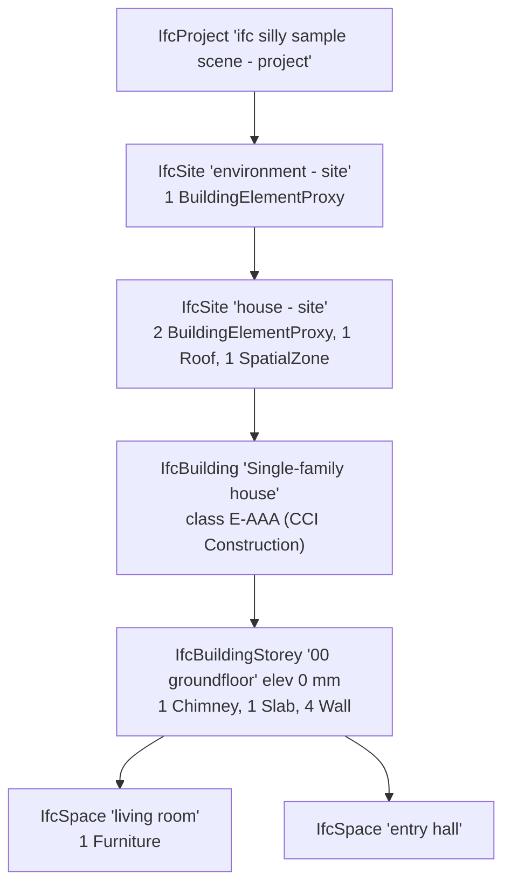

# CAD spike part D: BIM and EDA (IFC, KiCad, Gerber/Excellon, OpenSCAD)

Date: 2026-10-19. Group `bim-eda`. Probes in `spike/cad-test/bim-eda/` (one `p-<crate>/` per
candidate, `run.sh` runs all pairs through `run-ifc.sh`, `run-kicad.sh`, `run-gerber.sh`,
`run-openscad.sh`), corpus in `spike/corpus/cad/bim-eda/` with `MANIFEST-part.md` (about 43 MB).
Build time and binary size are not measured here (the coordinator does that).

## Summary

All four formats are text formats with a simple syntax. In every case the knowledge Rezzer needs
(relations, properties, BOM, nets, attributes, parameters) sits one mapping layer above the
syntax, and no crate offers that layer in a usable, robust form. The recommendation is the same
for all four: Rezzer's own reader, ready for the first release.

| Format | Recommendation | Own reader size | Best crate (role) | First release |
|---|---|---|---|---|
| IFC 2X3/4/4X3, ifcZIP | Own Part 21 reader (shared with STEP) plus IFC mapping | 354 lines Part 21 + 308 lines IFC mapping | ifc-lite-core 20.4.0 (MPL-2.0) only for per-schema attribute names, subtype tables and units, behind a trait; oxideav-ifc as cross-check | Yes |
| KiCad 6-10, legacy 5 | Own iterative s-expression reader with limits, KiCad mapping, serde_json for .kicad_pro, line reader for KiCad 5 | 193 lines s-expr, 1,423 lines in total; netlist pass 359 lines | none (cadlab 0.0.2 to watch: board only, two weeks old) | Yes |
| Gerber X2/X3, Excellon, job file | Own tolerant attribute reader plus own Excellon reader | 359 lines | gerber_parser 0.5.0 (typed attributes) as optional reference; no permissive Excellon crate exists | Yes |
| OpenSCAD | Own lexer and outline parser | 202 lines + 34 lines Customizer | tree-sitter-openscad-ng 0.7.1 (MIT, C build) in reserve behind the same trait | Yes |

Key findings:

- IFC: oxideav-ifc has the nicest semantic API but only an IFC4 typed slice (MEP classes and
  IFC4X3 nodes get no names) and rejects a whole file on one bad record. ifc-lite-core is a fast
  lazy index without pset or relation helpers. ifc_rs rejects 6 of 12 real files and panics on a
  dangling reference. step-p21 overflows the stack on deep nesting. ifc-lite-core-cat looks like an
  unattributed relicensed copy of the MPL crate: avoid. Every in-memory reader needs 8 to 10 times
  the file size in RAM, so very large models need a lazy index or two passes.
- KiCad: no crate reads a schematic into a model. lexpr fails on unquoted uuids, via-kicad-sexp
  and kicad-auto-importer-core overflow the stack at 100k nesting, kicad_parse_gen only reads
  KiCad 4 era files, serde_kicad_sexpr cannot skip unknown fields. The own netlist pass matched
  135 of 135 board nets on two projects and 97 of 97 by membership (81 by name) on a bus-heavy
  KiCad 9 project. When a board exists, its explicit pad nets are the netlist.
- Gerber: gerberx2 must not see untrusted input (a 297-byte step-repeat drove it to 18.6 GB; stack
  overflow on a nested macro; 9 of 22 real Gerber files fail completely, all of them from EAGLE, Altium or Allegro). gerber_parser is
  robust but drops EAGLE attributes and does not attach %TA/%TO to objects. The own reader gets a
  netlist from copper layers alone (62 nets on KiCad top copper) and hole counts that match the
  file's own comments.
- OpenSCAD: the own reader gives the same outline as tree-sitter-openscad-ng on 19 of 20 real
  files, at 9 times the speed. The grammar mis-reads identifiers starting with a digit and drops a
  module cut off by truncation. openscad-customizer-rs prints the input to stdout from the library
  (would break a stdio MCP server).
- Limits Rezzer needs in all four readers: file size cap, depth cap, iterative parsing, visited
  sets for reference resolution, decompression ratio cap for ifcZIP.

GPL crates named in the brief (kicad-parser, kicad-api-rs, openscad-rs) and openbim-ifc-cli (AGPL)
were not added or read. lib_gerber_edit and BREP_ecad_core were not added (non-standard licenses).
Every linked crate tree was checked with `cargo metadata`; details per format below.


## IFC (STEP Part 21: IFC2X3, IFC4, IFC4X3; ifcZIP)

### Candidates

| Crate | Version (date) | License | MSRV | Activity | Transitive licenses (cargo metadata, normal deps) |
|---|---|---|---|---|---|
| ifc-lite-core | 20.4.0 (2026-10-11) | MPL-2.0 | none | LTplus-AG/ifc-lite: 427 stars, 100+ commits in 90 days, 94 releases since 2026-01-12, 66 open issues | 25 crates, all MIT/Apache, one MPL-2.0 (itself): OK |
| ifc-lite-processing | 20.4.0 (2026-10-11) | MPL-2.0 | none | same repo | 93 crates (nalgebra, png, rayon, geometry), MIT/Apache/Zlib/ISC/0BSD/MPL-2.0: OK |
| oxideav-ifc | 0.0.3 (2026-10-04) | MIT | 1.80 | OxideAV/oxideav-ifc: 2 stars, 47 commits in 90 days, 3 releases since 2026-06-12, one author, "clean-room from ISO 10303-21 and the buildingSMART schema docs" | 0 dependencies with `default-features = false` (the default `registry` feature pulls oxideav-core/oxideav-mesh3d, MIT): OK |
| step-p21 | 0.1.1 (2026-08-18) | Apache-2.0 | 1.85 | virtualritz/step-p21: 1 star, 10 commits in 90 days, ruststep-style nom AST plus AP201/AP203 tables, no IFC schema | 41 crates, MIT/Apache/BSD-2: OK |
| ifc_rs | 0.1.0-alpha.9 (2024-12-04) | MIT | none | MetabuildDev/ifc_rs: 25 stars, no commits since 2025-07 | 63 crates; r-efi is "MIT OR Apache-2.0 OR LGPL-2.1-or-later" (pick MIT): OK |
| own reader (`p-own-p21`) | - | - | - | p21.rs 354 code lines (schema-free Part 21 reader, shareable with STEP) + main.rs 308 code lines (IFC mapping) | zip 9.0.5 for ifcZIP: 18 crates MIT/Apache/Zlib: OK |

Not probed:
- `ifc` 0.1.0 (2024, MPL-2.0): no dependencies and no code beyond a description ("IFC file format specification"), a name placeholder.
- `ifc-lite-core-cat` 0.1.1 (MIT OR Apache-2.0, 2,040 lines): its README is titled `ifc-lite-core` and uses the same wording as ifc-lite-core (MPL-2.0), but the files carry no MPL header and no attribution. If it is derived from the MPL files, the MIT/Apache label is wrong. License provenance unclear: avoid.
- `openbim-ifc-cli` (AGPL-3.0), not added.
- `ruststep` 0.4.0 (Apache-2.0): same AST approach as step-p21, compiles EXPRESS schemas into Rust types; nothing IFC-specific ships with it. step-p21 stands in for this family.

### Items that apply

All items from the brief apply: header, units, spatial structure, element counts, names and GlobalIds, property sets, quantity sets, materials and layer sets, classifications, type objects, relations (aggregation, containment, voids/fills), groups/systems/zones, external document references, owner history. Plus: per-schema attribute names, integrity (dangling references, cycles), ifcZIP/ifcXML, geometry summary facts (triangle count, bbox) as a minor item.

### Scoring matrix

Legend: E exposed in the public API, P partial, N not exposed, - not supported. `(src)` scored from source only.
ifc_rs is not in the matrix: it rejects 6 of 12 real files (see bugs), so its typed model is never reached.

| Item | ifc-lite-core | ifc-lite-processing | oxideav-ifc | step-p21 | own reader |
|---|---|---|---|---|---|
| Header: author, organization, application, schema, timestamp | P (string helpers `extract_record_args`, `decode_string_list`; no header struct) | P (schema version only) | E (`Header.file_name.{author,organization,time_stamp,originating_system,...}`) | P (generic records) | E |
| Units (IfcUnitAssignment) | E (`ProjectUnits`: symbol + SI scale per unit type, measure type to unit) | P (length scale only) | P (SI scale per kind: length/area/volume/angle/mass/time, no names or symbols) | N | E (SI prefix + name, conversion-based units with factor, derived units) |
| Spatial structure tree | N | E (`QuickMetadataSpatialNode`, elevation, element lists, pruned edges with reason) | E (`Model::aggregated_children` / `contained_elements`); IFC4X3 bridge nodes come back without names | N | E |
| Element counts by type | E (`count_by_type`) | P (mesh types only) | P (`products()` covers only its typed slice: HVAC file gives `{}`; `instances_of` is generic) | P (count by hand) | E (rooted-entity heuristic; a subtype table would make it exact) |
| Names and GlobalIds | E (positional + `attribute_names_for_schema`) | P (on meshes; spatial nodes have `global_id: None`) | P (`TypedEntity::name()/global_id()` only for typed slice; positional otherwise) | P (positional) | E |
| Property sets with values | P (generic decode; typed values flattened to `List[String("IFCLABEL"), ...]`) | N (private module; properties only attached to IfcSpace/IfcZone meshes, 0 of 14 meshes on the corpus) | E (`PropertySet`, `PropertyValue` single/enumerated/bounded/list/table/reference/complex; non-single kinds src) | N | E (single, enumerated, list, bounded, reference, complex count) |
| Quantity sets with values | P (generic decode) | N | E (`ElementQuantity`, `Quantity::si_value`) | N | E (value + quantity kind; SI scaling not done) |
| Materials, layer sets, constituents | N | P (style/material name per mesh) | E (`MaterialAssignment` incl. `LayerSetUsage`, constituents, profiles, list) | N | E |
| Classifications (system + reference) | N | N | E (`classification_reference`, `ClassificationParent`) | N | E (code, name, system, edition, URI) |
| Type objects and inherited psets | N | N | E (`type_of`, `type_objects`, pset inheritance with shadowing (src)) | N | E (type psets and type materials shown) |
| Aggregation / containment | N | E (as tree) | E | N | E |
| Voids / fills (door in wall) | N | N (geometry only) | E (`openings_of`, `hosted_fillers`) | N | E |
| Groups, systems, zones | N | N | E (`groups`, `group_members`, `serviced_buildings`) | N | E |
| External document references | N | N | E (`DocumentReference` + `DocumentInformation`) | N | P (reference followed, `IfcDocumentInformation` not yet: ~5 lines) |
| Owner history (who, when) | P (attribute names only) | N | N (positional only) | N | E (person, organization, application, change action, created/modified; epoch seconds still to format) |
| Integrity: dangling refs, cycles | P (scan diagnostics to stderr via report sink) | P (cycle edges in `pruned_aggregate_edges`) | E (`dangling_references`, cycle-safe `reachable_from`, WHERE-rule checks, `StepLimits`) | N | E (dangling list, revisit count, parse errors per record, truncated flag) |
| Schema awareness IFC2X3 / IFC4 / IFC4X3 | E (5 generated registries: attribute names, supertypes) | E (via core) | P (IFC4 attribute orders only; the IFC2X3 corpus works because the used attributes share positions) | N | P (hard-coded positions, two IFC2X3/IFC4 branches) |
| ifcZIP / ifcXML | - (zip input: 0 entities, no error) | - | - | - | E (ifcZIP via zip crate, 512 MiB cap) / - |
| Geometry summary facts | P (`scan_model_bounds` (src)) | E (meshes, triangle counts) | P (mesh3d behind default feature, not probed) | N | N |

### Evidence

```
# own reader, bsi-4-Building-Architecture.ifc (IFC4)
Ifcslab#53 "floor" GlobalId=3zR0BOEcLADRKln4HYporH type=Ifcslabtype#48 "house - groundfloor"
    (from type) Pset_SlabCommon (2 props)
    (from type)   FireRating = REI60 [IFCLABEL]
    Pset_SlabCommon (4 props)
      FireRating = REI30 [IFCLABEL]
    Qto_SlabBaseQuantities method="BaseQuantities" (3 q)
      Depth = 250 [Ifcquantitylength]
    material: Material "concrete_reinforced_in-situ"
Ifcbuilding#35 "Single-family house" -> E-AAA "Single-family house" in CCI Construction 1.0 (Molio) uri="https://identifier.buildingsmart.org/uri/molio/cciconstruction/1.0/class/E-AAA"
Ifczone#81 "house - living space" predefined=$ members={"Ifcspace": 2}

# own reader, bsi-4-wall-with-opening-and-window.ifc
PLANEANGLEUNIT: DEGREE = 0.01745 [IFCPLANEANGLEMEASURE] x PLANEANGLEUNIT: RADIAN
#2 user=Peter Bonsma / RDF app=Test Application 0.10 (RDF) state=$ change=NOTDEFINED created=1323724715
material: LayerSetUsage(dir AXIS2, sense POSITIVE, offset -150) -> LayerSet "" [Name of the material used for the wall t=300]
Ifcwall#45 "Wall for Test Example" has opening #80 filled by Ifcwindow#102 "Window for Test Example"

# own reader, ifc-docs-classif.ifc (synthetic): escapes, layer set, bounded value, document
#5 user=Jürgen Doe / Exämple GmbH app=ifc-gen 1.0 (Exämple GmbH) change=ADDED created=1750000000 modified=1760000000
OperatingTemperature = [-20 [IFCTHERMODYNAMICTEMPERATUREMEASURE] .. 60 [IFCTHERMODYNAMICTEMPERATUREMEASURE]]
material: LayerSetUsage(...) -> LayerSet "Cavity wall 215" [Brick t=115] [Mineral wool t=100]
Ifcwall#20 "Außenwand" -> Ifcdocumentreference location=Some("https://example.org/doc1.pdf#page=2") id=Some("DOC-001/2")

# oxideav-ifc, bsi-2x3-Building-Architecture.ifc
IFCSITE #18 Some("environment - site") contains {"IFCBUILDINGELEMENTPROXY": 4, "IFCROOF": 1}
   qto Some("Qto_SlabBaseQuantities") method=Some("BaseQuantities"): [(Some("Depth"), Some(250.0), Some(0.25)), ...]
group IFCZONE #179 Some("house - living space") members=2 serviced=[]
owner history (positional only): ["Reference(2)", "Reference(5)", "Unset", "Enum(\"ADDED\")", "Integer(1782208392)", ...]

# oxideav-ifc, bsi-4-Building-Hvac.ifc: typed slice misses MEP classes
IFCBUILDINGSTOREY #45 Some("00 groundfloor") contains {"IFCAIRTERMINAL": 2, "IFCCHIMNEY": 1, "IFCDUCTSEGMENT": 1}
products by type: {}
group IFCDISTRIBUTIONSYSTEM #59 Some("house - chimney flue") members=3

# oxideav-ifc, bsi-4x3-Infra-Bridge.ifc: tree complete, names missing outside the typed slice
IFCSITE #31 Some("road river bridge - site") contains {}
  IFCBRIDGE #37 None contains {}
    IFCBRIDGEPART #44 None contains {"IFCSLAB": 1}

# ifc-lite-core, bsi-4-wall-with-opening-and-window.ifc
unit PLANEANGLEUNIT -> Some(ResolvedUnit { symbol: "°", si_scale: 0.01745 })
attr names IfcClassificationReference @ IFC4: Some(["Location", "Identification", "Name", "ReferencedSource", "Description", "Sort"])
IfcPropertySingleValue Some("ThermalTransmittance") = Some("List([String(\"IFCTHERMALTRANSMITTANCEMEASURE\"), Float(0.24)])")

# ifc-lite-processing, bsi-4-Building-Architecture.ifc
IFCBUILDINGSTOREY #45 "00 groundfloor" gid=None elev=Some(0.0) elements=6
meshes with properties: 0 of 14
mesh #53 IfcSlab Some("floor") gid=Some("3zR0BOEcLADRKln4HYporH") material=Some("concrete_reinforced_in-situ") tris=76

# ifc_rs, bsi-4-Building-Architecture.ifc
ERROR: ID: #119: Variable relating_structure of type RelContainedInSpatialStructure isn't any of these types:
  Site, Building, Storey, OpeningElement, Slab, Roof, Wall, Window, Door instead is: ifc_rs::objects::space::Space (#85)
```

Parse speed on the biggest real file (BURKWIL_DX_B.ifc, 29 MB, 539,148 instances, IFC2X3 from ArchiCAD; timing only, not in the corpus):

| Probe | Parse | Model / mapping | Total wall | Peak RSS |
|---|---|---|---|---|
| own reader | 110 ms | 143 ms (indexes + output) | 0.32 s | 310 MB |
| ifc-lite-core | 32 ms index | 152 ms decode of all instances | 0.34 s | 250 MB |
| oxideav-ifc | 125 ms | 33 ms `Model::from_step` | 0.41 s | 340 MB |
| ifc-lite-processing | - | full geometry pipeline, 9,823 meshes | 1.64 s | 177 MB |
| step-p21 | 951 ms | - | 0.99 s | 255 MB |
| ifc_rs | - | rejects the file | 1.17 s | 101 MB |

On the real 29 MB file the own reader found 265 spatial nodes, 4,134 rooted objects (1,275 IfcBuildingElementPart, 540 IfcWall, 459 IfcVirtualElement, 353 IfcColumn ...), no dangling references.

### Bugs and surprises

- ifc-lite-core: a typed parameter `IFCLABEL('x')` decodes to `List([String("IFCLABEL"), String("x")])`, which looks the same as a real list of two strings. Rezzer has to know from the schema which attributes are selects.
- ifc-lite-core: on the 100,000-level list it returns an error whose message embeds the remaining input as a byte array (one 200 KB error string). Truncated records are dropped with a warning printed to stderr by the library (`[ifc-lite] scan: dropped a record ...`) unless a report sink is set. A zip file gives 0 entities and no error.
- ifc-lite-processing: properties are only attached to IfcSpace/IfcZone meshes, the pset module is private; spatial bootstrap nodes have `global_id: None`. It is a viewer pipeline, not a metadata API.
- oxideav-ifc: all-or-nothing parse. The truncated file (60 % of a valid file) gives `syntax error at 372:23295` and nothing else; the own reader and ifc-lite keep the 364 complete records. `products()` and `TypedEntity` only cover a hand-written IFC4 slice: MEP elements, proxies, roofs and IFC4X3 infrastructure have no typed view and no name. Owner history has no accessor. Default `StepLimits.max_input_len` is 256 MiB, so a larger clear-text model fails unless the limit is raised.
- step-p21: stack overflow (SIGABRT, exit 134) on the 100,000-level nesting; 7 to 9 times slower than the others (951 ms on 29 MB).
- ifc_rs: rejects valid files where an IfcSpace contains furniture or an IfcRoof aggregates slabs (5 of 11 buildingSMART files and the ArchiCAD file); panics with `Option::unwrap()` on a dangling reference; on the deep-nesting file it reports success but finds 0 projects (entities silently dropped).
- Own reader (lesson): the first version only had a depth cap on material resolution; a self-containing IfcMaterialList produced 2^8 repeated entries. Fixed with a visited path ("List (cycle back to #24), Material \"Brick\""). Every resolver that follows references needs a visited set, not only a depth cap.

### Robustness

Each pair ran in its own process, 60 s timeout, `/usr/bin/time -l`. Times in seconds, RSS in MB. Full table: `spike/cad-test/bim-eda/results-ifc.tsv`.

| File | own reader | ifc-lite-core | ifc-lite-processing | oxideav-ifc | step-p21 | ifc_rs |
|---|---|---|---|---|---|---|
| ifc-dangling.ifc (7 missing targets) | ok, 0.00 s, 2 MB; lists `#20 -> #994` etc., labels them "dangling" in tree and per element | ok, no dangling report | ok | ok, `dangling_references` = 7 | ok | panic (exit 101) |
| ifc-circular.ifc (aggregation cycle, self refs) | ok, "revisits: 2", material cycle reported | ok | ok, 2 pruned edges | ok, cycle-safe | ok | ok |
| ifc-deep-nesting.ifc (100k levels) | ok, record #20 rejected "nesting deeper than 64", rest read | ok, one decode error (200 KB message) | ok | error, whole file rejected (`limit exceeded`) | SIGABRT (stack overflow) | "ok" but 0 projects |
| ifc-truncated.ifc (cut at 60 %) | ok, 364 records, `truncated=true`, 1 error | ok, record dropped, stderr warning | ok, 13 meshes | error, whole file rejected | error | error |
| ifc-wall.ifczip | ok | 0 entities, no error | 0 meshes, no error | error (not Part 21) | error | error |
| ifc-bomb.ifczip (2 GiB entry) | rejected at 512 MiB cap, 0.06 s, 535 MB RSS | 0 entities | 0 meshes | error | error | error |
| ifc-huge.ifc (260 MB, 3.2 M instances, generated, deleted) | ok, 3.6 s, 2,089 MB | ok, 3.0 s, 2,029 MB (index 0.3 s) | ok, 1.8 s, 876 MB | ok with raised limit, 3.0 s, 2,753 MB | ok, 8.9 s, 1,863 MB | ok, 4.8 s, 853 MB |
| BURKWIL_DX_B.ifc (29 MB real) | ok, 0.32 s, 310 MB | ok, 0.34 s, 250 MB | ok, 1.64 s, 177 MB | ok, 0.41 s, 340 MB | ok, 0.99 s, 255 MB | rejected |
| 11 buildingSMART files | all ok, under 0.01 s, max 16 MB | all ok | all ok | all ok | all ok | 6 ok, 5 rejected |

Memory is 8 to 10 times the file size for every full in-memory reader. For files over about 200 MB Rezzer should use ifc-lite-core's lazy index (byte ranges only) or a two-pass streaming approach: first pass collects the relationship entities and header, second pass decodes only the referenced psets and objects. The own reader's zip cap should be a ratio to the compressed size, not a fixed 512 MiB, so a bomb is rejected before memory grows.

### License notes

- ifc-lite-core / ifc-lite-processing are MPL-2.0 (file-level copyleft). Linking from MPL-2.0 Rezzer is fine; changes to their files must stay MPL-2.0 and be published.
- oxideav-ifc MIT, zero dependencies without the default feature. Very young (one author, 3 releases, 2 stars).
- ifc-lite-core-cat: MIT/Apache label on what reads like a rewrite of MPL-2.0 ifc-lite-core without attribution: avoid.
- openbim-ifc-cli AGPL-3.0, IfcOpenShell LGPL-3.0: not used. Rezzer runs every reader in-process (owner decision 2026-10-19), so no external program is used either.
- Corpus: buildingSMART Sample-Test-Files is CC-BY-4.0 (LICENSE file checked at the pinned commit). IfcOpenShell's bonsai test files are GPL-3, its python test files LGPL-3: not taken. The 29 MB ArchiCAD file in the ifc-lite repo has no stated license: used for timing only, not kept.

### Recommendation

- Rezzer reads IFC itself with a shared Part 21 reader (also used for STEP) plus an IFC mapping layer. The spike reader is 354 code lines for Part 21 and 308 for the IFC mapping and already covers every item from the brief on IFC2X3, IFC4 and IFC4X3 files, tolerates truncation, dangling references, cycles and deep nesting, and is as fast as the crates (0.3 s for 29 MB). For the first release.
- Gap to close in the own reader: an attribute-name and subtype table per schema (IFC2X3, IFC4, IFC4X3). Options: (a) take `ifc-lite-core` as a dependency only for `attribute_names_for_schema` / `is_subtype_of_for_schema` / `ProjectUnits` (MPL-2.0 is fine, but the crate releases every few days: pin and wrap behind a trait), or (b) generate the tables at build time from the buildingSMART EXPRESS files (check their license first). (b) is cleaner long term; (a) is the fast path for the first release.
- oxideav-ifc has the best semantic API (psets, quantities with SI scaling, materials, classifications, documents, groups, voids/fills, dangling references, zero dependencies, MIT), but its typed slice is IFC4-only and hand-written, it rejects whole files on one bad record, and it is three releases old with one author. Use it as a reference and for cross-checks in Rezzer's test suite, not as the backend. Re-check in 6 months.
- ifc-lite-processing only if Rezzer later wants geometry facts (triangle counts, bbox, per-storey extents); not for metadata.
- Not recommended: step-p21 (no IFC layer, slow, stack overflow), ifc_rs (rejects valid files, panics), ifc-lite-core-cat (license provenance).
- ifcZIP: own reader with the zip crate and a ratio cap. ifcXML: not tested (no licensed sample); quick-xml plus the same mapping layer later.

### How Rezzer should present IFC knowledge

- Frontmatter: schema (`IFC4X3_ADD2`), MVD from FILE_DESCRIPTION (`ReferenceView_V1.2`), originating system, preprocessor, author/organization, timestamp, project name, length unit, owner-history application and last change.
- Spatial structure as Mermaid with element counts per node; elevation on storeys. Example from bsi-4-Building-Architecture.ifc:



- Element table per class: name, GlobalId, type object, storey, material (layer set as "Brick 115 + Mineral wool 100 mm"), classification code, key psets (`Pset_*Common`: IsExternal, LoadBearing, FireRating), base quantities with units (`NetVolume 6.44 m3`).
- Property sets once per type object, then only the occurrence overrides (FireRating REI60 on the type, REI30 on the occurrence is a real difference worth showing).
- Quantity take-off summary: sums of Qto values per class and per storey, with the unit resolved from IfcUnitAssignment (and a note that values are as exported, not recomputed).
- Systems, zones and groups as a members table; MEP systems with the buildings they serve; for larger MEP models a Mermaid graph of system to element classes.
- Openings: "Wall W1 has opening O1 filled by Window F1" as a table, so door/window schedules fall out.
- Documents and classifications as external references with URI.
- Losses section: unknown entity types, dangling references, records dropped as truncated, cycles found, geometry not read.


## KiCad (.kicad_sch, .kicad_pcb, .kicad_pro, .kicad_sym, .kicad_mod, legacy .sch/.lib/.pro)

Short version: there is still no permissive crate that reads KiCad schematics as a model.
`cadlab` 0.0.2 (MIT) has a serious board importer, but it converts the board into its own
CAD model and drops the things Rezzer cares about. Rezzer should read KiCad itself with its
own iterative s-expression reader and a KiCad mapping. In this spike that took about 1,400
lines. The own connectivity pass rebuilt every multi-pad board net of three real projects
from their schematics: 367 of 367 nets have the same members, and 351 of 367 also have the
same name.

### Corpus

All files are Apache-2.0 (antmicro open hardware), pinned to a commit. See manifest-kicad.md.

- `m2-k10/`: antmicro/m2-smart-iot-module at HEAD, KiCad 10 format (sch 20260306, pcb
  20260206). Hierarchical root plus 6 sheets, 213 symbols, 15 DNP, 4-layer board,
  `.kicad_pro`, `.kicad_sym` and two `.kicad_mod`.
- `m2-k6/`: the same project at a 2022 commit, KiCad 6 format (20211123 / 20211014). It has
  unquoted uuids and the root `symbol_instances` table. The two copies give a check across
  versions on one design.
- `oculink-k9/`: antmicro/oculink-pcie-adapter, KiCad 9 format (20250114 / 20241229).
  - Nested sheets, and one sheet (`ideal-diode`) is placed 3 times.
  - Hierarchical labels, sheet pins, bus aliases and bus groups (`PCIe_{x4}{PCIe}`).
  - Biggest real board: 10.5 MB.
- `alvium-k5/`: antmicro/alvium-flexible-csi-adapter, KiCad 5 legacy: `.sch` (Version 4),
  `-cache.lib`, `.pro`, and a `.kicad_pcb` with version 20171130.
- No Gerbers are committed in these repos (antmicro builds them in CI). See
  kicad-project-source.txt.
- Synthetic files (`synthetic/kicad-*`, made by `gen/kicad-gen.py`):
  - 100k-level and 1k-level nesting
  - a truncated board, a truncated sheet and a truncated legacy sheet
  - an unterminated string
  - a sheet that includes itself, plus a missing sheet file
  - binary garbage
  - a 124 MB board, generated into the scratchpad and deleted after the run

### Candidates

| Crate | Version (date) | License | MSRV | Activity | Transitive licenses |
|---|---|---|---|---|---|
| own reader (p-own-sexpr) | - | MPL-2.0 (Rezzer) | - | 1,423 lines incl. legacy and probe output; s-expr core 193 non-blank lines, connectivity 359 | serde_json only: clean |
| cadlab | 0.0.2 (2026-10-04) | MIT | 1.89 (edition 2024) | repo created 2026-10-03, 0 stars, 100+ commits in 2 weeks, 92k lines of Rust, ships a CLAUDE.md (AI-written). Clean-room from KiCad docs (says so in its docs) | 39 crates, clean |
| via-kicad-sexp + via-kicad | 0.1.1 (2026-07-07) | MPL-2.0 | none (edition 2024) | 1 star, no commits since 2026-07-11. 324-line generic parser; via-kicad is mostly a writer plus a pad-name reader | 11 crates, clean |
| kicad-auto-importer-core | 0.0.1 (2026-07-28) | MIT | none | 0 stars, 73 commits in 90 days. GUI importer for part downloads (Digikey/Mouser HTTP clients, notify, printpdf) | 208 crates; r-efi is MIT OR Apache OR LGPL (take MIT); clean |
| lexpr | 0.2.7 (2023-03-16) | MIT OR Apache-2.0 | none (2018) | 198 stars, 23 commits in 90 days, no release since 2023 | 7 crates, clean |
| kicad_parse_gen | 7.0.2 (2018-01-29) | MIT/Apache-2.0 | none | 12 stars, last push 2022 | 32 crates, clean |
| serde_kicad_sexpr | 0.1.0 (2022-01-15) | Apache-2.0 OR LGPL-3.0 (Apache chosen) | none | 2 stars, single release | 14 crates; the crate itself is dual-licensed, Apache-2.0 allowed |
| BREP_ecad_core | 0.3.0 | non-standard license | - | - | not added (license) |
| kicad-parser, kicad-api-rs | - | GPL-3.0 | - | - | not added, not read (hard rule) |

`kicad-ipc-rs` talks to a running KiCad and is not useful for files. `sexpr_parse` (BSD-3)
and `sexpr_parser` are generic parsers with nothing over lexpr, so they were not probed.

### Applicable items

- Schematic:
  - title block
  - sheet hierarchy
  - symbols with reference, value, footprint, datasheet and custom fields
  - BOM with grouping
  - DNP and exclude-from-BOM flags
  - text notes
  - labels
  - netlist (own connectivity pass)
  - embedded images (KiCad 10 schematic `image`)
- Board:
  - board size from Edge.Cuts
  - layer stack and thickness
  - footprints with ref, value, position and side
  - nets with pad membership
  - track and via counts
  - design rules and net classes
  - zones
  - title block
  - hole counts
- `.kicad_pro`: net classes and patterns, rules, BOM settings, sheets, text variables, bus
  aliases.
- `.kicad_sym` and `.kicad_mod`: library summary.
- Legacy: KiCad 5 `.sch`, `.lib` and `.pro`.

Not applicable: assembly placement in 3D (there is only a model path), parameters and
expressions (KiCad has text variables only, listed under `.kicad_pro`).

### Scoring matrix

E = exposed in the public API, P = partial, N = not exposed, - = format not supported.
`(src)` = scored from the source only.

Generic tree parsers (lexpr, via-kicad-sexp, the auto-importer `sexp`) expose nodes, not
KiCad items. On item rows they score N: Rezzer would do the mapping itself on top of them,
exactly as the own reader does.

| Item | own reader | cadlab | via-kicad-sexp / via-kicad | lexpr | kicad-auto-importer-core | kicad_parse_gen | serde_kicad_sexpr |
|---|---|---|---|---|---|---|---|
| Parses KiCad 6 / 7-9 / 10 s-expr files | E / E / E | board only: E / E / E | E / E / E | N (unquoted uuid: "invalid number") / E / E | E / E / E | - (expects KiCad 4) | - (fails on real files, see bugs) |
| Keeps the quoted vs bare atom flag | E | N (`Atom(String)`) | N (field private) | E (String vs Symbol) | E | - | - |
| **Schematic** | | | | | | | |
| Title block | E | - (no schematic import; only exports `.kicad_sch`) | N | N | P (via generic `find`) | - | - |
| Sheet hierarchy with instance paths (Mermaid) | E (3 levels, reused sheets, cycle guard) | - | N | N | P (walks files, visits each file once) | - | - |
| Symbols: ref, value, footprint, datasheet, custom fields | E (ref from the instance path; K6 `symbol_instances`) | - | N | N | P (`PlacedSymbol`: ref, lib_id, description, datasheet; no value, no footprint, no custom fields) | - | - |
| BOM grouping | E (by value, footprint, MPN, lib_id; `.kicad_pro` group_by fields available) | - | N | N | N (its BOM report is for part lookup) (src) | - | - |
| DNP / in_bom / on_board / exclude_from_sim | E | - | N | N | N | - | - |
| Text notes, text boxes | E | - | N | N | N | - | - |
| Labels (local, global, hierarchical), no-connects, junctions | E (counts and use in netlist) | - | N | N | N | - | - |
| Netlist from wires (own connectivity pass) | E (367/367 nets, see below) | - (reads `kicad-cli` `.net` files only, src) | N | N | N | - | - |
| Embedded images (to list as needing vision) | P (counted; extraction not written) | - | N | N | N | - | - |
| **Board** | | | | | | | |
| Board size from Edge.Cuts | E (bbox) | E (outline contours, cutouts) | N | N | N | - | - |
| Layer stack, thickness, dielectric materials | E (per layer: type, thickness, material, epsilon_r) | P (copper count, thickness, copper weights; "dielectric layers ... are not kept") | N | N | N | - | - |
| Footprints: ref, value, lib, position, side, fields | E | P (designator, position, rotation, side; value and fields go into generated parts) | N | N | N | - | - |
| Nets with pad membership | E (`net N "x"` and K10 `net "x"`) | E (circuit nets with `REF.pin`) | N | N | N | - | - |
| Track, arc and via counts, via types and drills | E | E (report counts) | N | N | N | - | - |
| Zones (net, layer, priority), rule areas | E | P (zones yes; fills dropped and recomputed) | N | N | N | - | - |
| Design rules, net classes (.kicad_pro, .kicad_dru) | E (`.kicad_pro` JSON; `.kicad_dru` not written) | E (rules plus net classes plus patterns, also `.kicad_dru`) | N | N | N | - | - |
| Title block, text on board | E | N | N | N | N | - | - |
| Holes: PTH / NPTH by drill | E | P (mounting holes only) | N | N | N | - | - |
| Machine-readable losses | P (`errors` list) | E (Diagnostic with code and hint, never silent) | N | N | N | - | - |
| **Libraries** | | | | | | | |
| `.kicad_sym`: symbols, properties, pins, units, power | E | E (parts with pins, MPN, manufacturer; 3 of 77 skipped with reason) | N | N | P (generic tree) | - | - |
| `.kicad_mod`: pads, attributes, 3D model refs | E | P (pads and land pattern; 3D model refs and texts dropped, reported) | P (pad names only) | N | P (generic tree) | - | - |
| **Legacy KiCad 5** | | | | | | | |
| `.sch` title block, components, fields, sheets | E (line reader, 172 lines incl. .lib and .pro) | - ("upgrade with kicad-cli" error) | - | - | - | N (rejects "Version 4": expects Version 2) | - |
| `.kicad_pcb` 20171130 | E (same reader: `module`, `fp_text`) | - (refuses below KiCad 6, clear error) | E (generic) | N (fails) | E (generic) | N (fails on `(thickness ..)`) | - |
| `-cache.lib`, `.pro` | E | - | - | - | - | N (`.lib` 2.4 rejected) / E (`.pro` raw text) | - |

### Netlist from the schematic: how hard is it

The own pass is 359 non-blank lines in `sch.rs` and took about 2 hours. It does the
following:

- One union-find per project over points, keyed by sheet instance and position rounded to
  1 um.
- Wire segments, plus every point that lies on a wire's interior (labels, pins, junctions,
  wire ends).
- Local labels per sheet instance, global labels.
- Power symbols: global or local.
  - The net name comes from the value in KiCad 7 and later, and from the hidden power_in pin
    name in KiCad 6.
  - `PWR_FLAG` (a power_out pin) is ignored.
- Hidden power_in pins on normal symbols.
- Sheet pins joined with the child's hierarchical labels.
- Bus groups and aliases (`PFX{ALIAS}`, `PFX{A B}`, `D[0..7]`) joined member by member
  across bus wires between sheet pins.
- Symbol pin positions:
  - taken from the embedded `lib_symbols`, for the placed unit and body style
  - the library y axis is flipped, then rotated by 0, 90, 180 or 270, then mirrored on x or y
- Reference designators per instance path: KiCad 7+ `instances`, KiCad 6 root
  `symbol_instances` (where the value `~` means "not set").

Results against the nets stored in the matching board (`p-own-sexpr netdiff`):

| Project | Board nets with 2+ pads | Same members | Same name | Time |
|---|---|---|---|---|
| m2-k10 (KiCad 10) | 135 | 135 | 135 | 17 ms |
| m2-k6 (KiCad 6) | 135 | 135 | 135 | 15 ms |
| oculink-k9 (KiCad 9, buses, reused sheet) | 97 | 97 | 81 | 40 ms |

How the result got there:

- The first run on oculink matched 68 of 97.
- Three KiCad rules had to be learned from the data:
  - PWR_FLAG shorted GND with +12V and +3V3.
  - KiCad 6 power symbols with value `~` take their name from the pin.
  - Bus groups across sheets.
- With those fixed, all 97 match.
- The 16 name differences are KiCad's driver-priority rules:
  - which of two equal labels on different sheets wins
  - a higher-level sheet name wins over a lower one
  - KiCad 9 names unnamed nets by pin name (`Net-(D1-C)`), not by pad number
- Known misses, not in the corpus:
  - bus entries that unpack single members onto wires
  - net ties
  - directive labels and net class flags
  - jumper pin groups (KiCad 10 `duplicate_pin_numbers_are_jumpers`)
  - alternate pin functions
  - pins at non-right angles
  - local power symbols (written, not tested)
  - exclude_from_board symbols in the diff

Rating: medium.

- The geometry part is easy.
- The cost is in KiCad's naming and scoping rules, which are only described in KiCad's code
  and docs.
- When a board exists, Rezzer should prefer the board's explicit nets as the netlist. Then it
  should use the schematic pass for schematic-only projects and to add sheet and label
  context to each net.

### Evidence

```
# own reader, m2-k10/m2-smart-iot-module.kicad_sch (whole hierarchy, 8 ms)
title_block {"title": "M.2 Smart IoT Module", "date": "2026-08-18", "rev": "1.2.9", "comment1": "www.antmicro.com", "comment2": "Antmicro Ltd."}
sheet_instances 7, symbols_placed 213, power_symbols 78, dnp 15, not_in_bom 2, bom_groups 77
symbol {"sheet": "/PCIe-USB-Bridge/", "ref": "C15", "lib_id": "m2-smart-iot-module:C_10n_0402", "footprint": "m2-smart-iot-module-footprints:0402-cap", "dnp": false, "in_bom": true, "fields": {"MPN": "04025G103ZAT2A", "Manufacturer": "AVX", "Val": "10n"}}
notes_sample ["Serial Flash memory", "External Flash Not Fitted\n", "PCIe -> 4xUSB Bridge", "info: RX and TX crossed", ...]

# own reader, oculink-k9 board (10.5 MB, parse 29 ms, total 47 ms, 93 MB RSS)
board_bbox_mm {"w": 58.0, "h": 135.0}, copper_layers 4, thickness 1.6
stackup ... {"name": "dielectric 2", "type": "core", "thickness": "1.2", "material": "FR4", "epsilon_r": "4.5"} ...
fp_attrs {"board_only": 7, "dnp": 20, "exclude_from_bom": 38, "smd": 142, "through_hole": 2}
holes_by_drill {"NPTH 0.65": 2, "PTH 3.2": 5, "PTH oval 0.6 1.4": 2, ...}, vias {"through": 583}, via_drills {"0.1": 532, "0.15": 51}

# own netdiff, oculink-k9 before the bus and power-flag rules
{"pcb_net": "+12V", "pcb_pads": 35, "sch_sets": [{"name": "GND", "pins": 303}]}      <- PWR_FLAG treated as a net
{"pcb_net": "/OCuLink/PCIe_{x4}.RX0+", "sch_sets": [{"/OCuLink/..": 3}, {"/PCIe-connector/..": 1}]}  <- bus group

# cadlab, m2-k10 board
report: copper_layers 4, thickness "0.746mm", footprints 209, tracks 1615, vias 435, zones 27, keepouts 12, not_imported 274
rules {"clearance": "0.125mm", ...}, netclasses ["85Ohm-diff_PCIe", "90Ohm-diff_USB"], assigned 30
Diagnostic import.stackup_dielectric: "dielectric layers of the stackup (materials, thicknesses) are not kept"
circuit_nets_sample {"1V8": {"pins": ["C72.1", "C74.1", "C78.1", "U1.2", "U1.31", "U1.43"]}}
cadlab, alvium-k5 board: "board format version 20171130 is older than KiCad 6 (20211014)", hint "run kicad-cli pcb upgrade"

# kicad-auto-importer-core, oculink-k9 root: load_schematic_symbols count=127 (the design has 159 references)
# lexpr, m2-k6/M2-Pins.kicad_sch: {"ok": false, "error": "invalid number at line 3 column 10"}   (uuid 94cf6556-... unquoted)
# kicad_parse_gen, alvium-k5 .sch: expected 'EESchema Schematic File Version 2', got 'EESchema Schematic File Version 4'
# serde_kicad_sexpr, any board: Err("invalid digit found in string"); minimal (title_block (title "M.2")): Err("Trailing tokens")
# via-kicad-sexp, kicad-deep-100k.kicad_pcb: thread 'main' has overflowed its stack, fatal runtime error: stack overflow, aborting
```

### Bugs found

- **kicad-auto-importer-core 0.0.1** `load_schematic_symbols`:
  - A sheet file that is placed several times is visited once (`visited_files`).
  - The reference is taken from the `Reference` property, not from the instance path.
  - Result on oculink-k9: 127 of 159 symbols.
  - It also panics the process on deep nesting (stack overflow, exit 134). It pulls in HTTP
    clients for Digikey and Mouser.
- **via-kicad-sexp 0.1.1**: the recursive parser overflows the stack on 100k-level nesting
  (exit 134, abort). The `quoted` flag is stored but has no accessor.
- **lexpr 0.2.7**: rejects every KiCad 6 file, because unquoted uuids such as `94cf6556-...`
  are read as a broken number. It also rejects the KiCad 5 board. KiCad 7+ files work. Its
  recursion limit turns deep nesting into a clean error.
- **kicad_parse_gen 7.0.2**:
  - reads only KiCad 4 era files: rejects legacy schematic Version 4, `.lib` 2.4, and every
    s-expr board (`(thickness ..)`)
  - stack overflow on deep nesting
  - 1.7 GB RSS on the 124 MB board before it fails
- **serde_kicad_sexpr 0.1.0**:
  - `deserialize_any` and ignored fields return an error (src), so a struct must model every
    field of the file
  - even a minimal struct failed on real files and on a two-line snippet
  - unusable for reading
- **cadlab 0.0.2**: no bug found in the board import. It refuses KiCad 5 boards with a clear
  hint. Its parser is iterative and survived 100k nesting. Nets are matched by designator
  only after it generates parts. On the 124 MB board with 40 copies of each reference it did
  not report the duplicate designators.
- **Own reader**, found and fixed during the spike:
  - KiCad 6 `symbol_instances` value `~` means "not set", not the value "~"
  - KiCad 6 power symbols take the net name from the pin
  - PWR_FLAG must not create a net
  - bus groups

### Robustness

Each pair runs in its own process with a 20 s timeout. Time is wall time, RSS is peak.

| File | own reader | cadlab | via-kicad-sexp | lexpr | auto-importer | kicad_parse_gen | serde_kicad_sexpr |
|---|---|---|---|---|---|---|---|
| deep 100k nesting | error "nesting deeper than the limit" (512), 3 MB | parsed (iterative), then "0 copper layers", 27 MB | stack overflow, exit 134 | error "recursion limit exceeded" | stack overflow, exit 134 | stack overflow, exit 134 | error |
| truncated board | error "file ends inside a list (truncated?)" at byte 1860285 | error "unbalanced `(`: the file ends inside a list", line 81349 | error "unterminated list" | error "EOF while parsing a list" | error UnexpectedEof | error | error |
| truncated sheet, unterminated string | clean errors | - | clean errors | clean errors | clean errors | error | error |
| recursive sheet + missing sheet | both reported in `errors`, 1 instance | - | parses (no hierarchy) | parses | count=0 ("no root schematic") | - | - |
| binary garbage | error "atom outside a list" | error "atom outside a list" | error | error | error | error (not UTF-8) | error |
| truncated legacy .sch | partial result (title block, components so far) | - | - | - | - | error | - |
| biggest real board (oculink, 10.5 MB) | 0.05 s, 93 MB | 0.10 s, 126 MB | 0.07 s, 106 MB | 0.06 s, 99 MB | 0.09 s, 231 MB | 0.16 s, 168 MB (fails) | fails, 22 MB |
| huge board 124 MB (generated) | 0.57 s, 1,075 MB | 0.87 s, 1,328 MB | 0.80 s, 1,195 MB | 0.74 s, 1,149 MB | 1.09 s, 2,634 MB | 1.99 s, 1,676 MB (fails) | fails |

- Parse speed of the own reader is about 200 MB/s.
- Memory is about 9x the file size, because every atom is an owned `String`. Borrowed
  `&str` slices or an interner would cut this. For Rezzer:
  - keep the depth limit
  - add a size limit (for example 200 MB) with a clear "not read: too big" note

### License notes

- All corpus files are Apache-2.0 (antmicro). No KiCad demo files (GPL / CC-BY-SA) were used.
- `serde_kicad_sexpr` is "Apache-2.0 OR LGPL-3.0". Choosing Apache is allowed, but the crate
  is not useful anyway.
- `kicad-auto-importer-core` pulls in `r-efi` (MIT OR Apache-2.0 OR LGPL-2.1+): take MIT.
- `via-kicad-sexp` is MPL-2.0, like Rezzer.
- `BREP_ecad_core` has a non-standard license and was not added.
- `kicad-parser` and `kicad-api-rs` are GPL and were not touched.
- `cadlab` is MIT and states a clean-room origin from KiCad's published format docs. Its
  codebase is AI-written (CLAUDE.md in the crate) and two weeks old, with 92k lines.

### Recommendation

- **Own reader** for all KiCad formats. It is ready for the first release:
  - an iterative arena s-expression reader with depth and node limits (about 200 lines)
  - a KiCad mapping for schematic, board, symbol library and footprint (about 600 lines)
  - `.kicad_pro` through serde_json
  - a small line reader for KiCad 5 `.sch`, `.lib` and `.pro`
  - None of the crates gives a schematic model. The two usable generic parsers have
    drawbacks: lexpr fails on KiCad 6, and via-kicad-sexp overflows the stack.
- **Netlist**:
  - Use the board's explicit pad nets when a `.kicad_pcb` is present.
  - Ship the own connectivity pass for schematic-only projects, marked as derived, with a
    "net names follow Rezzer's tie-break" note. A pin with no net found is reported, never
    guessed.
  - Reference files: the three corpus projects with the expected netdiff of 135/135/97 same
    members.
- **cadlab**: watch it, do not depend on it now.
  - Its board import and rules reader are good, and its diagnostics are a good model for
    Rezzer's "what could not be read" list.
  - But it is two weeks old and converts into an electronics-CAD model that drops the
    stackup dielectrics, title block, values and texts.
  - It is too big a dependency for a reader.
- **No external program**: Rezzer runs every reader in-process (owner decision 2026-10-19),
  so `kicad-cli` is not used. The netlist comes from the board or the own connectivity pass.
- **Later**:
  - embedded images and the `.kicad_sch` `image` items, extracted to files and listed as
    needing vision
  - `.kicad_dru` custom rules
  - variants (KiCad 10 `variants` in `.kicad_pro`)
  - jumper pins
  - design blocks

### How Rezzer should present KiCad knowledge

- **Frontmatter**:
  - KiCad version from `version` / `generator_version`
  - title, rev, date, company and comments from the title block
  - sheet count, symbol count, DNP count, board size, copper layers, thickness
- **Sheet hierarchy** as Mermaid. Each sheet is labelled with its name and file. A reused
  sheet shows once per instance (`Ideal-diode-0/1/2 -> ideal-diode.kicad_sch`):

  ```mermaid
  graph TD
    s0["root (oculink-to-pcie-adapter.kicad_sch)"] --> s2["Power (power.kicad_sch)"]
    s2 --> s6["Ideal-diode-1 (ideal-diode.kicad_sch)"]
    s2 --> s7["Ideal-diode-0 (ideal-diode.kicad_sch)"]
  ```
- **BOM table**:
  - Group by the fields the project itself marks as `group_by` in `.kicad_pro`
    `schematic.bom_settings`, with value, footprint and MPN as the fallback.
  - Columns: Qty, References (ranges such as `C1-C4, C9`), Value, Footprint, MPN,
    Manufacturer, DNP. DNP and excluded parts go in their own section.
  - Keep custom fields such as antmicro's `Val` (the real value when `Value` is empty).
- **Nets**:
  - a table of named nets with members (`U4.A18, C3.1`), net class and the sheets they cross
  - power nets summarized as counts (GND: 249 pads)
  - unnamed two-pin nets folded into a count
  - a Mermaid graph only for small designs or one selected net
- **Board**:
  - one table each for stackup (layer, type, thickness, material, epsilon_r), rules and net
    classes (from `.kicad_pro`), and holes by drill (PTH/NPTH)
  - footprint placement by side
  - zone list (net, layer, priority)
- **Notes**: schematic text notes in sheet order, as quotes with their sheet path.
- **Losses** section: bus members that were not unpacked, images not interpreted, and parts
  Rezzer does not read (`.kicad_dru` custom rules, 3D models).


## Gerber X2/X3 and Excellon

Corpus: 31 real data files (22 Gerber images, 7 Excellon drill/rout files, 2 job files, plus 4
license texts, 5.0 MB) from 4 EDA tools (KiCad 10 with full X2/X3 attributes, EAGLE 9 with X2 in
comments, Altium and Allegro without X2) plus 10 synthetic hostile files. Manifest:
`manifest-gerber.md`. Probes: `p-gerber_parser/`, `p-gerberx2/`, `p-own-gerber/`; all pairs via
`run-gerber.sh` (results in `results-gerber.tsv`, logs in `out-gerber/`).

### Candidates

| Crate | Version (date) | License | MSRV | Activity | Transitive licenses |
|---|---|---|---|---|---|
| gerber_parser + gerber-types | 0.5.0 (2026-05-20) + 0.7.0 (2025-12-19) | MIT OR Apache-2.0 | none | MakerPnP, 17 / 21 stars, 5 commits in 90 days each, 8 releases each since 2021, 23k downloads | 57 packages, all MIT/Apache/Unlicense/Unicode-3.0 |
| gerberx2 (+ pcb-ir) | 0.1.2 (2026-05-18) | MIT OR Apache-2.0 | none | part of diodeinc/pcb monorepo (464 stars, 100+ commits in 90 days), but only 3 crate releases, all in May 2026, 2.5k downloads | 84 packages (pulls pcb-ir with resvg, kurbo, i_overlay, terminal_size), all MIT/Apache/BSD/Zlib/0BSD |
| own reader (std + serde_json for .gbrjob) | - | - | - | 359 non-blank lines for Gerber attribute layer + Excellon (3 dialects) + job file | serde_json only |

Not tested: `lib_gerber_edit` 0.7.1 (non-standard license on crates.io, the only crate that
claims Excellon), `BREP_ecad_core` (non-standard license), `cadlab` 0.0.2 (MIT, a fab-output
writer with a large dependency tree, not a reader), `gerber_viewer` / `gerber2svg` (renderers),
`pcb-ir` (has no Excellon support; it is the render layer under gerberx2). No permissive Excellon
reader exists on crates.io, so Rezzer needs its own for drill files in any case.

### Applicable items

Gerber: file attributes (FileFunction, FilePolarity, GenerationSoftware, CreationDate, ProjectId,
SameCoordinates, Part), aperture attributes (AperFunction) bound to apertures, object attributes
(X2 nets and pins, X3 component refs and characteristics), units, coordinate format, aperture and
macro counts, object counts, step-repeat and block apertures (structure, not geometry), board
outline bbox from the Profile layer, deprecated commands, losses. Excellon: tools with diameters,
hole/slot/route counts, plated/non-plated, units and zero format, X2 attributes in comments.
Gerber job file (.gbrjob): board size, layer count, thickness, stackup, design rules, file list.
N/A: assemblies, feature trees, sketches, parameters, PMI, materials beyond the job stackup.

### Scoring

Legend: E exposed in the public API, P partial, N not exposed, - not supported; (src) scored from
source only (no corpus file has the feature).

| Item | gerber_parser + gerber-types | gerberx2 | own reader |
|---|---|---|---|
| %TF file attributes (FileFunction, Polarity, Software, Date, ProjectId, SameCoordinates) | E (typed enums: `FileFunction::Copper{layer,pos,copper_type}`, `ProjectId{id,uuid,revision}`) | P (name + raw string fields; whole file fails on many real inputs, see below) | E (raw name + fields, mapping done by Rezzer) |
| %TF.Part | E (src) (typed `Part`) | P (src) (raw) | E (EAGLE file) |
| X2 in comment form `G04 #@! ...` | P (standard form `G04 #@! TF...` typed (src); EAGLE 9 writes `G04 #@! %TF...`: 5 UnknownCommand errors, attributes lost) | N (comment kept as text; EAGLE file aborts with "unexpected '%' in word command") | E (both forms, notes the non-standard one) |
| Units (%MO) | E | E | E |
| Deprecated units G70/G71 | N (G71: UnknownCommand, parse continues) | - (fatal: "unsupported word command 'G71'") | P (listed as deprecated) |
| Coordinate format (%FS) incl. zero omission | E | P (digits only; rejects trailing-zero `%FSTAX25Y25*%`: fatal) | E |
| Aperture function bound to each aperture (%TA before %AD) | P (TA commands typed in the stream, but `GerberDoc.apertures` has no attribute field; caller must replay the dictionary) | E (`ApertureDefinition.attributes`) | E |
| Object attributes on each object (%TO .N/.P/.C) | P (typed `ObjectAttribute::{Net,Pin{refdes,name,function},Component}` in the stream; caller tracks the dictionary) | E (each `GraphicalObject` carries `aperture_attributes` and `object_attributes`) | E |
| X3 component characteristics (.CRot, .CMfr, .CMPN, .CVal, .CFtp, .CMnt, .CHgt) | E (src) (typed `ComponentCharacteristics`) | P (src) (raw) | P (src) (raw, not mapped; no X3 component layer in corpus) |
| Netlist: net to pads (refdes.pin) | P (derivable from the stream) | P (derivable per object) | E (62 nets with pads from KiCad F_Cu) |
| Pin functions (third .P field) | E (`Pin.function`) | P (raw) | E |
| Object counts (draws, arcs, flashes, regions) | P (D01/D02/D03 counts; region contour segments are counted as D01, no region object) | E (`ObjectKind::{Draw,Arc,Flash,Region}`) | E (per aperture function) |
| Step-repeat (%SR) | E (command kept, not expanded) | P (expanded eagerly into objects: memory bomb, see robustness) | E (count reported, never expanded) |
| Block apertures (%AB), nesting | E (100k nesting fine) | P (nesting rejected: "nested AB block apertures are not supported", allowed by the spec) | E (count and depth) |
| Aperture macros | E (typed primitives) | E (expression tree; overflows on deep nesting) | P (count and size only) |
| Board outline bbox from Profile layer | P (no geometry helper; caller uses typed coordinates) | P (points in file units; caller handles arcs) | P (centerline endpoints, no arc extremes, no aperture width) |
| Deprecated image commands (IP, MI, SF, LN, G54) | P (IP/MI/SF typed; %LN UnknownCommand) | - (fatal) | E (listed) |
| Error tolerance and machine-readable losses | E (per command `Result` with line number, parse continues) | N (first error aborts the file, no partial result) | E (`losses`, unknown and deprecated lists) |
| Gerber job file (.gbrjob, JSON and old %TJ form) | - | - | E (size, layers, thickness, finish, stackup, design rules, file list; old %TJ owner/thickness) |
| Excellon tools with diameters | - (48 to 4283 UnknownCommand errors per drill file) | - (fatal) | E |
| Excellon hit counts (incl. R repeat), G85 slots, routed slots | - | - | E (Allegro counts match the tool comment quantities after R repeat handling: 1873/1873, 50/50) |
| Plated / non-plated per tool | - | - | E (KiCad `; #@! TA.AperFunction,Plated,PTH,ViaDrill`, Altium `;TYPE=PLATED`, Allegro comment header) |
| Drill file function (%TF.FileFunction in drill comments, MixedPlating,1,4) | - | - | E |
| Excellon units and zero format | - | - | P (METRIC/INCH, LZ/TZ read; non-decimal coordinates not converted; Allegro file has no unit at all: reported as loss) |

### Evidence

```
# p-own-gerber, Easyduino_Atmega_Nano-F_Cu.gtl (KiCad 10, X2/X3)
apertures: 30 macros: 1  by function: {"ComponentPad": 4, "Conductor": 5, "HeatsinkPad": 1, "SMDPad,CuDef": 19, "ViaPad": 1}
objects by aperture function [draws, flashes, regions]:
  Conductor                      [244, 0, 1]
  SMDPad,CuDef                   [0, 131, 0]
components: 30 ["A1", "C1", "C10", "C11", ...]
nets: 62 (with pad membership from .P on the same object)
  +3.3V: ["A1.17", "C3.1", "U3.6"]
  /AREF: ["A1.18", "C8.1", "U1.20"]
  /CC1: ["J1.A5", "R1.1"]
pin functions: 123 e.g. [("A1.1", "D1/TX_1"), ("A1.10", "D7_10"), ...]

# p-gerber_parser, same file: typed file attributes
GenerationSoftware(GenerationSoftware { vendor: "KiCad", application: "Pcbnew", version: Some("10.0.0") })
ProjectId { id: "Easyduino_Atmega_Nano", uuid: 45617379-6475-4696-9e6f-5f41746d6567, revision: "rev?" }
FileFunction(Copper { layer: 1, pos: Top, copper_type: None })
ApertureFunction(SmdPad(CopperDefined))   x19

# p-gerberx2, Edge_Cuts.gm1: objects with attributes, outline bbox
objects: 8 by kind {"arc": 4, "draw": 4}   objects by AperFunction: {"Profile": 8}
profile bbox: x 139.570..183.010 y -107.522..-89.483 => 43.440 x 18.040
# (the job file says Size X 43.56, Y 18.16: a centerline bbox is 0.12 mm short)

# p-gerber_parser, eagle-gyw/copper_top.gbr
GerberParserErrorWithContext { error: UnknownCommand, line: Some((3, "G04 #@! %TF.FileFunction,Copper,L1,Top,Mixed*")) }
# p-own-gerber, same file
  .Part: ["Single"]  (form G04 #@!)
  note: 5 standard comments in the non-standard form 'G04 #@! %T..' (accepted)

# p-own-gerber, allegro-minnowmax/MinnowMax_RevA1_NCDRILL.drl (no M48, no unit line)
  T1: dia 8 plated Some("PLATED") function Some("from comment, unit mil") hits 1873 ... comment_qty Some(1873)
  T10: dia 20 plated Some("NON_PLATED") ... hits 8 ... comment_qty Some(8)
totals: holes 1991 slots 0 plated 1967 non_plated 24
losses: ["unit not declared in the file"]

# p-own-gerber, kicad Easyduino_Atmega_Nano.drl
file_attributes: ["TF.CreationDate,2026-04-11T10:05:01+02:00", "TF.GenerationSoftware,Kicad,Pcbnew,10.0.0", "TF.FileFunction,MixedPlating,1,4"]
  T2: dia 0.6 plated Some("Plated") function Some("Plated,PTH,ComponentDrill") hits 0 slots 4
  T4: dia 0.65 plated Some("NonPlated") function Some("NonPlated,NPTH,ComponentDrill") hits 2
totals: holes 93 slots 4 plated 91 non_plated 6

# p-own-gerber, Easyduino_Atmega_Nano-job.gbrjob
project: {"GUID":"45617379-...","Name":"Easyduino_Atmega_Nano","Revision":"rev?"}  size: {"X":43.56,"Y":18.16}  layers: 4  thickness: 1.6  finish: "None"
design_rule: {"Layers":"Outer","MinLineWidth":0.2,"PadToPad":0.128,...}
stackup: "Dielectric" "In1.Cu/In2.Cu" 1.24 "FR4"

# p-own-gerber, allegro MinnowMax_lyr1_GAF.art
unit: Some("IN")  format: Some("TAX25Y25")
deprecated_commands: {"%IP": 1, "%LN": 3, "%MI": 1, "%SF": 1, "G54": 3536}
```

Observations from real files: KiCad 10 puts nets (.N) and pins (.P, with pin function) on copper
objects and component refs (.C) on paste, mask and silkscreen objects; it writes no %TF.Part and
no X3 component layer by default. EAGLE 9 writes X2 only as comments in a non-standard form.
Altium and Allegro files of this age have no X2 at all: layer function must come from the file
name or extension (a guess, to be marked as such). Excellon has no common place for plating:
three tools use three different comment conventions.

### Bugs found

- gerberx2: `%SR` is expanded eagerly into object copies. A 297-byte file with
  `%SRX10000Y10000I1.0J1.0*%` around 10 flashes reached 18.6 GB RSS before the 20 s timeout.
  Denial of service on untrusted input.
- gerberx2: stack overflow (abort, exit 134) on a macro expression with 100k nested parentheses;
  the recursive expression parser has no depth limit.
- gerberx2: rejects nested `%AB` (spec allows nesting), trailing-zero `%FS`, `G71`, `%LN`, `%IP`,
  and EAGLE's `G04 #@! %TF` comments; any of these fails the whole file with no partial result.
  9 of 22 real Gerber image files fail (every EAGLE, Altium and Allegro file; all 13 KiCad 10
  files pass); drill and job files are out of its scope. A truncated file (no M02) gives nothing.
- gerber_parser: EAGLE's `G04 #@! %TF...` form is not accepted (UnknownCommand), so all EAGLE X2
  attributes are lost; `G71` and `%LN` are reported as unknown (deprecated but valid in old
  files). Parsing continues, so these are soft losses.
- gerber_parser: `GerberDoc.apertures` does not keep the aperture attributes that were in effect
  at `%AD`, and region contour segments are counted as ordinary D01 operations.
- gerber_parser: `.C` with more than one field is rejected (src); invalid UTF-8 input stops the
  parse with an IoError (partial document returned).
- own reader (fixed during the spike): byte slicing on lossy UTF-8 panicked on binary noise.

### Robustness

Each pair in its own process, 20 s timeout, peak RSS via `/usr/bin/time -l`.

| File | gerber_parser | gerberx2 | own reader |
|---|---|---|---|
| gerber-step-repeat-1e8.gbr (297 B, SR 10000 x 10000) | ok, 0.00 s, 7.7 MB | timeout 20 s, 18.6 GB RSS | ok, 0.01 s, 1.9 MB |
| gerber-huge-macro.gbr (2.7 MB, 150k primitives) | ok, 0.17 s, 42.9 MB | ok, 0.06 s, 162.5 MB | ok, 0.00 s, 4.6 MB |
| gerber-macro-deep-expr.gbr (100k parentheses) | ok, 8.3 MB | abort (stack overflow) | ok (macro body not evaluated) |
| gerber-nested-ab-1000.gbr / -100k.gbr | ok / ok (0.04 s, 27 MB) | error "nested AB not supported" | ok, depth 100000 reported (16 MB) |
| gerber-truncated-kicad-F_Cu.gtl | ok, 2 errors incl. NoEndOfFile | error, no result | ok, loss "unterminated word command at byte 15191" |
| gerber-truncated-kicad.drl | 56 UnknownCommand errors | error | ok, 36 hits, loss "no M30 end" |
| gerber-binary-noise.gbr | fatal IoError (invalid UTF-8), partial doc | error | ok, loss "content not recognized" |
| gerber-long-number.gbr (10000 digits) | ok, 1 error | error "Invalid numeric value" | ok |
| gerber-excellon-hostile.drl (R999999999) | 7 errors | error | ok, loss "implausible repeat count" |
| LimeSDR GBL (1.46 MB, biggest real file) | 31 ms parse, 17.9 MB | error (G71) | 7.5 ms, 3.4 MB |
| synthetic 40 MB KiCad body (scratchpad, deleted) | 1.0 s parse, 187 MB | 0.12 s, 338 MB | 0.26 s, 40 MB (whole file in memory) |

### License notes

All three probe trees are permissive (MIT/Apache/BSD/Zlib/0BSD/Unicode-3.0). gerberx2 pulls a
render stack (resvg, kurbo, i_overlay) for a parser. Corpus: Easyduino CERN-OHL-P-2.0 (permissive),
EAGLE files MIT, LimeSDR CC-BY-3.0, MinnowBoard MAX CC-BY-SA-3.0 (share-alike: flagged, data only).
The EAGLE job file carries the designer's name and e-mail in `%TJ.B_Owner` (public in the MIT
source repo): Rezzer will surface such owner fields, which is correct metadata but personal data.

### Recommendation

- Rezzer reads Gerber attributes, Excellon and job files with its own tolerant line reader
  (about 360 lines here, std + serde_json). It never expands step-repeat or block apertures,
  caps counts, reports deprecated and unknown commands, and says what it could not read
  (no X2 attributes, no unit in a drill file, truncated file). Ready for the first release.
- gerber-types (light: chrono, uuid, num-rational, strum) is a good reference for the typed X2/X3
  attribute vocabulary; Rezzer can copy the value lists into its own enums or depend on it.
  gerber_parser is tolerant and well behaved under attack; use it later only if Rezzer needs a
  full command model (for example exact outline geometry with arcs and aperture widths).
- Do not use gerberx2 for untrusted input: eager step-repeat expansion, unbounded recursion,
  all-or-nothing errors, and a render dependency stack.
- Board size: prefer the job file `Size`, then the Profile layer bbox (add arc extremes and the
  aperture width), and say which source was used.

### How Rezzer should present Gerber and drill data

- One Markdown file for a fab set (zip or folder): frontmatter with project (ProjectId name,
  GUID, revision), generation software, creation date, board size, layer count, thickness, finish.
- Per-layer table: file, function (Copper L1 Top, SolderMask Top, Profile, ...), polarity,
  source of the function (X2 attribute / job file / guessed from extension), objects (draws,
  flashes, regions), apertures by function.
- Stackup table from the job file (type, name, thickness, material) and design rules table.
- Drill table: file, tool, diameter with unit, plated or not, function (via, component, mechanical),
  holes, slots, routes; totals plated / non-plated.
- Components list (refdes from .C and .P) and a netlist table (net, pads). For small boards a
  Mermaid graph `net --- refdes` helps; above about 50 nets give the table only.
- Losses section: layers without X2 (function guessed), drill files without unit, deprecated
  commands, truncated files, non-standard attribute forms.


## OpenSCAD (.scad)

OpenSCAD files are source code, so the text is already readable for an agent. What Rezzer adds
is the outline an engineer looks for first: the Customizer parameters (the design inputs with
ranges, choices and tabs), the modules and functions with their parameters and defaults, the
library dependencies, the module call graph, the design checks (assert, echo) and the
resolution settings. No geometry is computed: Rezzer runs every reader in-process (owner
decision 2026-10-19), so the `openscad` CLI is not used and bbox or volume are not available.

### Candidates

| Crate | Version (date) | License | MSRV | Activity | Transitive licenses |
|---|---|---|---|---|---|
| tree-sitter-openscad-ng + tree-sitter | 0.7.1 (2026-03-21) + 0.27.1 (2026-10-08) | MIT + MIT | none / 1.90 | grammar: openscad org, 11 stars, 2 commits in 90 days, last push 2026-08-12, 8.6k downloads. tree-sitter: 27k stars, 100+ commits in 90 days | 26 crates, all MIT / Apache-2.0 / Unlicense OR MIT / Zlib / Unicode-3.0. OK |
| tree-sitter-openscad (bollian) + tree-sitter | 0.5.1 (2024-02-24) + 0.20.10 | MIT (no LICENSE file in the crate) | none | 22 stars, no commits since 2024-08, 21k downloads. Pinned to tree-sitter 0.20 | 20 crates, all permissive. OK |
| openscad-customizer-rs | 0.1.2 (2023-10-25) | MIT | none | 1 star, no commits since 2023 (repo now AtmoPierce/openscad-customizer-rs) | 12 crates (serde, serde_json). OK |
| scad-deps | 0.1.0 (2026-10-17) | MIT | 1.89 | 0 stars, created 2 days ago, 49 downloads (NeoSCAD project) | 28 crates; `option-ext` 0.2.0 is MPL-2.0 (via `dirs`), allowed. OK |
| openscad-lsp | 2.0.2 (2026-05-11) | MIT OR Apache-2.0 (GitHub says Apache-2.0) | none | 170 stars, 2 commits in 90 days | binary only, every item is `pub(crate)`: reference, not linkable. Uses tree-sitter-openscad-ng |
| own reader (lexer + outline pass) | - | MPL-2.0 (Rezzer) | - | 202 lines of code + 34 shared Customizer lines | serde_json only |

Not tested: `openscad-rs` 0.1.0 (GPL-3.0, banned), `openscad-language-server` 0.1.0 (2021,
an LSP binary), `tree-splicer-openscad` (a program generator for fuzzing), generators
(`scadman`, `solidrs`, `scad`). No other permissive .scad parser exists on crates.io.

Build note: both grammar crates compile a generated C parser with `cc` (parser.c is 294 KB
for -ng, 248 KB for bollian) and tree-sitter compiles its C runtime, so a C compiler is
needed at build time (also for cross builds). Both grammar crates export the same Rust lib
name `tree_sitter_openscad` and the same C symbol, so they cannot be linked into one binary.

### Applicable items

All items from the brief apply except materials: OpenSCAD has no material model, only
`color()` calls as appearance hints. N/A for the format: units (OpenSCAD is unitless; a
Customizer parameter or a comment may say "mm", which Rezzer can only quote), PMI, title
block, BOM (BOSL2 and NopSCADlib have their own BOM conventions via `echo`, not checked).

### Scoring

Legend: E exposed in the public API, P partial, N not exposed, - not supported. For the
tree-sitter grammars the "API" is the typed syntax tree; the outline logic (which node means
what) is about 120 lines of Rezzer code on top. (src) = scored from source only.

| Item | tree-sitter-openscad-ng | tree-sitter-openscad (bollian) | openscad-customizer-rs | scad-deps | own reader |
|---|---|---|---|---|---|
| Modules with parameters and defaults | E (`module_item` with `name`, `parameters`; defaults as `assignment` nodes) | E (`module_declaration`; parameters as one node, no split) | - | - | E |
| Functions with parameters and defaults | E (`function_item`) | E (`function_declaration`) | - | - | E |
| Nested definitions with scope | E (tree) | E (tree) | - | - | E (scope stack, jigsaw_puzzle: 3 functions inside a module) |
| Top-level variables (parameters) | E (`var_declaration`) | E (`assignment`) | - | - | E |
| Customizer: description comment above | P (comments are sibling nodes; pairing by line is own code) | P (same) | N | N | E |
| Customizer: annotation (slider, step, dropdown, labels, spinbox step, string length) | P (comment node; meaning is own code, 34 lines) | P (same) | N | N | E (same 34 lines) |
| Customizer: tabs `/* [Group] */`, `[Hidden]`, `[Global]` | P (block comment node, own code) | P (same) | N | N | E |
| Customizer parameter sets (.json next to the .scad) | - | - | P (map of sets; prints the whole file to stdout; preset order lost) | - | E (serde_json with `preserve_order` keeps preset order; not written in the probe) |
| include/use dependencies | E (`include_statement`/`use_statement` + `include_path`) | E | - | P (only library search dirs of a scad.toml project, not the statements) | E |
| Library resolution (OPENSCADPATH, project libraries) | N | N | - | E for scad.toml projects (dirs, declared libraries, git/path source); N otherwise | P (own: file dir + OPENSCADPATH, not written in the probe) |
| Module call graph | E (`module_call` vs `function_call` nodes) | E (same) | - | - | P (heuristic module/function split; matched -ng on 19 of 20 real files after 3 fixes; the 20th is example023.scad, where the grammar fails) |
| Special variables ($fn, $fa, $fs, $t, $vpr...) | E (`special_variable`) | E | - | - | E (assignments and uses in call arguments) |
| assert as design check | E (`assert_statement`, `assert_expression` with arguments) | E (with `condition` and `message` fields) | - | - | E (statement and expression, with scope) |
| echo as design output | E (`echo_expression`; `echo();` as a module call) | P (no echo expression: `echo(...) expr` gives ERROR nodes, see bugs) | - | - | E |
| color() appearance hints | E (call with arguments) | E | - | - | E |
| Syntax errors with position | P (ERROR nodes with line; on truncation the whole enclosing module is lost) | P (ERROR nodes; many false errors on BOSL2) | - | - | E (unterminated string/comment/path, unmatched and unclosed brackets with line) |
| Doc comments inside parameter lists (`size, // 0.5 to 2`) | P (comment nodes inside `parameters`) | P | - | - | N (dropped, could be added) |

### Evidence

Own reader, Customizer parameters (candleStand.scad, CC0):

```
length = 50 | tab Candle Stand | Length of candle stand | {"widget": "dropdown", "options": [{"value": "70", "label": "large"}, {"value": "50", "label": "medium"}, {"value": "30", "label": "small"}]}
count = 7 | tab Number of candle holders | Number of candle holders | {"widget": "slider", "min": "3", "max": "14"}
centerCandle = true | tab Number of candle holders | Do you want center Candle | {"widget": "checkbox"}
```

Own reader, design checks with scope (assert.scad):

```
assert_expression 3 size (x % 2 == 0, "Size must be an even number")
assert_statement 6 ring (r >= 10, "Parameter r must be >= 10")
assert_statement 7 ring (cnt >= 3 && cnt <= 20, "Parameter cnt must be between 3 and 20 (inclu...
```

Own reader, synthetic file with every annotation form (scad-customizer-full.scad):

```
depth  Box  Outer depth, slider with a step  [10:0.5:80]  {'widget': 'slider', 'min': '10', 'step': '0.5', 'max': '80'}
wall   Box  Wall thickness                   0.2          {'widget': 'spinbox', 'step': 0.2}
label  Box  Label text, at most 12 characters  12         {'widget': 'text', 'max_length': 12.0}
$fn    Hidden                                             {'widget': 'hidden'}
```

Dependencies: std.scad gives 30 `include` edges plus `assert(version_num()>=20210100, "BOSL2
requires OpenSCAD version 2021.01 or later.")`, a minimum tool version Rezzer can report.
logo_and_text.scad has `use <logo.scad>`, and the call graph edge `<top> -> Logo` resolves
into that file; example023.scad has `use <MCAD/fonts.scad>`, an external library that is not
in the corpus and must be reported as unresolved.

tree-sitter-openscad-ng on example023.scad: `thisFont=8bit_polyfont();` gives an ERROR node
at line 7 and the value comes back as `bit_polyfont()` (the leading `8` is lost).

Truncated inside a module (scad-truncated-gears-in-module.scad): the own reader keeps
`spur_gear` and reports `'{' never closed (truncated file?)` at line 1002 and `'(' never
closed` at line 1026. tree-sitter-openscad-ng turns the whole module into one ERROR node at
line 978: `spur_gear` disappears from the module list.

openscad-customizer-rs on candleStand.json prints `Contents: "{\n    \"parameterSets\"...`
and `Deserialized: ParameterSets {...}` to stdout from inside the library before the probe
prints anything.

scad-deps on the synthetic project:

```
dirs: [".../scad-project/.scad/libraries", ".../scad-project/lib"]
dep: BOSL2 folder=BOSL2 source=Git { url: "https://github.com/BelfrySCAD/BOSL2", reference: Tag("v2.0.716") } include_root=None
dep: parts folder=parts source=Path("../shared-parts") include_root=None
```

### Bugs found

- tree-sitter-openscad-ng 0.7.1: identifiers that start with a digit (`8bit_polyfont`, valid
  OpenSCAD) give an ERROR node and a cut name.
- tree-sitter-openscad-ng 0.7.1: on a file truncated inside a module, the module node is
  replaced by an ERROR node, so the outline loses the module instead of marking it incomplete.
- tree-sitter-openscad (bollian) 0.5.1: no support for `echo(...) expr` and
  `assert(...) expr` forms used by BOSL2 in ternaries, `each` after `let(...)` and digit
  identifiers: 32 ERROR nodes on gears.scad, 49 on skin.scad, 4 on echo.scad.
- openscad-customizer-rs 0.1.2: library code `println!`s the full file and the parsed value
  to stdout (breaks a stdio MCP server); parameter-set order is lost (serde_json map
  without `preserve_order`); errors are plain strings.
- Both grammar crates use the lib name `tree_sitter_openscad` and the same C symbol.
- Own reader, fixed during the spike: single-statement modules with `if ... else`,
  function calls in `[for ...]`, `let(...) f()` and `x = !f()` were first classified as
  module calls. Remaining limit: module vs function call is a token heuristic, while the
  grammar knows it from syntax.

### Robustness

Each pair in its own process, 20 s timeout, peak RSS from `/usr/bin/time -l` (macOS, release
build). Exit 0 everywhere: no crash, no timeout, no stack overflow. All three readers are
iterative (tree-sitter is a table-driven parser; the probes walk with a cursor or a stack).

| File | own reader | tree-sitter-openscad-ng | tree-sitter-openscad (bollian) |
|---|---|---|---|
| skin.scad (339 KB, biggest real file) | 0.00 s, 7 MB; lex+outline 2.1 ms | 0.02 s, 12 MB; parse 18.9 ms | 0.02 s, 10 MB; parse 12 ms, 49 false errors |
| gears.scad (246 KB) | 1.4 ms, 6 MB | 12 ms, 9 MB | 7.4 ms, 8 MB, 32 false errors |
| nest 100k braces | 0.01 s, 14 MB, ok | 0.11 s, 89 MB, ok | 0.05 s, 47 MB, ok |
| nest 100k parens | 0.01 s, 15 MB, ok | 0.08 s, 63 MB, ok | 0.07 s, 57 MB, ok |
| nest 100k lists | 0.01 s, 17 MB, ok | 0.12 s, 89 MB, ok | 0.10 s, 76 MB, ok |
| nest 100k transforms (1.8 MB) | 0.03 s, 63 MB, ok | 0.54 s, 250 MB, ok | 0.39 s, 232 MB, ok |
| truncated skin (cut in a comment) | no error reported | no error reported | errors only from its known bugs |
| truncated gears (cut in a module) | 2 errors with lines, module kept | 1 ERROR node, module lost | 7 ERROR nodes |
| unterminated comment / string | named error with line | ERROR node | ERROR node |
| binary garbage 64 KB | errors, no crash | 14,519 ERROR nodes, no crash | no crash |
| huge: skin.scad x120 (40.7 MB, scratchpad) | 0.24 s, 479 MB | 2.3 s, 952 MB | 2.3 s, 782 MB |
| huge: one-line list, 10.8 M numbers (21.7 MB, scratchpad) | 0.40 s, 1.3 GB | 13.2 s, 6.2 GB | 10.3 s, 6.2 GB |

The one-line list case is realistic: BOSL2 ships worldmap_360x180.scad (230 KB of numbers),
and height maps or point clouds pasted into .scad files are common. tree-sitter needs about
290 bytes of RAM per input byte there. Rezzer needs an input size cap and a cheap pre-scan:
the own lexer's memory is token vectors (32 bytes per token) and can be cut by skipping
number tokens inside data literals. A cut at a statement boundary or inside a comment cannot
be detected by syntax at all; Rezzer can only say "file ends without newline" or compare
with an expected size.

### License notes

- All linked candidates are MIT or MIT OR Apache-2.0; scad-deps pulls `option-ext` (MPL-2.0),
  fine. openscad-rs (GPL-3.0) was not added or read.
- openscad/examples: CC0-1.0 (COPYING-CC0.txt in the folder, most files with a CC0 header).
  BOSL2: BSD-2-Clause, LICENSE copied into the corpus. The two truncated files are derived
  from BOSL2 and keep BSD-2-Clause.
- The `openscad` CLI (GPL-2) is not used: no external programs.

### Recommendation

- Use the own reader for the first release: 236 lines (lexer, bracket matching, outline,
  Customizer), no C build, no extra crates, 9x faster than tree-sitter on the biggest file,
  2 to 6x less memory, and better error reports on truncated files. Its outline matched
  tree-sitter-openscad-ng on 19 of 20 real files (modules, functions, parameters with defaults,
  Customizer data, dependencies, checks) except example023.scad, where the grammar is wrong.
- Keep tree-sitter-openscad-ng in reserve, behind the same trait, if Rezzer later needs
  expression-level facts (which parameter feeds which module argument, constant folding of
  defaults). It is the official grammar, MIT, and the call-graph split is exact, but it costs
  a C build, has the two bugs above, and the commit rate is low. Do not use the bollian
  grammar (stale, pinned to tree-sitter 0.20, many false errors on BOSL2).
- Do not use openscad-customizer-rs; read the parameter-set JSON with serde_json (about 15
  lines). scad-deps is only useful for NeoSCAD `scad.toml` projects and is 2 days old; read
  `scad.toml` with a TOML crate if it ever matters.
- Resolution of `include`/`use`: Rezzer resolves against the file's folder and the
  OPENSCADPATH-style library dirs it is given, and lists every path it could not resolve as
  an external reference with the reason ("library MCAD not found").
- Ready for the first release: yes (own reader). Rendering facts (bbox, volume) are not available;
  an in-process evaluator would be a separate, large project.

### How Rezzer should present OpenSCAD knowledge

1. Frontmatter: `format: "openscad"`, `min_openscad_version` from a `version_num()` assert
   if present, counts of modules/functions/parameters, and `external_refs` for include/use.
2. Customizer parameter table, grouped by tab, `[Hidden]` and non-literal values listed
   separately as "internal variables" (the Customizer does not show them):

   | Tab | Parameter | Default | Control | Range / choices | Description |
   |---|---|---|---|---|---|
   | Candle Stand | length | 50 | dropdown | 70 large, 50 medium, 30 small | Length of candle stand |
   | Number of candle holders | count | 7 | slider | 3 to 14 | Number of candle holders |
   | Number of candle holders | centerCandle | true | checkbox | - | Do you want center Candle |

3. Parameter sets from the .json next to the file as a matrix: rows = parameters, columns =
   presets ("Medium Size", "small", "Large", "With Ball"), only the values that differ.
4. Modules and functions table: name, parameters with defaults, line, enclosing scope,
   doc comment above (BOSL2 has structured `// Module:` / `// Usage:` comments that can be
   attached), and whether it is used by the file's own top level.
5. Dependencies: a list of include (all code and variables) vs use (only modules and
   functions) with resolved path or "not found".
6. Module call graph in Mermaid, user modules as boxes, builtins hidden or collapsed (cube,
   translate, ...: a fixed list of OpenSCAD builtins in Rezzer), external modules from `use`
   marked. Example from logo_and_text.scad:

   ```mermaid
   graph LR
     top["(top level)"] --> t
     top --> green
     top --> corn
     top --> black
     top --> Logo["Logo (use logo.scad)"]
     t --> text(["text"])
     green --> children(["children"])
     corn --> children
     black --> children
   ```

   Recursive modules (module_recursion.scad) show as a self edge.
7. Design checks: table of assert conditions with message and scope ("ring: r >= 10,
   Parameter r must be >= 10"), and echo outputs as "reported values".
8. Resolution and view settings: `$fn`, `$fa`, `$fs`, `$t`, `$vpr`/`$vpt`/`$vpd` with value
   and where they are set (top level, Customizer, call argument).
9. Losses section: unresolved includes, syntax errors with line, "values are expressions,
   not evaluated", and "geometry not computed".

