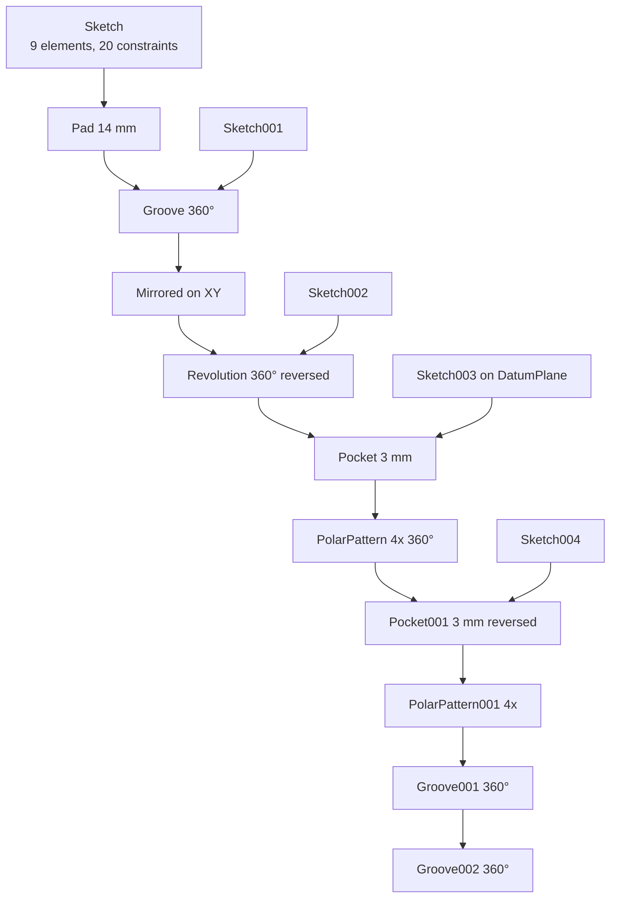
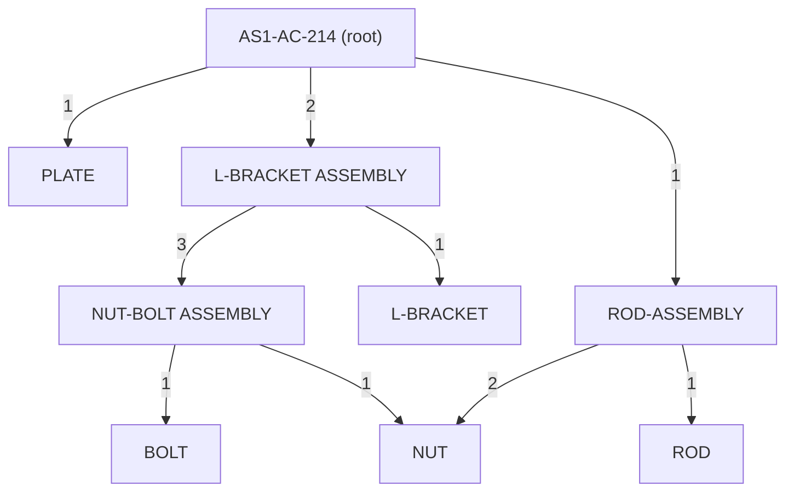
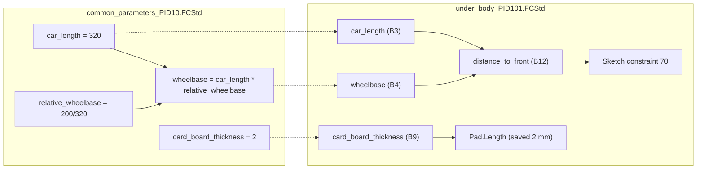

# Spike report: CAD and engineering formats

Date: 2026-10-19. Throwaway spike, no Rezzer code. Probes in `spike/cad-test/<group>/`, corpus in
`the CAD test corpus` (see [MANIFEST-cad.md](MANIFEST-cad.md)). Four groups ran in
parallel: `mcad` (FreeCAD, STEP, IGES, Fusion and closed native formats), `drawing` (DXF, DWG),
`mesh` (3MF with slicer data, STL, OBJ, glTF, G-code), `bim-eda` (IFC, KiCad, Gerber and
Excellon, OpenSCAD). Their full part reports with every matrix row, evidence and robustness
line are in `cad-parts/<group>.md`; this report merges them. Versions were checked
today; re-check before relying on them.

Owner decision during the spike: Rezzer runs every reader in-process, inside its one binary.
No external program (LibreDWG, ODA File Converter, OpenCascade, FreeCAD, KiCad, OpenSCAD,
IfcOpenShell, a slicer) is recommended as a helper anywhere in this report. Exact geometry
numbers (exact volume, mass, exact B-rep bbox) are computed in-process where cheap (meshes) or
stated as "not available".

Legend for the matrices: **E** exposed in the crate's public API, **P** partial (see note),
**N** not exposed, **-** format not supported by the crate. A crate that only prints text with
no field in its model scores **P** at best. `(src)` = scored from source only, because no corpus
file has the feature. "native only" (cadmpeg) = reachable only in cadmpeg's per-format raw
namespace; that ties Rezzer to codec internals, so it scores P.

## 1. Recommendation in short

The result is even clearer than for office formats. Of the 17 rows below, 14 are own readers
(12 ready for the first release, the two DWG rows later), STEP uses one crate (stepq) plus own
extras, and the two rows of closed native formats need a large crate (cadmpeg, later). The
knowledge (relations, parameters, BOM, nets, attributes, slicer settings) sits one mapping layer
above a simple syntax (zip + XML, Part 21, s-expressions, group codes, fixed columns, text
lines), and the crates either lack that layer, refuse real files, or fail on hostile input.

| Format | Use | Rezzer reads itself | First release? |
|---|---|---|---|
| FreeCAD `.FCStd` | own reader on `zip` + `quick-xml` (263 lines in the probe) | everything: object types, feature DAG, ExpressionEngine and spreadsheet aliases as "drives" edges (cross-document too, with cycle check), sketch constraints with values, placements, App::Link, Assembly workbench joints, TechDraw objects, metadata | **yes** |
| STEP AP203/214/242 | **stepq 0.6.0** (MIT) for header, units, product structure, BOM with roll-up quantities, placements, user properties, semantic PMI | colours, layers, graphic PMI counts, saved views, vertex bbox, entity histogram, dangling and cycle report, via the shared Part 21 tokenizer | **yes** |
| IGES | own fixed-column reader (88 lines) | start text, global section (units, author, system, dates), levels, 406 names, 212 notes, views, entity histogram | **yes** |
| IFC 2X3 / 4 / 4X3, ifcZIP | own Part 21 reader (shared with STEP) plus IFC mapping (354 + 308 lines) | spatial tree, elements, psets, Qto, materials and layer sets, classifications, types, voids/fills, systems, zones, documents, owner history | **yes**; per-schema attribute and subtype tables from `ifc-lite-core` 20.4.0 (MPL-2.0) behind a trait, or generated from the EXPRESS schemas later |
| DXF | own group-code reader (255 lines core) | header, layers with all flags, blocks, ATTDEF/ATTRIB (title block), TEXT and decoded MTEXT, dimensions, leaders, TABLE cells, xrefs, images, hatch names, XDATA, groups, unknown types by name | **yes**; acadrust 0.6.5 (failsafe mode) only as a reference for dynamic blocks and table grids |
| DWG R13 to R2018 | own in-process reader written from the separate DWG format specification | all of the DXF list plus summary info and preview | later (when the spec and reader exist); until then the first release reports the version from the 6-byte magic and "content not readable yet" |
| DWG R12 and older | own reader, AC1009 as its own simpler case in the spec | same | later; first release reports the version |
| 3MF incl. Bambu/Orca, PrusaSlicer, Cura | own reader on `zip` + `quick-xml` + `serde_json` (570 lines incl. all slicer configs) | everything; lib3mf-core's `bambu_config.rs` only as documentation of field meanings | **yes** |
| STL | own reader (110 lines, std only, streaming) | header text, solids, counts, bbox, area, volume, watertight, colours | **yes** |
| OBJ + MTL | own line reader (85 lines, std only) | objects vs groups, comments, materials, texture refs (listed, never followed) | **yes** |
| glTF / GLB | own reader on `serde_json` (124 lines, JSON chunk only) | asset info, node tree, extras, all extensions, variants, external refs | **yes** |
| G-code, Prusa `.bgcode` | own streaming line reader (207 lines incl. bgcode metadata, `miniz_oxide`) | slicer settings, time, filament, thumbnails, tools, temperatures, CNC tools/feeds/offsets | **yes**; bgcode G-code body (heatshrink/MeatPack) later |
| KiCad 6 to 10, legacy 5 | own iterative s-expression reader with limits plus KiCad mapping (1,423 lines in total, netlist pass 359) | title block, sheet tree, symbols with fields, BOM, DNP, notes, netlist (board nets, or own connectivity pass), board stackup, footprints, rules, holes | **yes** |
| Gerber X2/X3, Excellon, job file | own tolerant reader (359 lines) | X2/X3 attributes incl. EAGLE comment form, nets from copper, Excellon tools, plating, hit counts, job file | **yes** |
| OpenSCAD | own lexer and outline parser (236 lines) | Customizer parameters with tabs and widgets, modules/functions, include/use, call graph, assert/echo, `$fn` | **yes**; tree-sitter-openscad-ng 0.7.1 in reserve behind the same trait |
| Fusion 360 `.f3d` | cadmpeg-codec-f3d 0.6.2 | - | later, behind a feature flag; first release identifies the format and asks for STEP AP242 |
| SolidWorks, Creo, NX, CATIA, Inventor, Rhino, ACIS SAT | cadmpeg codecs 0.6.2 | magic-byte detection (Creo `#UGC:`, CFB, zip) | later, behind a feature flag; first release identifies the format and asks for STEP AP242 |

Reasons in short:

1. **Real files break the validating crates.** lib3mf-core, threemf, lib3mf and threemf2 each
   reject at least one real slicer or consortium 3MF outright (duplicate metadata names, a
   relationship to a missing thumbnail, a Bambu sub-model without `<build>`). gerberx2 fails on
   9 of 22 real Gerbers. ifc_rs rejects 6 of 12 real IFC files. dxf 0.6.2 fails on real R12 and
   R2000 binary DXF and silently drops HATCH, VIEWPORT, MULTILEADER, ACAD_TABLE and MESH. cadmpeg
   refuses a whole FreeCAD 1.0 Assembly file over one property type. A knowledge reader must read
   a damaged or unusual file and report the defect as a loss.
2. **The knowledge sits in the parts crates drop.** STL header text and solid names, OBJ comments
   and objects vs groups, glTF extensions the crate does not know, G-code comments and settings
   blocks, Prusa and Cura configs inside 3MF, KiCad schematic fields and DNP flags. Reading them
   is short, mostly std-only code.
3. **Hostile input.** Crates crashed or exploded on small files: lib3mf-core stack overflow on a
   component cycle and 6.1 GB RSS on a 2 MB zip bomb, gerberx2 18.6 GB on a 297-byte
   step-repeat, stack overflows in via-kicad-sexp, kicad-auto-importer-core, step-p21 and
   gerberx2, an acadrust panic on a truncated R2007 DWG. `tobj::load_obj` and `gltf::import`
   follow `../` references out of the input folder (proven: `/etc/hosts` read as a glTF buffer).
4. **stepq is the exception.** Small (1.1 MB probe), fast (49 MB STEP in 0.24 s), MIT, and its
   PMI values match the NIST definitions exactly. Its weakness is maturity (one maintainer, 1
   star, created 2026-09).
5. **cadmpeg is the best semantic model and the worst fit for the first release.** Its IR
   (design arenas, machine-readable losses, stable IDs) is what Rezzer wants, and it gives real
   feature trees and parameters for SolidWorks, Creo, NX and Fusion files, far above its own "L1"
   label. But design data needs a full decode, which decodes all geometry (44 s and 3.1 GB RSS
   on a real 20.6 MB FCStd, timeout on a 58.9 MB one), the probe with all codecs is 72 MB stripped
   and takes 257 s to build clean, and
   assemblies of native formats are weak. Use it later, behind a feature flag, for the formats
   nothing else can open.

## 2. Corpus

About 390 files, 168 MB, all from public sources with a redistributable license, pinned to a
commit or with URL and retrieval date. Full list with source, license, SHA-256 and purpose:
[MANIFEST-cad.md](MANIFEST-cad.md).

| Group | Files | Main sources and licenses | Covers |
|---|---|---|---|
| mcad: STEP | 9 | NIST MBE PMI files (public domain), FreeCAD repo (LGPL-2.1, flagged; AS1 is a CAx-IF assembly) | AP242 e1/e2/e3 semantic PMI, AP203 graphic PMI, tessellated, AS1 assembly with BOM, 6 MB file for speed |
| mcad: native CTC-01 | 6 | NIST FTC/CTC CAD models (public domain) | the **same part** in SolidWorks 2018 MBD, Creo 4, Creo 10, NX 1980, CATIA V5, Inventor 2021; ground truth `NIST-CTC-PMI-Definitions.xlsx` |
| mcad: Inventor | 5 | RespiraWorks (Apache-2.0), MXKeyboard (BSD-3) | parts, assemblies, a global parameter part |
| mcad: FreeCAD | 20 | cadmpeg CC0 fixtures (generated by cadmpeg, so circular for cadmpeg), FreeCAD examples (LGPL-2.1), levity0815 (CC-BY-SA-4.0), Assembly workbench files (MIT), f3d-app (BSD-3) | spreadsheet aliases with cross-document references driving 9 sketch constraints, PartDesign trees, Assembly joints, App::Link, broken links |
| mcad: f3d, 3dm, IGES | 11 | MIT, CC-BY-4.0, CC0, BSD | Fusion features and joints, Rhino layers, IGES units/levels/names |
| drawing | 95 | ACadSharp (MIT), ezdxf (MIT), acadrust (MPL-2.0), USDA Forest Service drawings (US public domain) | **one reference drawing saved as DWG and DXF in every version R14 to R2018** (paired check), dynamic blocks, TABLE, MULTILEADER, AEC proxies, damaged files, real R10/R12 DWG from 1987 to 1996 |
| mesh: 3MF | 19 | 3MF Consortium samples (BSD-2), BambuStudio, OrcaSlicer, PrusaSlicer repos (AGPL-3.0 data, flagged) | units, components, production, materials, beam lattice, slices, Bambu project/model/slice configs, plate G-code, Prusa configs, layer ranges, custom G-code per height |
| mesh: STL, OBJ, glTF, G-code | 39 | stl_io, tobj (MIT), Khronos glTF-Sample-Assets (CC0, CC-BY-4.0), Cura output (MIT), PrusaSlicer/Bambu G-code (AGPL), CNC demos (MIT) | header text, MTL, node trees, Draco, variants, extras, slicer settings, thumbnails, MMU tool changes, CNC |
| bim-eda: IFC | 11 | buildingSMART Sample-Test-Files (CC-BY-4.0, LICENSE checked at commit 80d976a) | IFC2X3, IFC4, IFC4X3 architecture, structure, HVAC, electrical, bridge, wall with window opening |
| bim-eda: KiCad | 4 projects | antmicro open hardware (Apache-2.0) | the same project in KiCad 10 and KiCad 6, a KiCad 9 project with buses and a reused sheet, a KiCad 5 legacy project |
| bim-eda: Gerber/Excellon | 31 | Easyduino (CERN-OHL-P), EAGLE (MIT), LimeSDR (CC-BY-3.0), MinnowBoard MAX (CC-BY-SA-3.0, flagged) | KiCad 10 X2/X3, EAGLE X2 in comments, Altium and Allegro without X2, three Excellon plating conventions, job files |
| bim-eda: OpenSCAD | 20 | OpenSCAD examples (CC0), BOSL2 (BSD-2) | Customizer annotations, parameter sets, include/use, asserts, recursion |
| Synthetic hostile | about 80 | generated by scripts outside the corpus (CC0) | truncation, zip bombs, cycles, dangling references, 100k-deep nesting, huge files (generated into the scratchpad, deleted) |

Known gaps (no redistributable file found in time): a real IGES with 212 general notes, a
`.f3d` with named user parameters, a real DXF/DWG xref, a real Cura 3MF project (only a
synthetic one, structure unverified), OrcaSlicer G-code (Bambu stands in), G-code QOI/JPG
thumbnails and a bgcode thumbnail block, real STL colours, a CNC program from a CAM system with a
tool table, a Gerber X3 component layer, ifcXML, a native MCAD assembly under a clear license
(the NIST MTC assembly was tested but not kept). Those cells are marked synthetic or `(src)`.

## 3. Method

- One small probe binary per candidate crate (`spike/cad-test/<group>/p-*`, 48 probes), each
  printing what the crate's model exposes for one file, plus "own reader" probes that show what
  Rezzer can read itself and at what size. `run.sh` per group runs every (probe, file) pair as
  its own process with a 20 s alarm (60 s for huge files) and records exit code, wall time and
  peak RSS with `/usr/bin/time -l`.
- APIs scored from the crate source in `~/.cargo/registry` first, then confirmed on corpus
  output. Paired checks where ground truth exists: NIST PMI definitions (STEP and native
  CTC-01), DWG vs DXF twins of the same drawing (ACadSharp, plus ACadSharp's own tree dump),
  KiCad board nets vs nets derived from the schematic, Allegro drill hit counts vs the counts in
  the file's own comments, OpenSCAD outline vs tree-sitter grammar.
- Licenses from `cargo metadata` over the full transitive tree of every probe.
- Build cost: `spike/cad-test/measure.sh`, a clean `--release` build per probe in its own target
  dir, one after the other on an idle machine (Apple M5, 10 cores), after `cargo fetch`. Binary
  sizes are stripped. Baseline hello world: 0.33 MB.
- Forbidden crates were never added or fetched: kicad-parser, kicad-api-rs, openscad-rs,
  brepkit-io, libredwg-sys, uncad, chipbreaker-gcode, opencascade(-sys), cadrum, openbim-ifc-cli.

## 4. Candidates

| Crate | Version (date) | License | MSRV | Activity |
|---|---|---|---|---|
| cadmpeg-ir + 11 codecs + registry | 0.6.2 (2026-10-19) | Apache-2.0 | 1.88 | 158 stars, created 2026-07-10, 100+ commits in 90 days, about 1.7 million lines of Rust |
| stepq | 0.6.0 (2026-10-11) | MIT | 1.85 | 1 star, created 2026-09-12, 48 commits in 90 days |
| step-io | 0.2.5 (2026-10-03) | MIT OR Apache-2.0 | 1.85 | 4 stars, "experimental", 1 commit in 90 days |
| dxf | 0.6.2 (2026-10-03) | MIT | none | 142 stars, since 2016, 4 commits in 90 days |
| acadrust | 0.6.5 (2026-10-18) | MPL-2.0 | none | 134 stars, created 2026-01, weekly releases |
| cadkit | 0.3.4 (2026-10-19) | MIT OR Apache-2.0 | 1.85 | 3 stars, created 2026-10-01, 8 releases in 19 days |
| undxf | 0.8.0 (2026-10-07) | MIT | 1.88 | 0 stars, created 2026-09-23 |
| lib3mf-core | 0.4.0 (2026-03-04) | BSD-2-Clause | 1.88 | 12 stars, no commits in 90 days |
| threemf | 0.8.0 (2026-03-05) | 0BSD | 1.56 | 49 stars (Fornjot) |
| lib3mf (telecos) | 0.1.6 (2026-03-13) | MIT | none | 5 stars, no release since March |
| threemf2 | 0.4.1 (2026-08-17) | MIT OR Apache-2.0 | 1.89 | 3 stars |
| stl_io | 0.11.0 (2026-03-15) | MIT | 1.85 | 64 stars, 5.1 M downloads |
| tobj | 4.0.5 (2026-08-02) | MIT | none | 275 stars, 3 M downloads |
| obj-rs | 0.7.4 (2024-09-28) | MIT OR Apache-2.0 | none | 96 stars, stale |
| gltf | 1.4.1 (2024-05-10) | MIT OR Apache-2.0 | 1.61 | 644 stars, no release since 2024, 91 open issues |
| gcode / g-code / gcode-nom | 0.7.0 / 0.6.0 / 0.7.0 | MIT OR Apache-2.0 / same / MIT | 1.85 / none / 1.94 | 109 / 14 / 8 stars |
| ifc-lite-core (+ processing) | 20.4.0 (2026-10-11) | MPL-2.0 | none | 427 stars, 94 releases since 2026-01 |
| oxideav-ifc | 0.0.3 (2026-10-04) | MIT | 1.80 | 2 stars, one author, clean-room |
| step-p21 | 0.1.1 (2026-08-18) | Apache-2.0 | 1.85 | 1 star |
| ifc_rs | 0.1.0-alpha.9 (2024-12-04) | MIT | none | 25 stars, stale |
| cadlab | 0.0.2 (2026-10-04) | MIT | 1.89 | 0 stars, two weeks old, 92k lines, AI-written |
| lexpr, via-kicad-sexp, kicad_parse_gen, serde_kicad_sexpr, kicad-auto-importer-core | 0.2.7 / 0.1.1 / 7.0.2 / 0.1.0 / 0.0.1 | MIT/Apache, MPL-2.0, MIT/Apache, Apache-2.0 OR LGPL-3.0 (Apache chosen), MIT | - | generic or stale; none reads a schematic into a model |
| gerber_parser + gerber-types | 0.5.0 + 0.7.0 | MIT OR Apache-2.0 | none | 17 / 21 stars, since 2021 |
| gerberx2 | 0.1.2 (2026-05-18) | MIT OR Apache-2.0 | none | diodeinc/pcb monorepo, 3 crate releases |
| tree-sitter-openscad-ng + tree-sitter | 0.7.1 + 0.27.1 | MIT | none / 1.90 | official grammar, 11 stars, C build |
| tree-sitter-openscad (bollian) | 0.5.1 (2024-02-24) | MIT | none | stale, tree-sitter 0.20 |
| openscad-customizer-rs, scad-deps | 0.1.2 / 0.1.0 | MIT | none / 1.89 | 1 star / 2 days old |

Looked at and not probed: `cadaclysm-sdk` (loads prebuilt native libraries at run time: not
in-process Rust, not auditable), `ogeom-io`, `monstertruck-io`, `parasolid-core` (geometry
kernels), `stepperoni`, `oxideav-step`, `dxf-tools-rs`, `dxfscan`, `dwg2geo`, `ifc` (empty
placeholder), `ruststep`, `openscad-lsp` (binary only), `kicad-ipc-rs` (needs a running KiCad).
Avoided on license grounds: `ifc-lite-core-cat` (MIT/Apache label on what reads like an
unattributed rewrite of the MPL-2.0 ifc-lite-core), `lib_gerber_edit` and `BREP_ecad_core`
(non-standard licenses). Build time and binary size per probe are in section 12.

## 5. Scoring: native MCAD (FreeCAD, STEP, IGES, Fusion and closed formats)

### 5.1 Do cadmpeg's self-scored levels hold?

Tested on the same NIST part CTC-01 in six CAD systems (cadmpeg 0.6.2, full decode), with the
NIST PMI spreadsheet as ground truth: datums A, B, C; tolerances 2 surface profile, position
0.75 A|B|C, flatness 0.2, perpendicularity 1.5 A; dimensions incl. 60° ±0.5°.

| Item | STEP AP242 (stepq) | STEP AP242 (cadmpeg) | SolidWorks 2018 | Creo 4 / 10 | NX 1980 | CATIA V5 | Inventor 2021 |
|---|---|---|---|---|---|---|---|
| cadmpeg self-score | - | L9 | L1 | L1 | L1 | L1 | L1 |
| Detected | - | yes | yes | yes | yes | yes | **no** (forced codec works) |
| Units | mm, degree | mm | mm | mm | mm | mm | mm |
| Part number / name | "NIST Test Case 1" | yes | file path | `model_name` | attribute "Part Number" | no | `part_number`, `author` |
| Custom properties | Modeled By, CAGE Code, Company | native only | 4 attribute records | no | Description, Revision, Part Number | no | native only |
| Faces | 117 | 117 | 137 | 38 (111 rejected) | 0 (not reconstructed) | 117 | 139 |
| Features with operation parameters | - | - | **47** | 30 | 38 | 3 unresolved | 0 |
| Parameters | - | - | 97 (D1 = 50) | 144 (d8 = 50) | 88 | 0 | 0 |
| Sketches / constraints | - | - | 10 / 50 | 12 / 549 | 7 / no graph | 0 | 0 |
| Semantic PMI | 3 datums, 6 tol, 12 dims | same + 23 graphic | **19, matches NIST** | 0 | 0 (opaque) | 0 | 0 |
| Losses reported | - | 33 | 4 | 23 | 25 | 4 | 4 |

Verdict: STEP (L9) holds for structure, PMI and losses. FreeCAD (L5) and f3d (L4) mostly hold
(f3d: features with extents and radii, sketches with dimension constraints linked to
parameters, components, physical materials; joints silently missing on both files that have
them). SolidWorks, Creo and NX are **understated** at L1 for single parts: real feature trees and
parameters, and for SolidWorks semantic PMI that matches NIST. Assemblies are weak everywhere:
the NIST SolidWorks assembly gives no occurrences, NX and Inventor occurrences exist only in the
native namespace. CATIA, Rhino and SAT hold at L1 (geometry, units, a few attributes).

### 5.2 FreeCAD `.FCStd`

Applicable: all core items except PMI and print settings.

| Item | cadmpeg-codec-freecad | own reader (zip + quick-xml) |
|---|---|---|
| Object types and labels | E | E |
| Feature operation semantics (Pad, Pocket, Fillet, Hole, primitives) | E (typed extrude with extent, profile, direction) | P (raw properties Type, Length, Midplane; mapping per type needed) |
| Feature dependency DAG | E | E (ObjectDeps and links); P on 0.17 files without ObjectDeps |
| ExpressionEngine entries | E | E |
| Parameter "drives" edges | E (resolved to spreadsheet cells) | E (33 edges on the levity file, alias to cell, cross-document refs, cycle check) |
| Spreadsheet cells and aliases | E | E |
| Sketch geometry | E (typed) | P (types and counts) |
| Sketch constraints with values, driving flag | E | E |
| Placement | E | E |
| Materials | P (native only, material uuid) | P (uuid only) |
| Appearance | E | P (colours) |
| App::Link and external links | E | E (target `file#object`, placement) |
| Assembly workbench joints | E (17 on AssemblyExample) | P (joint type code and refs) |
| TechDraw pages, dimensions | E | P (objects and types) |
| Metadata (CreatedBy, Company, License, dates, ProgramVersion) | P (ProgramVersion; rest native raw XML) | E |
| Geometry summary | E (decodes the BREP) | N (`.brp` not parsed) |
| Losses | E | P (own messages) |
| Files read (10 independent FCStd) | 7 (2 refused, 1 timeout) | 10, all under 50 ms and 40 MB |

### 5.3 STEP

Applicable: metadata, units, product structure and BOM, placements, colours, layers,
properties, materials, PMI, geometry summary, losses. N/A: feature history, sketches,
parameters, configurations (STEP carries the result, not the design intent).

| Item | stepq | step-io | cadmpeg-codec-step | own Part 21 tokenizer |
|---|---|---|---|---|
| Header (schema, author, organization, system, time) | E | E | E | E |
| Units | E | E | E (normalised to mm) | P (names) |
| Product structure, BOM with quantities | E (AS1: NUT qty 8, correct roll-up) | P (tree, no quantities) | E | P (NAUO counts) |
| Placements | E | E | E | N |
| Colours | N | E | E | P (histogram, RGB) |
| Layers | N | E | E | P (names, member counts) |
| User properties | E (Modeled By, CAGE Code, Company) | P | P (native only) | P |
| Materials | N (none in corpus) (src) | N | N | P (MATERIAL_DESIGNATION names) |
| Semantic tolerances with magnitude and datums | E (position 0.75 A|B|C) | P (magnitude `None`) | E | P (counts) |
| Semantic dimensions with values and tolerances | E (60° -0.5/+0.5) | P (value `None`) | E | P (counts) |
| Graphic PMI | N | N | E (labelled presentation) | P (counts, saved views) |
| Solid and face counts | E | E | E | E |
| Approximate bbox | N | P | E | E (vertex bbox) |
| Dangling and circular references reported | E (strict graph, then `Graph::build`) | N (silent) | E (cycle not reported) | E |

### 5.4 IGES

| Item | cadmpeg-codec-iges | own fixed-column reader |
|---|---|---|
| Start section text | P (native, hex) | E |
| Units, sender, file name | E | E |
| Native system, author, organization, dates | P (native only) | E |
| Entity histogram, levels | P (native) | E |
| Colours (314) | E (named) | P (numbers) |
| Names (406 form 15), general notes (212) | P (native, hex-encoded; notes "not projected") | E |
| Views/drawings (410/404) | P (native) | E (counts) |
| Geometry (faces, bodies) | E | N |
| Truncated file | refuses whole file | partial result with losses |

### 5.5 Fusion and closed formats (cadmpeg only)

| Item | f3d | SolidWorks part | Creo | NX | CATIA | Inventor | Rhino |
|---|---|---|---|---|---|---|---|
| Version, producing system | E | E | E | E | P | E | E |
| Units | E | E | E | E | E | E | E |
| Custom properties | N | P | N | E | N | P | P (native) |
| Features with operation semantics | E | E | P | P | N | N | - |
| Parameters | E | E | E | E | N | P (1 of 5 files) | - |
| User parameters with expressions | E (src; none in corpus) | P | N | N | N | N (`global_params.ipt`: 0) | - |
| Sketches and constraints | E | E | E | N | N | P (native) | - |
| Configurations | N | E ("Default") | N | P | N | N | - |
| Components / occurrences | E | N (assembly: none) | E | P (native) | N | P (native) | P (native groups) |
| Joints / mates | P (silent miss) | N | N | N | N | N | - |
| Appearances, materials | E (density, yield stress) | E | N | P | P | P | P (native layers) |
| PMI | - | E (19, matches NIST) | N | N | N | N | - |
| External references | N | N | N | P (native, 32 on assembly) | N | N | - |
| Preview | P | P | N | E | N | E | P |
| Losses | E | E | E | E | E | E | E |

## 6. Scoring: drawings (DXF, DWG)

### 6.1 DXF

| Item | dxf 0.6.2 | acadrust 0.6.5 | cadkit 0.3.4 | undxf 0.8.0 | own reader |
|---|---|---|---|---|---|
| $INSUNITS, $MEASUREMENT, $ACADVER | E | E | E (typed units with meters per unit) | P | E |
| $EXTMIN/$EXTMAX vs computed extents | E | E | P (raw) | P | E (both; they differ on the ACadSharp sample) |
| $TDCREATE, $TDUPDATE, $LASTSAVEDBY, $FINGERPRINTGUID | P (**invents** now() and a random GUID when absent, +1 s) | E | P (raw) | P | E |
| Layers with on, frozen, locked, plot, linetype | P (no frozen, no locked) | E | E | E | E |
| Blocks, INSERT with ATTRIB (title block) | E | E | E | E | E |
| ATTDEF tag, prompt, default | E | E | P (props) | P (no prompt) | E |
| Multi-line ATTRIB | E | E | E | N | E |
| Dynamic block parameters | N | E | N | N | - |
| TEXT, MTEXT decoded | P (raw, truncation bug) | E | E | P (raw) | E (subset) |
| DIMENSION value, override, style | P (2-line angular dropped) | E | E | E | E |
| Dimension tolerances from DIMSTYLE | E (src) | E (src) | N | E (src) | N (about 20 lines) |
| LEADER / MULTILEADER text | P | E | P | E | E |
| TABLE entity (BOM table) | - (dropped silently) | E | N (Unknown, warned) | E | P (cell strings, no grid) |
| Layouts and viewports | P | E | E | E | P |
| XREF path (synthetic file) | E | E | E | E | E |
| Images, underlays | E | E | E | E | E |
| Hatch patterns | - (dropped) | E | E | P | E |
| XDATA, XRECORD, dictionaries, groups | E | E | P | N | E |
| Entity counts per layer and type | P | E | E | E | E |
| Machine-readable losses | N (silent skips) | E (strict mode aborts, use failsafe) | E (typed warnings) | P | E |

### 6.2 DWG and the paired check

| Item | acadrust 0.6.5 | cadkit 0.3.4 |
|---|---|---|
| Versions read on real files | AC1014 to AC1032 | AC1014 to AC1032 |
| AC1006 / AC1009 (8 real USFS drawings) | all fail (README claims R12) | all fail ("unrecognized file format") |
| Header, units, layers, blocks, ATTRIB, TEXT, MTEXT, dimensions, layouts | E | E |
| DWG summary info (title, author, keywords, custom) | E | N |
| Preview image | E | P |
| Dynamic block parameters | E | N |
| TABLE cells, MULTILEADER | E | N (Unknown with warning) |
| XDATA, XRECORD, groups | E | P |
| AEC (AutoCAD Architecture) proxies | P (named as unsupported) | P (named) |
| Corruption detection (CRC, checksums) | N (200 bit flips read with 0 diagnostics) | E (typed warnings) |

Paired fidelity on the ACadSharp reference drawing (DWG vs its DXF twin, read by the own DXF
reader; independent check against ACadSharp's own tree dump): for AC1015 to AC1032 both crates
match exactly, 169/169 entities, 4/4 ATTRIB values, 29/29 TEXT, 5/5 MTEXT, 11/11 dimension
values, all layers with flags, all layouts. AC1014 (R14) stores no dimension measurement:
acadrust reports 0.0 (looks like a real value), cadkit reports None.

This shows that a pure-Rust in-process DWG reader for R2000 to R2018 is realistic, and gives
Rezzer's own DWG reader a regression corpus and two reference outputs to diff against.

## 7. Scoring: mesh and manufacturing (3MF, STL, OBJ, glTF, G-code)

### 7.1 3MF

| Item | lib3mf-core | threemf | lib3mf (telecos) | threemf2 | own reader |
|---|---|---|---|---|---|
| Opens real slicer and consortium files (19) | P (rejects 4) | P (rejects Bambu root model) | N (rejects all Bambu/Orca, 2 of 3 Prusa, 2 consortium) | P (rejects 3) | E (19 of 19) |
| Unit, metadata in order | P (HashMap) | E | E | E | E |
| Objects with name, type, part number, UUID | E | P | E | E | E |
| Components and build items with transforms (assembly) | E | P | E | E | E (cycle and depth guard) |
| Triangle counts, world bbox | E | P | P | P | E |
| Manifold check | P (field never set) | N | N | N | N |
| Base materials, colour groups, textures | E | P | E | E | E |
| Beam lattice, slice stack | E | N | E | E | P (counts) |
| Thumbnails as pictures for vision | P | N | E | E | E |
| Bambu/Orca project, model and slice configs | E | N | N | N | E |
| Embedded plate G-code header | P (path) | N | N | N | E |
| PrusaSlicer configs, layer ranges, custom G-code per Z | N | N | N | N | E |
| Cura `.cfg` stacks | N | N | N | N | E (synthetic file only) |
| Losses (cycles, dangling refs, limits) | P (errors abort) | N | P | P | E |

### 7.2 STL, OBJ, glTF

| Item | stl_io | own STL |
|---|---|---|
| ASCII vs binary detection | P (bare `solid` misread) | E |
| Header text (exporter), solid names, multi-solid | N (dropped; only the first solid read) | E |
| Triangle count header vs real | P (trusts header: error or silent loss) | E (mismatch reported) |
| Bbox, area, volume, watertight | P / P / P / E | E |
| Colours (facet bits, Materialise header) | N | E |
| Units | not stored in STL: say so | same |

| Item | tobj | obj-rs | own OBJ |
|---|---|---|---|
| `o` vs `g` names | P (merged) | P | E |
| Comments (exporter, units hints), smoothing groups | N / N | N / E | E / E |
| MTL properties, texture file and options | E / P | P | E / E |
| External refs listed, not followed | P (`load_obj` follows `../`) | E | E |
| Free-form statements | E (ignored) | N (panic) | E (counted) |

| Item | gltf 1.4.1 | own glTF |
|---|---|---|
| Opens files with an unknown required extension (Draco, meshopt) | N (whole file rejected) | E |
| Asset generator, copyright; extensions used/required | E | E |
| Node tree with names and transforms | E (no cycle check) | E (cycle and depth guard) |
| World bbox through transforms | N | E |
| Materials, all KHR and vendor extensions | E (known only) / P | E |
| Extras at every level, KHR_materials_variants | E | E |
| External URIs listed, not followed | P (`import` follows `../` and `file://`) | E |
| Truncated GLB | N | E (JSON chunk intact) |

### 7.3 G-code

| Item | gcode 0.7.0 | g-code 0.6.0 | gcode-nom 0.7.0 | own reader |
|---|---|---|---|---|
| Parses real slicer output | P (whole file `Err` on any odd token: Cura, Bambu, Prusa MMU failed) | P | E | E |
| Streaming, constant memory | N (3.3 GB on 144 MB) | N (8.0 GB) | E | E (3 MB) |
| Comments, slicer settings, time, filament, layers | E / P | P | N | E |
| Thumbnails as pictures | P (raw lines) | P | N | E |
| Temperatures, tools, feeds, spindle, work offsets | E | P | P (M-code args dropped) | E |
| Object names (`;MESH:`, M486, EXCLUDE_OBJECT) | P | P | P | E |
| CNC program (N-numbers, paren comments) | E | N | N | E |
| Prusa bgcode metadata | N | N | P | E |

## 8. Scoring: BIM and EDA (IFC, KiCad, Gerber/Excellon, OpenSCAD)

### 8.1 IFC

| Item | ifc-lite-core | ifc-lite-processing | oxideav-ifc | step-p21 | own reader |
|---|---|---|---|---|---|
| Header | P | P | E | P | E |
| Units (IfcUnitAssignment) | E | P | P | N | E |
| Spatial structure tree | N | E | E (IFC4X3 nodes nameless) | N | E |
| Element counts by type | E | P | P (typed IFC4 slice only) | P | E |
| Names and GlobalIds | E | P | P | P | E |
| Property sets with values | P (typed values flattened) | N | E | N | E |
| Quantity sets | P | N | E (SI scaled) | N | E (not SI scaled yet) |
| Materials, layer sets | N | P | E | N | E |
| Classifications | N | N | E | N | E |
| Type objects and inherited psets | N | N | E | N | E |
| Aggregation, containment, voids/fills | N | E / N | E | N | E |
| Groups, systems, zones | N | N | E | N | E |
| External documents | N | N | E | N | P (~5 lines missing) |
| Owner history (who, when) | P | N | N | N | E |
| Dangling refs, cycles | P | P | E | N | E |
| Schema awareness 2X3 / 4 / 4X3 | E (generated registries) | E | P (IFC4 slice) | N | P (hard-coded positions) |
| ifcZIP | - | - | - | - | E |
| Tolerates truncation and one bad record | E | E | N (whole file rejected) | N | E |

### 8.2 KiCad

Generic tree parsers (lexpr, via-kicad-sexp) score N on every knowledge row; Rezzer would do
the mapping on top of them, as the own reader does. Both also fail as a base (lexpr rejects
every KiCad 6 file on unquoted uuids, via-kicad-sexp overflows the stack).

| Item | own reader | cadlab 0.0.2 | kicad-auto-importer-core | kicad_parse_gen | serde_kicad_sexpr |
|---|---|---|---|---|---|
| Parses KiCad 6 / 7-9 / 10 | E / E / E | board only | E | - (KiCad 4 era) | - |
| Title block | E | N | P | - | - |
| Sheet hierarchy with instance paths, reused sheets | E | - | P (reused sheet visited once) | - | - |
| Symbols with ref, value, footprint, datasheet, custom fields | E | - | P (127 of 159 symbols) | - | - |
| BOM grouping, DNP, in_bom, on_board | E | - | N | - | - |
| Text notes, labels, no-connects | E | - | N | - | - |
| Netlist from the schematic (own connectivity pass) | E (135/135, 135/135, 97/97 same members vs board) | - | N | - | - |
| Board size, stackup with dielectric materials | E | E / P (dielectrics dropped) | N | - | - |
| Footprints with ref, value, side, position | E | P | N | - | - |
| Nets with pad membership | E | E | N | - | - |
| Tracks, vias, zones, holes by drill | E | E / P | N | - | - |
| Design rules, net classes | E (`.kicad_pro`; `.kicad_dru` later) | E | N | - | - |
| `.kicad_sym`, `.kicad_mod` | E | E / P | P | - | - |
| Legacy KiCad 5 `.sch`, `.lib`, `.pro`, board 20171130 | E | - (refuses, clear hint) | P (board only) | N | - |
| Machine-readable losses | P | E (diagnostics with codes) | N | - | - |

Netlist from the schematic is medium effort (359 lines, about 2 hours): the geometry is easy,
the cost is KiCad's naming and scoping rules (PWR_FLAG must not create a net, KiCad 6 power
symbols take the name from the pin, bus groups across sheets, driver priority for names). When
a board exists, its explicit pad nets are the netlist; the schematic pass adds sheet and label
context and covers schematic-only projects.

### 8.3 Gerber, Excellon, job file

| Item | gerber_parser + gerber-types | gerberx2 | own reader |
|---|---|---|---|
| %TF file attributes | E (typed) | P (raw; whole file fails on many real inputs) | E |
| EAGLE comment form `G04 #@! %TF` | P (attributes lost) | N (file aborts) | E |
| Units, coordinate format | E | P | E |
| Aperture function bound to each aperture | P (caller replays) | E | E |
| Object attributes (.N, .P, .C) on each object | P (caller tracks) | E | E |
| X3 component characteristics | E (src) | P (src) | P (src) |
| Netlist (net to refdes.pin) | P (derivable) | P (derivable) | E (62 nets from KiCad top copper) |
| Step-repeat, block apertures | E (kept, not expanded) | P (**eager expansion**: memory bomb) | E (counted, never expanded) |
| Board outline bbox | P | P | P (job file `Size` preferred) |
| Losses, tolerance | E (per command) | N (first error aborts) | E |
| Job file (.gbrjob) | - | - | E |
| Excellon tools, hits, slots, plating | - | - | E (Allegro: 1873/1873 matches the file's comments) |

### 8.4 OpenSCAD

| Item | tree-sitter-openscad-ng | tree-sitter-openscad (bollian) | openscad-customizer-rs | own reader |
|---|---|---|---|---|
| Modules and functions with parameters and defaults | E | E (parameters not split) | - | E |
| Top-level variables | E | E | - | E |
| Customizer description, widget, tabs | P (comment nodes; meaning is 34 own lines) | P | N | E |
| Parameter sets (.json) | - | - | P (prints the file to stdout) | E (serde_json) |
| include/use dependencies | E | E | - | E |
| Module call graph | E | E | - | P (heuristic; matched -ng on 19 of 20 files) |
| Special variables, assert, echo, color | E | P | - | E |
| Syntax errors with position, truncated module kept | P (module lost) | P (many false errors) | - | E |

## 9. Evidence

### 9.1 Parameters and features

```
# own FCStd reader, levity_common_parameters_PID10.FCStd (CC-BY-SA-4.0)
metadata: Company "SCALE GmbH", CreatedBy "Marko Thiele", License "CreativeCommons Attribution"
spreadsheet: cells=29 aliases=12 ["car_length=B4:320", "relative_wheelbase=B10:=200 / 320",
  "wheelbase=B11:=car_length * relative_wheelbase", ...]
  Spreadsheet.car_length[B4] --> Spreadsheet.B11
  Spreadsheet.relative_wheelbase[B10] --> Spreadsheet.B11

# own FCStd reader, levity_under_body_PID101.FCStd (the second document)
spreadsheet: aliases=16 ["car_width=B2:=common_parameters_..._PID10#Spreadsheet.car_width", ...]
expressions: 9 edges=33 external_doc_refs=8
  Spreadsheet.card_board_thickness[B9] --> Pad.Length
  Spreadsheet.car_width[B2] --> Sketch.Constraints[80]
feature Pad [PartDesign::Pad] Length=2.0 Midplane=true links={"Sketch"}

# cadmpeg, same file
{"dependencies": ["fcstd:design:parameter#Spreadsheet:cell:B9"],
 "expression": "Spreadsheet.card_board_thickness", "name": "Length",
 "owner": "fcstd:design:feature#Pad", "value": {"kind": "length", "value": 2.0}}

# own FCStd reader, bldc_BLDCM.FCStd (FreeCAD 1.0 Assembly; cadmpeg refuses the file)
link Chassis -> ["BLDCM_Chassis.FCStd#Body"] pos=(0,0,-1.2) axis=(0,0,1) angle=3.14159
joint Joint type=1 label="Revolute"
cadmpeg: malformed container: joint parameter property ...Joint:AngleMax has runtime type
  App::PropertyFloat, expected App::PropertyAngle
```

### 9.2 STEP PMI and BOM

```
# nist_ctc_01_asme1_ap242-e1.stp
stepq tol: {"kind":"position","magnitude":{"value":"0.75"},"datums":[{"label":"A"},{"label":"B"},{"label":"C"}]}
stepq dim: {"kind":"location","name":"angle","values":[{"value":"60.0"}],"tolerance":{"lower":"-0.5","upper":"0.5"}}
step-io:   tol kind=Position magnitude=None   warn: tolerance magnitude is a complex measure instance

# freecad_as1-ac-214.stp, stepq bill_of_materials
PLATE 1, L-BRACKET ASSEMBLY 2, L-BRACKET 2, NUT-BOLT ASSEMBLY 6, BOLT 6, NUT 8, ROD-ASSEMBLY 1, ROD 1
header: originating_system "AutoCAD 2000", schema AUTOMOTIVE_DESIGN (AP214), units millimetre
```

### 9.3 Drawings

```
# synthetic/titleblock_xref_r2000.dxf, title block (all five readers agree)
{"block":"TITLEBLOCK","attribs":[{"tag":"TITLE","value":"Mounting bracket"},{"tag":"DRAWING_NO","value":"DWG-0815"},
 {"tag":"REV","value":"C"},{"tag":"MATERIAL","value":"S235JR"},{"tag":"PART_NO","value":"BR-100-42"}]}
xrefs [{"block":"XREF_BRACKET","path":"..\\parts\\bracket.dwg","overlay":false}]
dims  [{"type":"linear","measurement":120.0,"text":"<> H7","style":"ISO-25"}]

# acadsharp/sample_AC1032.dwg, acadrust
tables [{"rows":4,"cols":5,"cells":["Hello this is a title","A2 cell",...,"$100.00"]}]
dynamic_blocks [{"block":"my-dynamic-block","properties":[{"name":"dynamic-diameter","value":"Real(2.0)"}]}]

# ezdxf/Minimal_DXF_AC1009.dxf (no date variables in the file), dxf crate
"tdcreate":"2026-10-19T19:49:13.942584+02:00","fingerprintguid":"9011e0f6-..."   <- invented
```

### 9.4 Manufacturing

```
# own 3MF reader, prusa_fdm_roundtrip1.3mf
config/object[1]/volume volume_type = NegativeVolume
custom_gcodes_per_print_z/code print_z=13.4 type=1 extra=pause gcode=M601
custom_gcodes_per_print_z/code print_z=15.05 extruder=2 color=#DB5182 gcode=M600
Slic3r_PE.config: 376 keys   filament_type = PVA;PVA;PVA;PVA;PVA   fill_density = 15%

# lib3mf-core, bambu_reference.gcode.3mf
slice_info: client_version 02.05.00.66, prediction 7745 s, weight 32.12 g, filament PLA #FFFFFF 23.43 g,
  warning bed_temperature_too_high_than_filament
# lib3mf-core / lib3mf, orca_sliced.3mf: Duplicate metadata name 'OrcaSlicer'  <- whole file lost

# own G-code reader, cura56_tmpusb_case_top.gcode
FLAVOR:Marlin, Cura_SteamEngine 5.6.0, TIME = 370, LAYER_COUNT = 16, TARGET_MACHINE.NAME = Creality Ender-3 S1
# gcode 0.7.0, same file: parse returned Err with 97 diagnostics (no program at all)

# gltf::import, syn_external_refs_bufonly.gltf (buffer uri "../../../../etc/hosts")
import ok: buffers=[216]   <- file outside the input folder was read
```

### 9.5 BIM and EDA

```
# own IFC reader, bsi-4-Building-Architecture.ifc
Ifcslab#53 "floor" GlobalId=3zR0BOEcLADRKln4HYporH type "house - groundfloor"
    (from type) Pset_SlabCommon FireRating = REI60
    Pset_SlabCommon FireRating = REI30          <- occurrence overrides the type
    Qto_SlabBaseQuantities Depth = 250
    material "concrete_reinforced_in-situ"
Ifcbuilding#35 -> E-AAA in CCI Construction 1.0 (Molio)
# own IFC reader, bsi-4-wall-with-opening-and-window.ifc
Ifcwall#45 "Wall for Test Example" has opening #80 filled by Ifcwindow#102

# own KiCad reader, m2-k10 schematic (8 ms)
title_block {"title": "M.2 Smart IoT Module", "rev": "1.2.9", "comment2": "Antmicro Ltd."}
symbols_placed 213, dnp 15, not_in_bom 2, bom_groups 77
symbol {"sheet": "/PCIe-USB-Bridge/", "ref": "C15", "footprint": "...:0402-cap",
        "fields": {"MPN": "04025G103ZAT2A", "Manufacturer": "AVX", "Val": "10n"}}

# own Gerber reader, Easyduino F_Cu (KiCad 10)
nets: 62  +3.3V: ["A1.17", "C3.1", "U3.6"]   pin functions: ("A1.1", "D1/TX_1")

# own OpenSCAD reader, candleStand.scad (CC0)
length = 50 | tab Candle Stand | Length of candle stand | dropdown 70 large, 50 medium, 30 small
count = 7   | tab Number of candle holders | slider 3..14
```

## 10. Bugs found in the crates

- **cadmpeg 0.6.2:** Inventor detection fails on all 6 real files (forcing the codec works);
  whole FCStd refused on one property type (FreeCAD 1.0 Assembly) and on broken ObjectDeps;
  truncated FCStd and IGES refused; design data only through a full geometry decode (44 s, 3.1 GB
  on a 20.6 MB FCStd; timeout on 58.9 MB); f3d joints silently missing; Inventor user parameters
  not decoded without a loss; IGES notes only hex-encoded in the native namespace.
- **stepq 0.6.0:** no bug found. **step-io 0.2.5:** tolerance magnitudes and dimension values
  `None` on NIST AP242 files; dangling references not reported.
- **dxf 0.6.2:** silent drops (HATCH, VIEWPORT, MULTILEADER, ACAD_TABLE, MESH, 2-line angular
  dimensions: 135 of 169 entities survive), invented `$TDCREATE` and `$FINGERPRINTGUID`, dates
  1 s off with the machine's time zone, text truncation in ANSI_1252 files, hard failure on real
  R12 ASCII/binary and R2000 binary DXF, no frozen/locked layer flags.
- **acadrust 0.6.5:** panic on a truncated R2007 DWG (also failsafe); bit-flipped DWG read
  without diagnostics; strict mode aborts a real R2004 DXF; failsafe labels unreadable files
  AC1032; claims R12 DWG but fails all 6 real AC1009 files; R14 dimension 0.0 instead of absent.
- **cadkit 0.3.4:** misleading errors (pre-R14 "unrecognized file format", random data
  "password-encrypted"); accepts a DXF with a bad group code as an empty drawing.
- **lib3mf-core 0.4.0:** stack overflow on a component cycle; no size cap on zip entries
  (6.1 GB on a 2 MB bomb); `is_manifold` never set; rejects duplicate metadata and dangling
  thumbnail relationships; parse errors in vendor configs swallowed.
- **threemf, lib3mf, threemf2:** strict rejections of real files; threemf and threemf2 2 to 6 GB
  on the zip bomb; lib3mf's 1 GiB cap gives a misleading error.
- **stl_io 0.11.0:** bare `solid` read as binary; only the first ASCII solid; header triangle
  count trusted. **tobj 4.0.5:** `o` and `g` merged, texture options in the file name, follows
  `../` mtllib. **obj-rs 0.7.4:** `unimplemented!()` panic on valid free-form statements.
- **gltf 1.4.1:** unknown required extension rejects the file; no node cycle check; `import`
  follows `../` and `file://`.
- **gcode 0.7.0:** one odd token and no program at all; **g-code 0.6.0:** private fields, 8 GB
  for 144 MB; **gcode-nom 0.7.0:** drops comment text and M-code arguments, MSRV 1.94.
- **ifc-lite-core 20.4.0:** typed parameter `IFCLABEL('x')` indistinguishable from a 2-element
  list without the schema; 200 KB error string on deep nesting; stderr warnings from the library;
  a zip input gives 0 entities and no error. **oxideav-ifc:** all-or-nothing parse, IFC4-only
  typed slice. **ifc_rs:** rejects valid files, panics on a dangling reference. **step-p21:**
  stack overflow on deep nesting.
- **KiCad crates:** lexpr rejects KiCad 6 (unquoted uuids); via-kicad-sexp,
  kicad-auto-importer-core and kicad_parse_gen overflow the stack; auto-importer misses reused
  sheets and takes the ref from the property instead of the instance path; serde_kicad_sexpr
  cannot skip unknown fields.
- **gerberx2 0.1.2:** eager step-repeat expansion (18.6 GB from 297 bytes), unbounded recursion
  in macro expressions, first error aborts, rejects valid nested `%AB`, trailing-zero `%FS`, G71.
  **gerber_parser 0.5.0:** EAGLE attribute form lost, aperture attributes not kept on apertures.
- **tree-sitter-openscad-ng 0.7.1:** identifiers starting with a digit cut; a truncated module
  disappears. **openscad-customizer-rs 0.1.2:** `println!` of the whole input from the library,
  which would corrupt a stdio MCP stream.

## 11. Robustness

Every pair ran in its own process with a timeout and peak RSS measured. Full tables in the part
reports. Summary of the cases that matter for Rezzer:

| Case | Crash or blow-up | Handled well |
|---|---|---|
| Zip bomb (FCStd 1 GiB, 3MF 2 GiB model, 3MF bomb in a config part, ifcZIP 2 GiB) | lib3mf-core 2.0 and 6.1 GB, threemf 6.1 GB, threemf2 2.0 GB | cadmpeg (budget before inflating, 5 MB), own readers (cap, 2 to 84 MB) |
| Component or node cycle (3MF, glTF, IFC, FreeCAD expressions, DXF self-insert) | lib3mf-core stack overflow (abort); gltf accepts, caller loops | own readers report the cycle; DXF readers all fine |
| 100k-deep nesting (Part 21, s-expr, XML, Gerber macro, OpenSCAD) | step-p21, via-kicad-sexp, kicad-auto-importer-core, kicad_parse_gen, gerberx2: stack overflow (abort) | stepq, step-io, cadmpeg, lexpr, cadlab, own readers: clean error or ok |
| Truncated file | acadrust panic (R2007 DWG); oxideav-ifc, cadmpeg (FCStd, IGES), gerberx2: whole file lost | own readers, cadmpeg (STEP, 355 losses), cadkit, gerber_parser: partial result with losses |
| Step-repeat / repeat-count bombs | gerberx2 18.6 GB (timeout) | gerber_parser, own reader (never expand) |
| Huge files (45 MB DXF, 49 MB STEP, 124 MB board, 144 MB G-code, 238 to 255 MB STL/OBJ, 260 MB IFC) | g-code 8.0 GB, gcode 3.3 GB, tobj 1.07 GB, dxf 1.0 GB | own streaming readers 3 MB RSS (G-code, OBJ, binary STL); own DXF 214 MB; stepq 470 MB |
| References outside the input folder | tobj `load_obj`, gltf `import` follow them | own readers list them and never follow |
| Corrupted DWG (bit flips) | acadrust silent | cadkit checksum warnings |

Memory rule of thumb: every in-memory reader of Part 21 or s-expressions needs 8 to 10 times
the file size (owned strings). Rezzer needs per-format size caps with a clear "not read: too
big" note, or borrowed slices / an interner, or two passes (IFC: relations first, then only the
referenced records).

Speed on the biggest real files: STEP 6.1 MB in 0.02 to 0.04 s (stepq, own), 49 MB generated
STEP 0.24 s (stepq); FCStd 58.9 MB 0.05 s (own); IFC 29 MB 0.32 s (own); KiCad board 10.5 MB
0.05 s; 3MF with 20 MB model XML 0.09 to 0.16 s; G-code 160 MB/s; DXF and DWG under 10 ms.
Only cadmpeg is slow on large native files.

## 12. Licenses, binary size and build time

All probe dependency trees (from `cargo metadata`, full transitive) are MIT, Apache-2.0,
BSD-2/3, ISC, Zlib, 0BSD, Unlicense, Unicode-3.0 or MPL-2.0. Notes:

- `r-efi` (MIT OR Apache-2.0 OR LGPL-2.1, UEFI only) appears in several trees: MIT applies.
- MPL-2.0 crates: acadrust, ifc-lite-core, via-kicad-sexp, `option-ext` (via `dirs` in
  scad-deps). Fine to link; changes to their files stay MPL-2.0.
- `serde_kicad_sexpr` is Apache-2.0 OR LGPL-3.0: Apache may be chosen, but the crate is not
  useful anyway.
- `ifc-lite-core-cat` (avoid: license provenance), `lib_gerber_edit`, `BREP_ecad_core`
  (non-standard licenses): not added. `cadaclysm-sdk` loads prebuilt native libraries: not a
  candidate under the in-process, auditable rule.
- No GPL, AGPL or LGPL crate was added or fetched (section 3).
- acadrust ships `src/docs/OpenDesign_Specification_for_.dwg_files.pdf` inside its crate. That
  document has its own terms from the Open Design Alliance; check them before the DWG spec work
  uses it. ACadSharp (MIT) is a clean reference implementation and its samples are in the corpus.
- Corpus data licenses are listed per file in `MANIFEST-cad.md`. LGPL, AGPL and CC-BY-SA files are
  redistributable as test data and flagged. The EAGLE job file contains a designer's name and
  e-mail (public in the MIT source repo): Rezzer will surface such owner fields as metadata,
  which is correct but personal data.

Clean `--release` build per probe, serial, own target dir, after `cargo fetch`; stripped binary;
packages = resolved packages in `cargo metadata`. Baseline hello world: 0.33 MB.

| Group | Probe | Clean build | Stripped binary | Packages |
|---|---|---|---|---|
| baseline | baseline hello world | 0s | 0.33 MB | 1 |
| mcad | cadmpeg (IR + 11 codecs + registry) | 257s | 72.02 MB | 102 |
| mcad | own FCStd reader | 4s | 0.63 MB | 16 |
| mcad | own IGES reader | 0s | 0.41 MB | 1 |
| mcad | own Part 21 tokenizer (STEP) | 0s | 0.47 MB | 1 |
| mcad | step-io | 79s | 4.80 MB | 14 |
| mcad | stepq | 6s | 0.83 MB | 15 |
| drawing | acadrust | 31s | 5.45 MB | 63 |
| drawing | cadkit | 12s | 1.82 MB | 49 |
| drawing | dxf | 12s | 1.34 MB | 72 |
| drawing | own DXF reader | 2s | 0.53 MB | 12 |
| drawing | undxf | 7s | 1.11 MB | 21 |
| mesh | g-code | 5s | 0.41 MB | 27 |
| mesh | gcode | 3s | 0.41 MB | 17 |
| mesh | gcode-nom | 4s | 0.49 MB | 34 |
| mesh | gltf | 25s | 2.60 MB | 41 |
| mesh | lib3mf | 5s | 1.26 MB | 20 |
| mesh | lib3mf-core | 8s | 1.07 MB | 57 |
| mesh | obj-rs | 3s | 0.44 MB | 11 |
| mesh | own 3MF reader | 5s | 0.71 MB | 26 |
| mesh | own G-code reader | 2s | 0.49 MB | 14 |
| mesh | own glTF reader | 2s | 0.45 MB | 12 |
| mesh | own OBJ reader | 0s | 0.39 MB | 1 |
| mesh | own STL reader | 0s | 0.41 MB | 1 |
| mesh | stl_io | 0s | 0.42 MB | 2 |
| mesh | threemf | 5s | 0.73 MB | 26 |
| mesh | threemf2 | 6s | 1.03 MB | 42 |
| mesh | tobj | 2s | 0.42 MB | 17 |
| bim-eda | cadlab | 44s | 1.97 MB | 40 |
| bim-eda | gerber_parser | 7s | 1.98 MB | 57 |
| bim-eda | gerberx2 | 13s | 0.52 MB | 84 |
| bim-eda | ifc-lite-core | 8s | 1.34 MB | 26 |
| bim-eda | ifc-lite-processing | 34s | 5.25 MB | 94 |
| bim-eda | ifc-rs | 8s | 0.94 MB | 64 |
| bim-eda | kicad-auto-importer-core | 22s | 0.44 MB | 209 |
| bim-eda | kicad-parse-gen | 3s | 0.61 MB | 33 |
| bim-eda | lexpr | 2s | 0.42 MB | 8 |
| bim-eda | openscad-customizer-rs | 3s | 0.44 MB | 13 |
| bim-eda | own Gerber/Excellon reader | 2s | 0.53 MB | 12 |
| bim-eda | own Part 21 + IFC reader (with zip) | 4s | 0.63 MB | 19 |
| bim-eda | own OpenSCAD reader | 2s | 0.45 MB | 12 |
| bim-eda | own KiCad reader | 4s | 0.82 MB | 16 |
| bim-eda | oxideav-ifc | 4s | 0.63 MB | 2 |
| bim-eda | scad-deps | 4s | 0.62 MB | 29 |
| bim-eda | serde-kicad-sexpr | 3s | 0.39 MB | 15 |
| bim-eda | step-p21 | 9s | 0.52 MB | 42 |
| bim-eda | tree-sitter-openscad | 6s | 0.55 MB | 21 |
| bim-eda | tree-sitter-openscad-ng | 7s | 0.57 MB | 27 |
| bim-eda | via-kicad-sexp | 4s | 0.41 MB | 12 |

Reading the table: sizes are for a probe that touches only what it prints, so they are a lower
bound for a full reader. The own readers add 0.1 to 0.5 MB over the baseline and build in 0 to
5 s. stepq costs 0.5 MB and 6 s. cadmpeg with all codecs is the outlier: 72 MB stripped (100.5 MB
unstripped) and 257 s, more binary than the other 47 probes together (49 MB); a build with only the f3d and SolidWorks codecs should be measured before it goes behind a
feature flag. step-io (79 s) and acadrust (31 s, 5.5 MB) are the next most expensive.
ifc-lite-core alone is 1.3 MB; ifc-lite-processing (geometry) 5.3 MB.

## 13. How Rezzer should present CAD knowledge

The same idea as for engineering spreadsheets: the geometry is one layer, the design intent is
another. Rezzer shows the intent (what drives what, what is made of what, what must hold) as
tables and Mermaid, and the geometry only as summary facts. Every value says where it came from
when that is not obvious (file field, computed, guessed from a file name).

### 13.1 Frontmatter and overview

OKF keys first, then Rezzer's own snake_case keys, values from the file double-quoted. Example
for a FreeCAD part (format not final):

````markdown
---
type: document
title: "under_body PID101"
description: "FreeCAD 0.17 part: 1 body, 1 pad, 1 sketch with 81 constraints, 16 spreadsheet parameters, 8 of them from a linked file."
resource: "levity/under_body_PID101.FCStd"
tags: [cad, freecad]
generated: { by: rezzer/0.1.0, at: 2026-11-02T10:15:00+01:00 }
source_date: 2018-07-19
cad_format: "FreeCAD FCStd"
cad_tool: "FreeCAD 0.17R5235"
cad_units: "mm"
cad_author: "Marko Thiele"
cad_organization: "SCALE GmbH"
cad_license: "CreativeCommons Attribution"
external_refs: ["common_parameters_PID10.FCStd"]
---
````

Then one overview table per file, the same rows for every CAD format so an agent can compare:

| Item | Value |
|---|---|
| Format and version | FreeCAD FCStd, schema 4, written by FreeCAD 0.17R5235 |
| Units | mm (FreeCAD stores mm) |
| Parts / bodies | 1 body |
| Features | 1 (Pad) |
| Sketches | 1, 26 lines, 81 constraints (8 driving dimensions, all 8 set from spreadsheet parameters) |
| Parameters | 16 spreadsheet aliases (8 read from another file), 9 expressions on features and sketch constraints |
| Assembly | none |
| PMI | not in this format |
| Geometry | 4 BREP shapes, not measured (exact volume: not available) |
| External references | `common_parameters_PID10.FCStd` (8 parameters read from it) |
| Not read | material library entries, per-face colours |

### 13.2 Feature tree as Mermaid

Nodes are features with operation and key value, edges are "built on". Sketches hang off the
feature that consumes them. From `freecad_PartDesignExample.FCStd`:



Suppressed features dashed, failed features marked. For cadmpeg formats (f3d, SolidWorks,
Creo) the same graph comes from `features` with their ordinals and dependencies.

### 13.3 Assembly and BOM

Assembly tree as Mermaid with quantities on the edges, placements in a collapsed table, and an
indented BOM table with roll-up totals. From the AS1 STEP assembly (stepq):



| Level | Part | Qty per parent | Total | Kind |
|---|---|---|---|---|
| 1 | PLATE | 1 | 1 | part |
| 1 | L-BRACKET ASSEMBLY | 2 | 2 | assembly |
| 2 | L-BRACKET | 1 | 2 | part |
| 2 | NUT-BOLT ASSEMBLY | 3 | 6 | assembly |
| 3 | BOLT | 1 | 6 | part |
| 3 | NUT | 1 | 6 + 2 = 8 | part |
| 1 | ROD-ASSEMBLY | 1 | 1 | assembly |
| 2 | ROD | 1 | 1 | part |

(Per-parent quantities resolved from the file's 13 NEXT_ASSEMBLY_USAGE_OCCURRENCE entities with a
throwaway script; the totals match stepq's `bill_of_materials`.)

The same table shape serves the other formats: KiCad BOM (grouped by the project's own
`group_by` fields, references as ranges `C1-C4, C9`, DNP in its own section), DXF block
counts with attribute columns (PART_NO), DXF/DWG TABLE entities as tables, 3MF objects and
plates with filament per object, IFC element schedules per class, FreeCAD App::Link and
Assembly workbench components with joints.

### 13.4 Parameters: inputs vs results

One table per parameter source, the same roles as in spreadsheets: **input** (a constant nothing
else drives), **derived** (an expression over other parameters), **result** (a feature or
constraint value an expression drives). Real chain from the two levity files (cell contents as
stored in `Document.xml`):

| Parameter | Where | Content in file | Role | Drives |
|---|---|---|---|---|
| car_length | common_parameters, Spreadsheet B4 | `320` | input | wheelbase (B11); under_body car_length (B3) |
| relative_wheelbase | common_parameters B10 | `=200 / 320` | input (constant expression) | wheelbase |
| wheelbase | common_parameters B11 | `=car_length * relative_wheelbase` | derived | wheelbase_offset (B13); under_body wheelbase (B4) |
| card_board_thickness | common_parameters B7 | `2` | input | wheel_width (B17); under_body B9 |
| car_length | under_body B3 | `=common_parameters_PID10#Spreadsheet.car_length` | external input | distance_to_front (B12), distance_to_back (B13) |
| distance_to_front | under_body B12 | `=car_length / 2 - wheelbase / 2 - wheelbase_offset - wheelhouse_length / 2` | derived | Sketch constraint 70 |
| card_board_thickness | under_body B9 | `=common_parameters_PID10#Spreadsheet.card_board_thickness` | external input | Pad.Length |
| Pad.Length | under_body, Pad | `Spreadsheet.card_board_thickness`, saved value 2 mm | result | body thickness |



FreeCAD stores the expression of a spreadsheet cell but not its computed value; feature
properties driven by an expression (Pad.Length) keep the value of the last recompute. Rezzer
does not recalculate, so the output shows "value as saved" where the file has one and
"expression only, not evaluated" where it has none. Evaluating simple FreeCAD expressions
(arithmetic over aliases) is small and could come later, marked as computed by Rezzer.

Cycles are marked, never resolved. The same table serves cadmpeg parameters (SolidWorks D1@Sketch1,
Creo dNN, Fusion user parameters with expressions), OpenSCAD Customizer parameters (with tab,
widget, range, description; presets from the .json as extra columns), KiCad text variables,
and slicer settings (input = user setting, derived = per-object override).

### 13.5 Constraints and dimensions

Per sketch one line of counts, then only the driving dimensions as a table, because they are the
design intent; geometric constraints (coincident, horizontal) are counted, not listed:

| Sketch | On | Elements | Constraints | Driving dimensions |
|---|---|---|---|---|
| Sketch003 | DatumPlane | 1 arc, 5 lines | 12 | DistanceY 1, Radius 14, Distance 0.35 |
| Sketch (under_body) | XY plane | 26 lines | 81: 26 coincident, 22 equal, 12 vertical, 10 horizontal, 3 symmetric, 8 dimensions | 5 DistanceX, 3 DistanceY, all set from parameters (constraint 70 = distance_to_front, 80 = car_width, ...) |

Fully constrained or not is reported when the source says so (cadmpeg `driving`, FreeCAD
does not store it). PMI uses the same idea: a table per tolerance (type, value, modifiers, datum
reference frame, target faces), datums, dimensions with tolerance, and the line "PMI is graphic
only" when there is no semantic PMI. Drawing dimensions (DXF/DWG) list measured value, override
text, style and tolerance from the style.

### 13.6 What the agent should ask for when only metadata is available

For closed formats in the first release (SolidWorks, Creo, NX, CATIA, Inventor, Rhino, Fusion)
and for DWG until the own reader exists, Rezzer outputs what it can prove (format and version
from magic bytes and container, file size, embedded preview extracted for vision when the
container exposes it; this fallback was not probed in the spike, only the DWG version from the
magic bytes was) and a fixed "to get more" block that the agent can pass to the user:

| What you need | Ask for |
|---|---|
| Assembly structure, BOM, placements, PMI with tolerances | STEP AP242 export (with "export PMI" and "semantic PMI" on) |
| Geometry only (3D print, mesh check) | 3MF or STL export |
| Drawing text, title block, dimensions | DXF export of the drawing (R2018), or PDF |
| Feature tree and parameters | the native file of a format Rezzer reads (FreeCAD), or a parameter table export (SolidWorks design table, Fusion parameters CSV, Inventor parameters to Excel) |
| Custom properties (part number, material, revision) | a BOM export (CSV/XLSX) from the CAD system |

The "Not read" section is always present, grouped by reason, with counts: unsupported entity
types by name, losses from cadmpeg by code, truncation, limits hit, references outside the
folder (listed, not read), unknown required extensions, parts that were not interpreted
(pictures needing vision, `.brp` geometry).

### 13.7 Per format family, in one line each

- **Drawings:** title block as key/value table, parts list from TABLE entities and block
  counts, annotations by layout and layer, dimensions table, layers table, layouts, xrefs and
  images, block hierarchy as Mermaid.
- **Manufacturing:** "what is printed, with what, how, how long, what was warned": objects and
  plates, printer and filaments with grams, curated settings with a full collapsible list,
  per-object overrides, layer ranges, pauses and colour changes, slicer warnings, thumbnails for
  vision. G-code: generator, time, filament, tools and changes, CNC tool list with spindle and
  feed ranges and work offsets.
- **Meshes:** one geometry summary table (units or "not stored", triangles, bbox size, area and
  volume when watertight), STL header and solids, OBJ materials and texture refs, glTF scene
  graph as Mermaid (capped at about 200 nodes), extras as key/value tables (exporters put part
  numbers there), variants.
- **BIM:** spatial tree as Mermaid with element counts, element table per class (name,
  GlobalId, type, storey, material, classification, key psets), psets once per type then only
  overrides, quantity summary per class and storey, openings as door/window schedule, systems
  and zones, documents and classifications as external references.
- **EDA:** sheet hierarchy as Mermaid, BOM, nets table (power nets summarized, unnamed 2-pin
  nets folded), stackup, rules and net classes, holes by drill, notes; for Gerber sets a
  per-layer table with the source of each layer function (X2, job file, or guessed from the
  extension).
- **OpenSCAD:** Customizer table by tab, presets matrix, modules and functions, include/use
  with resolved path or "not found", module call graph, asserts as design checks, `$fn` and
  view settings, "values are expressions, not evaluated".

## 14. Recommendation per format and release plan

**First release (all in-process, own readers unless named):**

| Format | Reader | Shared building block |
|---|---|---|
| FreeCAD `.FCStd` | own | zip with size and ratio caps + quick-xml |
| STEP | stepq 0.6.0 (pinned, behind Rezzer's STEP trait, NIST files as golden tests) + own extras | shared Part 21 tokenizer (iterative, depth cap, dangling and cycle report) |
| IFC, ifcZIP | own mapping | shared Part 21 tokenizer; schema tables from ifc-lite-core 20.4.0 behind a trait (or generated from EXPRESS later) |
| IGES | own | fixed-column line reader |
| DXF | own | group-code reader (ASCII and binary, lenient mode) |
| 3MF | own | zip + quick-xml + serde_json, INI reader for Prusa and Cura |
| STL, OBJ, glTF/GLB | own | std streaming readers, serde_json |
| G-code, bgcode metadata | own | streaming line reader, miniz_oxide |
| KiCad 5 to 10 | own | iterative s-expression reader with depth and node caps, serde_json |
| Gerber, Excellon, job file | own | tolerant line reader; gerber-types as the attribute vocabulary reference |
| OpenSCAD | own | lexer and outline pass |
| DWG, closed MCAD formats | detection and "ask for" block (13.6); not probed in the spike | magic bytes, zip/CFB listing (not probed) |

Own code in the spike probes: about 4,700 lines in total, spike quality. Production readers
will be larger (dialect tables, schema tables, more entity types), but each is small, has no
heavy dependency and stays under Rezzer's control and its loss model.

**Later:**

1. **DWG** R13 to R2018 own reader from the separate specification, then R12 (AC1009) as its own
   case. Requirements from this spike: verify page checksums and CRCs, never panic on truncated
   input, version from the 6-byte magic, the ACadSharp paired corpus as regression test, acadrust
   and cadkit outputs in `spike/cad-test/drawing/results/` as reference diffs. Items worth the
   effort: TABLE cells, MULTILEADER text, dynamic block parameters, summary info, groups,
   XRECORDs.
2. **cadmpeg** behind a feature flag for f3d, SolidWorks, Creo, NX, CATIA, Inventor, Rhino and
   SAT, once (a) design data can be decoded without full geometry, (b) a single odd record gives
   a loss instead of a refused file, (c) Inventor detection works, and (d) the binary cost is
   acceptable (section 12). Re-test then on the CTC-01 set; it is the right ground truth.
3. cadmpeg-codec-freecad as an optional enricher for FreeCAD (typed features, sketch geometry,
   BREP face counts) after the same fixes.
4. bgcode G-code body, KiCad `.kicad_dru` rules and variants, embedded KiCad images, ifcXML,
   gerber outline with arcs and aperture width, OpenSCAD expression facts via
   tree-sitter-openscad-ng.

**Not recommended:** dxf 0.6.2 (silent drops, invented metadata), undxf, lib3mf-core, threemf,
lib3mf, threemf2 (refuse real files; lib3mf-core crashes), stl_io, tobj and gltf `import` paths
(follow references), obj-rs (panic), gcode, g-code, gcode-nom, ifc_rs, step-p21, step-io (PMI
values missing), gerberx2 (DoS on untrusted input), lexpr, via-kicad-sexp, kicad_parse_gen,
serde_kicad_sexpr, kicad-auto-importer-core, openscad-customizer-rs, tree-sitter-openscad
(bollian), ifc-lite-core-cat (license provenance). Watch: cadlab (KiCad board import with good
diagnostics, two weeks old), oxideav-ifc (best IFC semantic API, IFC4-only for now).

## 15. Risks

1. **stepq is one person's two-month-old crate.** Its results are the best in the spike, but
   pin it, wrap it, keep the NIST CTC/FTC files with expected output, and keep the shared Part 21
   tokenizer able to take over the BOM and PMI walk if stepq stalls.
2. **Own reader effort.** About 4,700 spike lines cover the knowledge layer; production needs
   dialect tables (G-code flavours, KiCad naming rules, IFC schema tables, Excellon plating
   conventions, DXF code pages) and more entity types. Mitigation: the paired checks of this
   spike become golden tests.
3. **DWG is the largest single piece of work** and depends on the specification being written
   separately. Until then DWG gives version only. The acadrust-shipped ODA specification PDF has
   its own terms; check them before use.
4. **Closed formats stay metadata-only in the first release.** That is the honest state; the
   "ask for STEP AP242" block makes it useful.
5. **Resource limits are mandatory from the start:** size and ratio caps for zip parts, depth
   caps and iterative parsers, visited sets for every reference walk (a depth cap alone gave
   2^8 repeated IFC materials), no expansion of step-repeat or instancing, caps on edge tables
   (STL watertight check), references outside the input folder listed and never followed.
6. **Corpus gaps** (section 2) are untested on real files: IGES notes, f3d user parameters, DWG
   and DXF xrefs, Cura 3MF, X3 component layers, ifcXML, native assemblies.
7. **Personal data in metadata.** CAD files carry author names, e-mails (Gerber job owner),
   licence strings and machine names; Rezzer surfaces them as metadata, as it does for office
   files.
