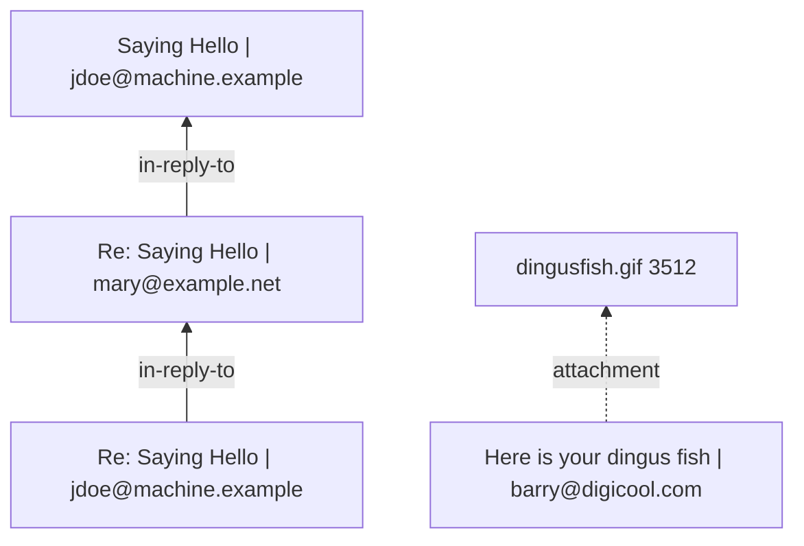

# Spike report: HTML, EPUB, PostScript/EPS, CSV/TSV, plain text, Markdown, mail

Date: 2026-10-19. Throwaway spike, no code from here goes into Rezzer as is.

- Corpus: `spike/corpus/web-text/` (46 files, `MANIFEST-web-text.md` lists source, license and purpose)
- Probe code: `spike/web-text-test/probe/` (one binary, subcommands per format and `logic-*` for the hidden-logic layer)
- Size projects: `spike/web-text-test/sizes/` (one tiny binary per candidate), script `scripts/measure.sh`
- Scripts: `scripts/make_derived.py` (derived corpus files), `scripts/run-ps-stet.sh` (sandboxed stet run), `scripts/licenses.py`
- Raw evidence: `spike/web-text-test/out/*.txt` (html, epub, ps-dsc, ps-stet, ps-selftest, csv, text, md, mail, logic, licenses, sizes, xberg-summary) and `out/md/` (converter Markdown dumps). These are verbatim tool output and contain third-party text (including dashes); they are evidence, not authored files

Toolchain: Rust 1.97.0, Apple M5 (10 cores), macOS. All crate versions are the newest on crates.io today and pinned exactly.

## 1. Short recommendation

| Format | Use | Rezzer reads itself | Do not use |
|---|---|---|---|
| HTML | **scraper 0.27** as the one DOM (html5ever 0.39 + ego-tree, CSS selectors). **dom_smoothie 0.18** for main content and article metadata (same html5ever version) | The whole walk into Rezzer's model: landmarks, sections, tables with spans and caption, figures, details/summary, abbr/time, MathML, meta/OG/canonical, JSON-LD and microdata as entities, forms, link graph, data-* on tables, script list | htmd (string only, breaks MathML), html2md (GPL), lol_html (no tree; only worth it for a streaming head-only pass) |
| HTML (reference) | html-to-markdown-rs 3.18 is the best "converter" by far (metadata, document tree, table grid with spans) but 4.1 MB, a third html5ever version and 254 releases in 12 months. Keep it as a golden-file reference in tests, not as a dependency | | |
| EPUB | **rbook 0.7.12** for the package (metadata with MARC roles, refinements, series, a11y entries, spine, TOC with depth, landmarks, resource reader) | Chapter XHTML through the same HTML walker. Footnote and cross-reference graph, reading order vs TOC check. A fallback OPF reader with zip + roxmltree (proved in about 200 lines here; Jordi's MIT epub-tailor `epub/read.rs` is a ready source) | `epub` crate (GPL) |
| PostScript/EPS | **Own DSC reader** in core (never executes the file). Text: **stet 0.8.7 only as an optional, out-of-process, sandboxed** reader. Ghostscript (`gs -dSAFER`) only as optional external program | DSC header and `(atend)` trailer, DOS EPS binary header, page count; the extraction-quality decision ("needs interpreter") | stet linked into the core process |
| CSV/TSV | **csv 1.4** (+ the encoding pipeline below) | Delimiter and quote sniffing, header detection, column types, keys, units, missing values, derived-column check | qsv-sniffer (failed or wrong on 8 of 13 files, 28 crates, +1.6 MB, GitHub repo archived) |
| Text | **encoding_rs 0.8.42 + chardetng 1.0** (BOM first, then strict UTF-8, then chardetng), **whatlang 0.18** for a language hint | Line endings, BOM, confidence flag (chardetng 1.0 has no score API) | `chardet` (LGPL) |
| Markdown | **pulldown-cmark 0.13.4** (offset iterator, YAML and TOML metadata blocks, wikilinks) | Keep the original frontmatter, parse its values (needs a YAML and a TOML crate, not tested here), heading outline with source offsets, link kinds | comrak only if a mutable AST is needed later |
| Mail | **mail-parser 0.11.9** (EML and mbox) | Thread graph, attachments as children that recurse into Rezzer, HTML parts through the HTML walker | `body_html()` as "the HTML part" (it synthesizes HTML from text) |

Xberg is not a good fallback for this group: it drops EPUB roles and series, treats PostScript as source code, mbox as plain text and a semicolon CSV as plain text (section 6).

## 2. Corpus summary

46 files, all redistributable, details in the MANIFEST:

- HTML (10): Wikipedia x3 (MathML, big spanned tables, JSON-LD), MDN (details/summary, time), GOV.UK (JSON-LD, OG, forms), WHATWG tables chapter (caption, spans), W3C blog (article, time, abbr), schema.org microdata example (derived), W3C WAI forms x2 (required, pattern, fieldset, select)
- EPUB (6): Gutenberg EPUB 2, Standard Ebooks x2 (series, roles, 122 cross-file endnotes, a11y), IDPF wasteland (notes), epub30-spec (TOC depth 7), linear-algebra (MathML)
- PostScript/EPS (4): RFC 1341 (ditroff), RFC 1950 (dvips), RFC 2490 (MS Word driver, `(atend)`), CTAN mwe EPS
- CSV/TSV (14): csv-spectrum x6, FDIC banklist, DWD stations (semicolon, Latin-1, padded), GeoNames (header-less TSV), pandas Shift_JIS and UTF-16LE-BOM, datahub CO2 (total vs parts), derived header-less Latin-1, derived broken CSV
- Text (4): UTF-8, ISO-8859-1, Windows-1252 (derived), Shift_JIS (Aozora)
- Markdown (3): YAML frontmatter, TOML frontmatter, Foam wikilinks
- Mail (5): CPython msg 07/15/43, RFC 2046 example, derived RFC 5322 thread mbox

Gaps: no `%%For` in any PS file, no DOS-binary EPS with TIFF preview, no EPUB with a page list or series in Calibre style, no HTML with a `<dl>`-heavy layout. Corpus license notes: csv-spectrum is BSD-2-Clause (not MIT); linear-algebra is GFDL 1.2 (license text must travel with it); the pandas UTF-16 file has unclear upstream provenance.

## 3. Scoring matrices

E = exposed, P = partial, N = not exposed. "Own" means Rezzer must compute it from what the crate gives.

### 3.1 HTML

| Intent | scraper (DOM) | html-to-markdown-rs 3.18.4 | htmd 0.5.6 | dom_smoothie 0.18.2 | lol_html 3.0.1 |
|---|---|---|---|---|---|
| Headings, sections | E (elements) | E: `document.nodes` Group per heading with level and text, `metadata.headers` with id and depth | P: Markdown only | N | P: selector callbacks, no tree |
| Landmarks main/nav/aside | E | N (no landmark node kinds) | N | P: drops boilerplate, no landmark labels | P |
| Lists | E | E (List/ListItem nodes) | P | N | P |
| Tables with spans and caption | E (attrs) | E: `tables[].grid.cells` with row_span/col_span/is_header (386 spanned cells on Nobel); caption not in grid; Markdown leaves the spanned cell empty | P: spans lost, Markdown table | N | P |
| Figures with captions | E | P: Image node with description; figcaption as paragraph | P | N | P |
| Links with titles | E | E: `links[]` href, text, title, rel, link_type Internal/External/Anchor | P (in Markdown) | N | P |
| abbr / time values | E (title, datetime) | P: abbr expanded inline as "W3C (World Wide Web Consortium)" (`expand_abbreviations`); time datetime lost, only the text stays | N: abbr title and time datetime both lost | P: published/modified from meta and JSON-LD only | P |
| details/summary | E | N: flattened, summary becomes a bold line, the open state and the fold are lost | N: flattened to plain paragraphs | N | P |
| MathML | E (MathML tree, TeX alttext) | N: flattened to text ("a+b"); on Wikipedia only the fallback `` with TeX alt survives | N: flattened, on Wikipedia garbled "a 2 + b 2 \= c 2" plus TeX | N | P |
| Meta: title, description, author, canonical, language | E | E: DocumentMetadata (title, description, author, canonical_url, language, text_direction, meta_tags map) | N | E: title, byline, excerpt, lang, site_name, published_time, modified_time, image, favicon | P |
| Open Graph / Twitter | E | E: open_graph and twitter_card maps | N | P (used for title/image) | P |
| JSON-LD | E (script text, parse with serde_json) | E: structured_data with schema_type and raw JSON | N | P: parse_json_ld for article fields | P: text callback gives the JSON |
| Microdata | Own (walker over itemscope/itemprop; 20 lines) | N: `StructuredDataType::Microdata` exists and `extract_structured_data` is on by default, but no code in 3.18.4 produces it (grep for itemscope finds nothing); empty on the schema.org BlogPosting and on our own snippet | N | N | P |
| Main content vs boilerplate | N | P: `exclude_selectors` by hand | N | E: Readability; GOV.UK 5.3k of 15k chars, byline "Department for Transport" | N |
| Forms (fields, types, required, pattern, options) | E | N | N | N | P |
| Script presence (list only) | E | N (scripts stripped) | P (skip_tags) | N | E |

Evidence (from `out/html.txt` and `out/md/`):

```
== html-to-markdown-rs (9 ms)
doc meta: title=Some("The Highway Code - Guidance - GOV.UK") ... canonical=Some("https://www.gov.uk/guidance/the-highway-code") lang=Some("en") og=6 twitter=1 meta_tags=23
  structured JsonLd schema_type=Some("Article") ...
html-wikipedia-nobel-physics: tables=8 spanned_cells_in_grid=386
== dom_smoothie (4 ms): title="The Highway Code" byline=Some("Department for Transport") site=Some("GOV.UK") lang=Some("en") published=Some("2015-10-01T01:00:00+01:00") modified=Some("2025-10-22T14:29:14+01:00") main_text_len=5324
scraper: math alttext=Some("{\displaystyle a^{2}+b^{2}=c^{2}.}")
htmd: ...the Pythagorean equation:[\[2\]](#cite_note-Sally-Ch3-2) a 2 + b 2 \= c 2 . {\\displaystyle a^{2}+b^{2}=c^{2}.} 
h2m (rowspan lost in Markdown): | 1903 | [Henri Becquerel...] / |  | [Marie Curie ...]
```

### 3.2 EPUB

| Intent | rbook 0.7.12 | own zip + roxmltree |
|---|---|---|
| Titles | E (with kind main/sub, alternate scripts) | E |
| Creators with roles | E: `roles()` with code and source (aut, dto, trl, ann ...), `file_as()`; EPUB 2 `opf:role` absent in corpus | E: refines resolved by hand |
| Dates | E: published, modified as typed DateTime | E (strings) |
| Identifiers | E (scheme from opf:scheme) | E |
| Language, publisher | E | E |
| Subjects | E (`tags()`) | E |
| Series / collections | E via `metadata().iter()` + `refinements()`: "Sherlock Holmes" collection-type=series group-position=5 | E |
| Accessibility metadata | E via `iter()` (11 entries on SE books; refined a11y:certifiedBy sits under its parent) | E (12) |
| Spine order, linear="no" | E | E |
| Nav/TOC with levels | E: nested `iter()`, `max_depth()`, `flatten()`, landmarks, page_list; NCX for EPUB 2 | E (nav `ol` depth, NCX navPoint depth) |
| Footnotes and their references | N: Rezzer must resolve `epub:type="noteref"` hrefs across documents | Own: 122 noterefs, 0 missing targets, 122 backlinks |
| Images with alt text | P: manifest images; alt from the XHTML through the HTML walker | Own |
| Per-chapter structure | P: `reader()` gives XHTML per spine item | Own via HTML walker |

```
creator "Arthur Conan Doyle" file_as=Some("Doyle, Arthur Conan") roles=["aut(Some(\"marc:relators\"))", "dto(...)"]
contributor "George Long" roles=["ann", "trl", "win"]
series-like meta belongs-to-collection="Sherlock Holmes" refinements=["collection-type=series", "group-position=5"]
toc entries=316 max_depth=7      (epub30-spec)
rbook a11y entries=11 ["dcterms:conformsTo=EPUB Accessibility 1.1 - WCAG ...", "schema:accessMode=textual", ...]
```

### 3.3 PostScript / EPS

| Intent | own DSC reader | stet 0.8.7 (sandboxed) | string-literal heuristic | Xberg 1.3.10 |
|---|---|---|---|---|
| Title, Creator, CreationDate | E (all 4 files) | N (no DSC API) | n/a | N (file read as source code) |
| For | not in corpus | N | n/a | N |
| Pages incl. `(atend)` | E: "35 (from trailer)" on RFC 2490 | E: page count from rendering | n/a | N |
| BoundingBox, DocumentFonts, LanguageLevel | E | N | n/a | N |
| Text quality | n/a | E: very good. Correct words and ligatures for ditroff, dvips and Word output (RFC 1341: 23,336 words, RFC 2490: 10,896 words), lines in drawing order (Word puts the page footer first); 0.1 to 0.6 s per file | P: works for ditroff and dvips; useless for Word ("P u l l e n ..."), octal escapes and font encodings not decoded | N |
| Needs an interpreter | no | yes (it is one) | no | n/a |

```
%%Pages: (atend) 35 (from trailer)                      (DSC reader, RFC 2490)
== stet (551 ms): pages=35 words=10896 sample="Pullen, et. al. Informational [Page 1] | Network Working Group M. Pullen | Request for Comments: 2490 ..."
== stet (34 ms): pages=10 words=3394 sample="... ZLIB Compressed Data Format Specification version 3.3 | Status of This Memo ..."
string-literal heuristic (RFC 2490): "P u l l e n e t a l I n f o r m a t i o n a l ..."
```

**stet safety finding:** stet has no SAFER mode. Its `deletefile`, `renamefile`, `file`, `filenameforall` and `run` operators reach the real file system. Self test with our own two-line program (not corpus data, `out/ps-selftest.txt`):

```
strip_file_ops=false: exec=Ok(()) victim_still_exists=false
strip_file_ops=true: exec=Err("PostScript error: stop") victim_still_exists=true
```

Removing the operators from systemdict through `Interpreter::context()` works for the direct case, but it is not a proof of safety (procedures bound at init time can still hold operator objects). Reading is a risk too: a PostScript program can open any readable file (for example `~/.ssh/...`) and `show` its content, which would end up in the extracted text and go to the LLM. The spike ran stet only under `sandbox-exec` with no file writes, no network and no reads under /Users or /private except the probe binary and an empty temp dir holding a copy of the input (stet's resources are embedded, so this works; `scripts/run-ps-stet.sh`). If Rezzer uses stet, it must run in a child process with OS sandboxing that denies writes, network and all reads outside the input (seatbelt on macOS, Landlock/seccomp on Linux), plus a timeout and a memory limit.

### 3.4 CSV / TSV

| Intent | csv 1.4.0 | qsv-sniffer 0.12.2 | Rezzer own (spike code in `logic.rs`) |
|---|---|---|---|
| Delimiter | N (given by caller) | P: right on 8, wrong on 1 (broken file: '-'), error on 4 real files (banklist, comma_in_quotes, quotes_and_newlines, json) | E: simple max-count on line 1 was right on all 14; a quote-aware check over several records is needed |
| Quoting, newlines in fields | E (RFC 4180, CRLF, escaped quotes) | P | E (via csv) |
| Header detection | N | P: wrong on both header-less files (said header=true), wrong on newlines_crlf (header=false, preamble=3) | P: right on 14/14 here with a numeric/empty-cell rule; needs more cases |
| Column types | N | P: DWD columns all "Text" (padded numbers), dates only partly | P: integer/number/date/bool/text after trim; "31-May-13" style dates partly |
| Encoding | N (bytes) | P: `is_utf8` flag only; raw UTF-16 fails | E via the text pipeline |
| Broken rows | E: strict mode errors with line and byte; flexible mode reads ragged rows. An unterminated quote swallows the rest of the file into one field without an error | P | must report: field count histogram, records with embedded newlines |

```
== csv(delim=',', flexible=false): records=7 errors=3 first_err=Some("CSV error: record 3 (line: 4, byte: 253): found record with 9 fields, but the previous record has 7 fields")
== csv(delim=',', flexible=true): records=10 errors=0 widths={3: 1, 5: 1, 7: 7, 9: 1} fields_with_newline=1
== qsv-sniffer[raw] ERROR Sniffing failed: unable to find valid delimiter      (csv-pandas-fdic-banklist.csv)
== qsv-sniffer[raw] ... delim=',' header=true ... names=["AT.09", "Vienna", "Vienna", "2761367"]   (header-less file)
```

### 3.5 Plain text

| Intent | encoding_rs + chardetng | whatlang |
|---|---|---|
| Encoding detection | E: all 10 files decoded without a replacement char. Latin-1 files are labelled windows-1252 (correct per WHATWG). UTF-16 is found only by the BOM step; chardetng alone says windows-1252 | n/a |
| Confidence | N: chardetng 1.0 has no confidence or score API (find_score is test-only) | E: confidence and is_reliable |
| Line endings | own (CRLF/LF/CR counts) | n/a |
| Language hint | n/a | E on prose (eng, deu, jpn reliable=true); unreliable on tables (DWD deu 0.52, geonames "fra" 0.01) |

```
text-shiftjis-aozora-botchan.txt: label=Shift_JIS via=chardetng U+FFFD=0 ... whatlang jpn conf=1.00 reliable=true
tsv-utf16le-bom: label=UTF-16LE via=bom ... chardetng_alone=windows-1252
```

### 3.6 Markdown input

| Intent | pulldown-cmark 0.13.4 | comrak 0.56.0 |
|---|---|---|
| Existing frontmatter kept | E: YAML (`---`) and TOML (`+++`) metadata blocks as raw text; values need a YAML/TOML parser | E: raw front matter string incl. delimiters (one delimiter per parse) |
| Structure | E: event stream with byte offsets (`into_offset_iter`) | E: AST with line/column sourcepos |
| Links, wikilinks | E: link type Inline/Reference/Autolink/WikiLink (`ENABLE_WIKILINKS`) | E (wikilinks extension) |
| Size delta | +270 KB | +516 KB |

### 3.7 Mail

| Intent | mail-parser 0.11.9 | Xberg |
|---|---|---|
| From, to, date, subject | E (typed addresses, RFC 3339 date) | E (from, to, cc, bcc) |
| Message-ID, In-Reply-To, References | E | N |
| Multipart tree | E: parts with content type, disposition, encoding, nested message/rfc822 | P: children for attachments |
| Attachments with names and types | E | E (names), and it OCRs a GIF |
| mbox | E: `mailbox::mbox::MessageIterator` with From_ line and date | N (read as plain text) |
| Caveat | `body_html(0)` returns HTML generated from the text part when there is no HTML part (msg07 shows html_bodies=1); use the part list | |

```
== mbox message 3 ... message_id=Some("abcd.1234@local.machine.test") in_reply_to=Some(["3456@example.net"]) references=Some(["1234@local.machine.example", "3456@example.net"])
   part[2] ct=Some("image/gif") name=Some("dingusfish.gif") disp=Some("attachment") size=3512 encoding=Base64
```

## 4. The hidden-logic layer per format

Jordi's addition: every format has a layer behind the text, like formulas in a spreadsheet. The spike checked what is cheap to find (`out/logic.txt`).

| Item | What was found | Who gives it |
|---|---|---|
| HTML forms | form action/method, fields with type, name, label (label[for]), required, pattern, min/max, select options, fieldset/legend groups. WAI page: German plate pattern `[A-ZÖÄÜ]{1,3} [A-Z]{2,4} [0-9]{1,4}`, number 0..100, select "course" with 8.01.1 ... | own walker on scraper |
| HTML link graph | in-page anchors with missing targets (Wikipedia Nobel: 308 anchors, 10 missing), internal vs external, top external hosts | own; html-to-markdown-rs has link_type but no target check |
| JSON-LD / microdata entities | typed entities and relations: GOV.UK Article -about-> Thing, -publisher-> Organization, BreadcrumbList -itemListElement-> ListItem; microdata BlogPosting -author-> Person, Comment -author-> Person | own (serde_json walk; microdata walker) |
| data-* on tables | Wikipedia `data-sort-value` (257, a hidden sort key per cell), `data-mw`, `data-file-*`; WHATWG `data-dfn-for/type` | own |
| Scripts | listed only (src or inline bytes and type), never run | own |
| EPUB footnote and cross-reference graph | Meditations: 122 noterefs, 0 broken targets, 122 backlinks; edges book-N -> endnotes and back; epub30-spec 45 cross-document edges | own (HTML walker + href resolver) |
| Reading order vs TOC | Gutenberg: spine item `wrap0000.html` (cover wrapper) not in TOC; no order inversions in corpus | own |
| Accessibility metadata | 11 to 12 entries on Standard Ebooks (conformsTo WCAG 2.2 AA, accessMode, features, hazards) | rbook `iter()` or own |
| CSV types, keys, missing | Year/CERT/Stations_id key-like; CO2: Gas Flaring missing 200 of 275 | own |
| CSV units in headers | only weak hints in this corpus ("Stationshoehe"); CO2 units live in datapackage.json (Frictionless). Rezzer should read a sibling datapackage.json or CSVW metadata when present | own |
| CSV derived columns | CO2: `Total = sum(Gas Fuel, Liquid Fuel, Solid Fuel, Cement, Gas Flaring)` within rounding on 210/275 rows (154 exact), residual p95 106, max 125: in later years Total holds more than the listed parts. Method: score every subset of up to 10 numeric columns (missing = 0), tolerance half a unit of the last decimal per term, keep the best (most matches, then most exact), ignore rows where the target is 0, need at least 10 counted rows. A first version with a fixed tolerance and first-match reported a 4-term formula and a false positive `c = a + b` on a 2-row file; the guards above remove both. Cost: milliseconds | own |
| Mail threads | reply graph from Message-ID / In-Reply-To / References, attachments as child nodes | mail-parser fields, own graph |
| Markdown relations | link kinds (inline internal/external/anchor, reference, wiki), 6 wikilinks (others inside code spans correctly ignored), frontmatter relation keys (redirect_from, aliases, path, category) | pulldown-cmark + own |

Mermaid produced by the spike code (mbox):



### How Rezzer should present this layer

- **HTML:** a "Forms" section with one table per form (field, type, label, required, constraint, options), grouped by fieldset legend. An "Entities" section with a table of typed entities (type, name, key properties) and a Mermaid flowchart of their relations. A "Links" summary (counts, external hosts, broken in-page anchors) and a "Scripts" list marked "not executed". Hidden cell values (`data-sort-value`) as an extra column only when they differ from the visible text.
- **EPUB:** footnotes inline at the reference as Markdown footnotes (text pulled from the target), plus a "Cross references" table and, for big books, a Mermaid graph of chapter-to-chapter links. A "Reading order" note when spine and TOC differ. Accessibility metadata in frontmatter under a Rezzer key.
- **PostScript:** a "Document" table from DSC (title, creator, date, pages, box, fonts) and a clear line on how the text was read (DSC only / interpreter / not read, with the reason).
- **CSV:** a "Columns" table (name, type, unit, missing, distinct, key) and a "Relations" section with checked formulas like `Total ~ Gas Fuel + Liquid Fuel + Solid Fuel + Cement + Gas Flaring (210 of 275 rows within rounding, residual up to 125)`, stated as an observed relation with its residual, not as a fact. Small files (under 10 rows) get no relation claims.
- **Mail:** a "Thread" Mermaid graph and a table (message-id, date, from, subject, in-reply-to); attachments as linked child results.
- **Markdown:** original frontmatter kept as is (Rezzer keys appended after it), a "Links" table (target, kind, resolved yes/no) and wikilinks as relations.

## 5. Size, compile time, MSRV, maintenance

Stripped release binary, clean build with its own target dir (sequential), delta over an empty baseline of 342,176 bytes. Deltas are not additive, the html5ever crates share code.

| Candidate | Version | Clean build s | Binary bytes | Delta | Crates | MSRV | Last release | Repo: last push, stars, open issues |
|---|---|---|---|---|---|---|---|---|
| scraper | 0.27.0 | 9 | 1,165,488 | +0.82 MB | 48 | none set | 2026-05-11 | 2026-10-18, 2424, 12 |
| dom_smoothie | 0.18.2 | 20 | 1,752,640 | +1.41 MB | 58 | 1.75 | 2026-09-21 | 2026-10-14, 227, 7 (shares html5ever 0.39 with scraper) |
| html-to-markdown-rs | 3.18.4 | 33 | 4,488,208 | +4.15 MB | 86 | 1.88 | 2026-10-19 | 2026-10-19, 882, 0 (254 versions since 2025-10) |
| htmd | 0.5.6 | 11 | 1,179,408 | +0.84 MB | 32 | none set | 2026-10-15 | 2026-10-17, 463, 3 (html5ever 0.38) |
| lol_html | 3.0.1 | 8 | 947,856 | +0.61 MB | 47 | 1.85 | 2026-07-29 | 2026-07-29, 2074, 41 (Cloudflare) |
| rbook | 0.7.12 | 10 | 917,616 | +0.58 MB | 23 | 1.88 | 2026-10-10 | 2026-10-10, 52, 0 (57k downloads, single maintainer) |
| zip + roxmltree | 9.0.5 / 0.21.1 | 8 | 562,672 | +0.22 MB | 19 | 1.88 / 1.60 | 2026-10-17 / 2025-10-12 | zip2: 2026-10-19, 360, 54; roxmltree: 2026-09-22, 539, 11 |
| stet | 0.8.7 | 39 | 9,282,784 | +8.94 MB | 70 | 1.92 | 2026-10-15 | 2026-10-15, 18, 0 (first release 2026-03-01, single author, embeds 35 fonts) |
| csv | 1.4.0 | 4 | 376,064 | +0.03 MB | 6 | 1.73 | 2025-10-17 | 2026-08-04, 1965, 107 |
| qsv-sniffer | 0.12.2 | 7 | 1,944,992 | +1.60 MB | 28 | 1.85 | 2025-09-25 | **archived** (last push 2026-01-21), 11, 5 |
| chardetng + encoding_rs | 1.0.0 / 0.8.42 | 6 | 591,872 | +0.25 MB | 8 | 1.40 / 1.88 | 2026-03-30 / 2026-09-24 | chardetng: 2026-03-30, 130, 3; encoding_rs: 2026-10-12, 470, 18 |
| whatlang | 0.18.0 | 3 | 610,656 | +0.27 MB | 5 | none set | 2025-10-16 | 2025-12-24, 1087, 20 |
| pulldown-cmark | 0.13.4 | 2 | 612,112 | +0.27 MB | 4 | 1.71.1 | 2026-05-20 | 2026-10-19, 2746, 94 |
| comrak | 0.56.0 | 8 | 858,240 | +0.52 MB | 24 | 1.89 | 2026-10-06 | 2026-10-19, 1721, 12 (default features off) |
| mail-parser | 0.11.9 | 3 | 545,296 | +0.20 MB | 9 | none set | 2026-09-09 | 2026-10-19, 465, 3 (Stalwart, fuzzed) |

Recommended set (scraper, dom_smoothie, rbook, zip, roxmltree, csv, chardetng, encoding_rs, whatlang, pulldown-cmark, mail-parser) is roughly 4 MB on top of the core. stet alone would add about 9 MB, one more reason to keep it optional.

Dependency hygiene: with all candidates in one tree, cargo builds html5ever 0.38 (htmd), 0.39 (scraper, dom_smoothie) and 0.40 (html-to-markdown-rs). Rezzer should allow one html5ever version (cargo-deny `bans.multiple-versions`). `markup5ever_rcdom` calls itself "unsupported, for tests"; avoid it as Rezzer's DOM.

## 6. Xberg 1.3.10 as comparison

Release CLI (`xberg extract -f json`, 111 MB binary plus dylibs). Exposed vs Rezzer's needs:

- HTML: title, description, canonical, language, OG, Twitter, meta tags (same code as html-to-markdown-rs). Plain text content, no microdata entities.
- EPUB: title, authors, keywords, language, created_at, identifier, publisher, rights. **No contributor roles (translator lost), no series, no TOC structure.**
- PostScript: detected as `text/x-source-code`, content is the PS program text. No PS support.
- CSV: comma CSV gives a table and column types; the semicolon DWD file and the UTF-16 TSV become plain text.
- mbox: plain text. EML: from/to/cc/bcc/attachments, no Message-ID or reply headers; it OCRs the attached GIF.
- Distribution: the macOS CLI archive ships `libx265` (GPL-2.0) and `libheif` (LGPL) dylibs for HEIC. Fine for Xberg, but Rezzer must not bundle that archive.

Note: Xberg picked the format from the file extension. The DWD file (`.txt`), the UTF-16 TSV (`.txt`) and the mbox were read as plain text for that reason. This sets a requirement for Rezzer: sniff the content of `.txt` files for delimited data, mbox From_ lines and mail headers, and say in the output which way the format was decided.

Verdict: Xberg does not cover this group better than the small crates. Not a fallback here.

## 7. License findings

Transitive licenses were taken per candidate from the resolved graph (`cargo metadata --filter-platform aarch64-apple-darwin`, `out/licenses.txt`). All are MIT, Apache-2.0, BSD-2/3, ISC, Zlib, MPL-2.0 (cssparser/selectors from Servo), Unicode-3.0, Unlicense, CC0, BSL-1.0 alternatives. No GPL/LGPL/AGPL in any recommended crate. Points to watch:

- **stet bundles data outside its Apache-2.0 OR MIT license:** 35 URW base-35 Type 1 fonts and a CC0 CMYK ICC profile. stet's `LICENSE-URW-FONTS` says it "takes the OFL option" of URW's 2017 tri-license (AGPL with font exception, LPPL 1.3c, OFL 1.1), while the exact files come from Artifex's repository, which publishes them under AGPL only. That reasoning is plausible but is stet's own legal reading. Rezzer should not link stet into the core binary before Jordi has decided on this; as an optional separate program the question is smaller but not gone. stet also pulls `jpeg-encoder` (MIT OR Apache-2.0 AND IJG, attribution needed).
- **encoding_rs** carries BSD-3-Clause for the WHATWG index data (attribution in the notice file).
- **lol_html** is BSD-3-Clause, comrak BSD-2-Clause, scraper ISC: all fine, need notices.
- **Avoid:** `html2md` (GPL-3.0+), `markitdown` crate (via html2md), `epub` (GPL-3.0), `chardet` (LGPL-3.0), Ghostscript (AGPL, external only).
- `cargo metadata` does not see bundled data licenses. cargo-deny's license check will pass stet even though its fonts need a decision. Keep a manual allow list for crates that bundle fonts, ICC profiles or models.

## 8. Risks

- **rbook:** young and single maintainer (57k downloads). Mitigation: behind Rezzer's own EPUB trait; the zip + roxmltree path (or epub-tailor's MIT reader) is a proven fallback.
- **dom_smoothie:** Readability heuristics can drop real content on non-article pages (WHATWG spec kept 73k chars, fine; GOV.UK manual kept 5.3k of 15k). Use it to mark the main region, never to delete content silently; say in the output what was treated as boilerplate.
- **stet:** read and write access to the file system from PostScript (no SAFER mode), font license question, +9 MB, 7 months old. Only optional, out of process, sandboxed against writes, network and reads outside the input.
- **qsv-sniffer:** besides the wrong results, its GitHub repository is archived. Do not depend on it.
- **Own CSV sniffer:** needs its own test set (the qsv-sniffer failure list above is a good start). Header detection on header-less files is guesswork; output must say "header assumed" with the reason.
- **chardetng** gives no confidence. Short Latin-1 files with few high bytes (the derived GeoNames CSV has 6) are a weak spot; Rezzer should state the detected encoding and how it was found (BOM, valid UTF-8, guess).
- **html-to-markdown-rs churn:** 254 releases in one year. Only as a test reference.
- **Fast-moving pins:** zip 9.x, comrak 0.5x and scraper 0.2x change APIs often (lol_html 3 made Settings fields private, chardetng 1.0 has no guess_assess). Pin exactly and keep golden files.
